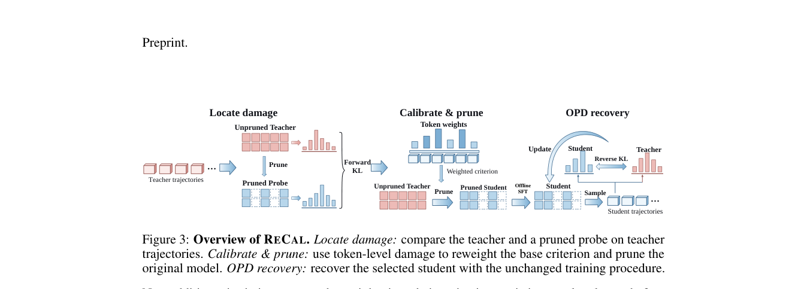

# ReCal：为 OPD 恢复校准结构化剪枝

> 已实现真实 FFN 通道删除、教师 SFT 和学生轨迹 OPD；当前四题诊断包含负结果，不代表论文 benchmark 收益。

## 论文信息

| 字段 | 内容 |
|---|---|
| 论文链接 | [ReCal: Calibrating Structured Pruning for On-Policy Distillation Recovery](https://arxiv.org/abs/2610.11332) |
| 公司 / 机构 | Zhongguancun Academy / Tencent / University of Science and Technology of China（第一作者 Houcheng Jiang） |
| 首次公开日期 | 2026-10-08（arXiv v1） |
| 原作者代码 | [已开源](https://github.com/jianghoucheng/ReCal) |
| 本地 Adapter | `recal` |
| 本地复现代码 | `src/auto_research/post_training/recal.py`；入口 `scripts/run_recal_checkpoint.py` |

## 原始论文总结

### 背景与主要改动

先剪枝再蒸馏并不保证可恢复：损坏的学生轨迹会限制 OPD 教师信号。ReCal 先用剪枝 probe 测量教师轨迹上损伤，再用损伤重加权原始未剪枝模型的校准统计，重新选择通道；目标宽度和恢复流程保持一致。


<!-- paper-figure:start -->
### 原论文关键图

[](https://arxiv.org/pdf/2610.11332#page=5)

> **原论文 Figure 3（关键图）**：从教师轨迹定位剪枝损伤，回到未剪枝模型重加权校准，再实体剪枝并进行 SFT/OPD 恢复；不是在 probe 剩余通道中再次选择。图片来自[原论文](https://arxiv.org/abs/2610.11332)，版权归原作者所有；点击图片可查看来源。
<!-- paper-figure:end -->

### 核心公式

损伤由 $D_{KL}(p_T\|p_{probe})$ 测量；实现保留教师 Top-16 及其余词表的总概率桶，而非只归一化 Top-16。每条响应的损伤权重归一至单位质量，零损伤退化为均匀权重。Wanda-SP 用权重范数乘加权激活 RMS 选通道。

### 论文离线与线上效果

[原文](https://arxiv.org/html/2610.11332v1)在数学比较中最高提高 AIME 16.7 个百分点，但并非所有模型或任务都改善；IFBench 比较存在下降。未报告线上 A/B。

## 本地复现

Qwen3-4B/A100，FFN 宽度从 9728 真正减到 7296。对照与 ReCal 使用相同目标宽度和教师 SFT 响应，2 轮 SFT、4 步 OPD；SFT/OPD 问题分开，验证 4 题。见[运行说明](../oct11-checkpoint-guide.md)。

```bash
python scripts/run_recal_checkpoint.py --help
```

### 数据协议与结果

教师生成截断时停止而非悄悄接受不完整目标；学生推理不接收答案。具体阶段成绩、非零梯度和参数位移见[逐阶段指标](metrics/checkpoint-a100-seed42.json)，不要把四题满分解释为稳定能力。使用 [GPU 回执](../../gpu-validations/recal-a100-20261011.json) 对照执行命令。

### 代码映射与复现边界

`prune_gated_ffn` 删除 gate/up 的行及 down 的列，不是把 dense 参数置零。恢复使用 q/v LoRA，未复现原文全参数 FSDP、四领域数据或多 seed。原始短跑里 ReCal OPD 后 exact match 从 1 降到 0.75，对照仍为 1；保留负结果，不声称提升。旧切分声明与重跑原因见[运行审计](../../research-audits/oct11-runtime-audit.md)。尚未接入 Evolve。
