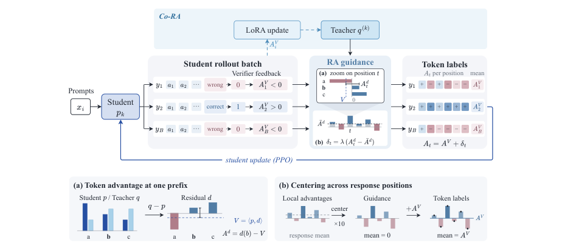

# Residual Advantage: Student-Relative Teacher Guidance for RL with Verifiable Rewards

<!-- source-sha256: ea00ca575be197a7e08c8234a95fd64b6fd0c850bc5976b08e76c97ccb990bae -->

[简体中文](README.md)

> Core mechanism. Short-budget runs on real checkpoints validate the training path, not paper-scale capability.

## Paper information

| Field | Details |
|---|---|
| Paper | [Original paper](https://arxiv.org/abs/2610.11519) |
| Organization | First-author affiliations: Harbin Engineering University / Tencent / Harbin Institute of Technology |
| First public release | 2026-10-08 (arXiv v1) |
| Authors' code | No author-released code was found as of 2026-10-10. |
| Local adapter | `residual-advantage` |
| Local reproduction code | [oct10_objectives.py](https://github.com/daiwk/auto-research/blob/main/src/auto_research/post_training/oct10_objectives.py), [oct10_checkpoint.py](https://github.com/daiwk/auto-research/blob/main/src/auto_research/post_training/oct10_checkpoint.py) |

## Original paper

### Motivation and method

Full-vocabulary teacher–student probability residuals become bounded, student-relative local advantages. These are centered per response and added to the verifier advantage. Co-RA updates teacher LoRA on the same scored student batch and uses the new teacher only in the next round.

~~~mermaid
flowchart LR
  B[Same student batch] --> R[Full-vocabulary teacher-student residual] --> E[Student expectation baseline] --> C[Response-level centering] --> P[Student PPO update] --> T[Teacher LoRA update] --> N[Teacher for next round]
~~~

<!-- paper-figure:start -->
### Key figure from the paper

> **Figure 2:** After student sampling, the verifier supplies response-level advantages and the teacher–student residual gives token-level guidance. The student is updated after centering over response positions; Co-RA also updates the teacher with verifier feedback. From the [original paper](https://arxiv.org/abs/2610.11519); copyright remains with the authors.
<!-- paper-figure:end -->

### Core equations

$d=q-p$, $a_t=d(y_t)-\sum_vp(v)d(v)$, and $A_t=A_{\mathrm{verifier}}+\lambda(a_t-\bar a)$. Co-RA updates the teacher only with fixed verifier advantages. Score first, update the two policies separately, and do not recompute labels mid-update.

### Paper results

RA improves the underlying sequence-advantage algorithms in all 24 reported comparisons, and Co-RA further improves Avg@8. No online A/B test is reported.

## Local reproduction

See the [checkpoint guide](../oct10-checkpoint-guide.md) for installation, data formats, and commands.

Core entry points are `residual_advantage / co_ra_step`. The checkpoint runner is `scripts/run_oct10_post_training.py --objective residual-advantage`. Use `--objective co-ra` for Co-RA.

Explicitly supply a local checkpoint path, public model ID/revision, public GSM8K train and validation JSONL, data revision, and an output directory. See `python scripts/run_oct10_post_training.py --help` for options. No automatic downloads or private data uploads. Teacher and student vocabularies must match token for token. The runner supports causal LMs with `q_proj` and `v_proj`; base parameters stay frozen while LoRA trains.

### Data protocol and results

The generator reads only questions, and answers are reserved for an external numerical verifier. Train/validation overlap raises an error. Isolated validation runs after training and does not select hyperparameters. Outputs retain seed, data hashes, checkpoint revision, token counts, loss, and measured parameter changes.

A real NVIDIA A100 ran LoRA training for a Qwen3-4B student and public MOPD teacher at seed 42 for two steps. The student had two effective gradient steps and adapter parameter change of 0.020295 in $L_2$. Exact match was 0.5 on two isolated validation questions, insufficient to claim a gain. See [measured results](metrics/checkpoint-a100-seed42.json) and [sanitized GPU evidence](../../gpu-validations/residual-advantage-a100-20261010.json).

Truncation, a small question count, and one seed support only a runtime smoke test, not improved mathematics capability.

Co-RA separately ran 10 same-batch student/teacher updates with four responses per question and 512 tokens. All 10 student steps and one teacher step had effective gradients; the teacher peak was 0.124529 and teacher LoRA change was 0.028806 in $L_2$. The maximum response-mean error in guidance advantage was $5.97\times10^{-8}$. The teacher rescored only in the next round, after the fixed-label update. Frozen base parameters are not in the teacher optimizer. See [Co-RA measurements](metrics/co-ra-checkpoint-a100-seed42.json); the GPU receipt includes the additional command. Small-sample validation is still not a capability comparison.

### Code mapping and reproduction limits

`oct10_objectives.py` contains formulas and selectors. `oct10_checkpoint.py` implements LoRA, rollout, teacher scoring, optimization, and validation. Contract tests are `tests/test_oct10_objectives.py` and `tests/test_oct10_checkpoint_contracts.py`. The original training data, full budget, and multi-benchmark controls have not been reproduced. The method is not integrated into the multi-round evolve controller; a catalog label does not establish integration.
