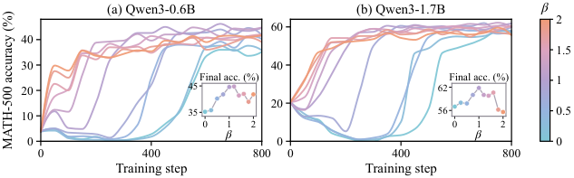

# DIAL-OPD: Learning More from Fewer Tokens in On-Policy Distillation

<!-- source-sha256: 947c4a66db527caa10bb44235819e841a6086e9d959d0fbade349c91a70ca68c -->

[简体中文](README.md)

> Core mechanism with a bounded real-checkpoint run; not a paper-scale capability reproduction.

## Paper information

| Field | Details |
|---|---|
| Paper | [Paper](https://arxiv.org/abs/2610.11659) |
| Institution | Eastern Institute of Technology, Ningbo / The Hong Kong Polytechnic University (first author). |
| First public release | 2026-10-08 (arXiv v1) |
| Author code | Yes: [EIT-NLP/DIAL-OPD](https://github.com/EIT-NLP/DIAL-OPD). |
| Local adapter or method key | `dial-opd` |
| Local reproduction code | [oct10_objectives.py](https://github.com/daiwk/auto-research/blob/main/src/auto_research/post_training/oct10_objectives.py), [oct10_checkpoint.py](https://github.com/daiwk/auto-research/blob/main/src/auto_research/post_training/oct10_checkpoint.py) |

## Paper method and evidence

A logarithmic probability mean reduces supervision priority for tokens that both teacher and student consider unlikely. Rank positions separately per response; unselected positions remain in the context.

<!-- paper-figure:start -->
### Original paper figure

Figure 6 varies density exponent β at fixed retention and shows paper-reported learning curves and final accuracy, not the local run. From the [original paper](https://arxiv.org/abs/2610.11659); copyright remains with the authors.
<!-- paper-figure:end -->

### Core equation

For sampled student/teacher probabilities $p_t,q_t$, define $L(p,q)=(q-p)/(\log q-\log p)$. Score positions with $L(p_t,q_t)^\beta|\log q_t-\log p_t|$, then optimize $-\operatorname{sg}(\log q_t-\log p_t)\log p_t$ on selected positions. Use the continuous limit when probabilities match.

### Reported results

Across four student–teacher pairs and seven math tasks, the paper reports up to 5.25 percentage points higher average accuracy while keeping 40% of tokens. No production A/B.

## Local reproduction

See the [checkpoint guide](../oct10-checkpoint-guide.md) for installation, data and runnable examples. The components are `dial_opd_scores` and `dial_opd_loss`; the runner is `scripts/run_oct10_post_training.py --objective dial-opd`. Run `python scripts/run_oct10_post_training.py --help` for required local checkpoints, public model ID/revision, public GSM8K train/validation JSONL, dataset revision, and output directory. There is no automatic download or private data upload. Teacher and student vocabularies must match token by token; only causal LMs with q_proj/v_proj are supported, with base weights frozen and genuine LoRA updates.

The generator sees questions only; an external numerical verifier sees answers. Reject train/validation overlap; evaluate isolated validation after training without tuning on it. Save seed, data hash, checkpoint revision, token counts, loss, and parameter change. On an A100, Qwen3-4B student and a public MOPD teacher ran seed 42 for two steps; both steps had effective gradients, adapter L2 change was 0.019681, and exact match on two isolated examples was 0.5. [Measured metrics](metrics/checkpoint-a100-seed42.json) and [sanitized receipt](../../gpu-validations/dial-opd-a100-20261010.json). This short, truncated single-seed run does not measure math gains.

`oct10_objectives.py` implements scoring and selection; `oct10_checkpoint.py` handles LoRA, sampling, teacher scoring, updates and validation. Tests: `tests/test_oct10_objectives.py` and `tests/test_oct10_checkpoint_contracts.py`. Original data, full budget, benchmark comparisons and Evolve controller integration were not completed.
