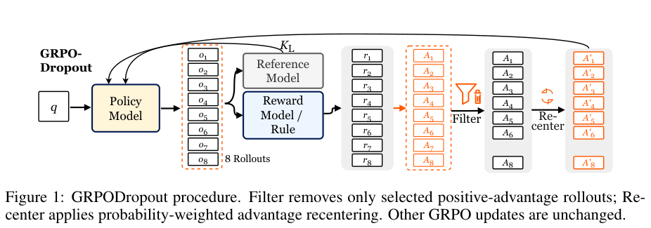

# GRPODropout: Less is More for Online Reinforcement Learning Rollouts

<!-- source-sha256: 96dfa5ae23433d3e1908e36e95216f24e5f00e3b7fb391c4874f23c56864ca87 -->

[简体中文](README.md)

> Core mechanism. Short-budget runs on real checkpoints validate the training path, not paper-scale capability.

## Paper information

| Field | Details |
|---|---|
| Paper | [Original paper](https://arxiv.org/abs/2610.11854) |
| Organization | First-author affiliation: Harbin Institute of Technology (Shenzhen) |
| First public release | 2026-10-08 (arXiv v1) |
| Authors' code | [Public implementation](https://github.com/hexuandeng/GRPODropout) |
| Local adapter | `grpo-dropout` |
| Local reproduction code | [oct10_objectives.py](https://github.com/daiwk/auto-research/blob/main/src/auto_research/post_training/oct10_objectives.py), [oct10_checkpoint.py](https://github.com/daiwk/auto-research/blob/main/src/auto_research/post_training/oct10_checkpoint.py) |

## Original paper

### Motivation and method

GRPODropout removes some high-probability, positive-advantage responses from a same-prompt GRPO group, then recenters retained advantages using old-policy probabilities. This is not random dropout and does not change the generation budget.

~~~mermaid
flowchart LR
  A[Multiple responses to one prompt] --> B[Verifier reward and old-policy probability] --> C[Greedy entropy-contribution filter] --> D[Restore nonpositive advantages] --> E[Probability-weighted centering] --> F[GRPO update]
~~~

<!-- paper-figure:start -->
### Key figure from the paper

> **Figure 1:** Selectively filters positive-advantage rollouts from the same question and recenters the rest using probability weights. Other GRPO update steps are unchanged. From the [original paper](https://arxiv.org/abs/2610.11854); copyright remains with the authors.
<!-- paper-figure:end -->

### Core equations

$s_g=-\sum_t\log p_{g,t}/T_g$ and $h_g=A_g(s_g-\bar s)/G$. Remove the most negative contributions first, then restore all $A_g\le0$. Compute $b=\sum_{keep}e^{-s_g}A_g/\sum_{keep}e^{-s_g}$ and update with $A_g-b$.

### Paper results

Across three models and ten benchmarks, the paper reports a mean gain of 1.55 percentage points. Restoring nonpositive-advantage responses does not guarantee that the final subset still satisfies the original entropy constraint. No online A/B test is reported.

## Local reproduction

See the [checkpoint guide](../oct10-checkpoint-guide.md) for installation, data formats, and commands.

The core entry points are `grpo_dropout / clipped_actor_loss`. For real checkpoint execution use `scripts/run_oct10_post_training.py --objective grpo-dropout`.

Explicitly provide a local checkpoint path, public model ID/revision, public GSM8K train and validation JSONL, data revision, and an output directory. Run `python scripts/run_oct10_post_training.py --help` for the full options. No automatic downloads or private data uploads. Teacher and student vocabularies must align token by token. Only causal LMs with `q_proj` and `v_proj` are supported; base parameters are frozen and LoRA trains.

### Data protocol and results

The generator reads questions only; answers go to an external numerical verifier. Train/validation overlap is rejected. Isolated validation runs after training and is not used for hyperparameter selection. Reports retain seed, data hashes, checkpoint revision, token counts, loss, and measured parameter changes.

A real NVIDIA A100 ran a Qwen3-4B student on the first 10 public GSM8K training questions, four sampled responses per question, up to 512 tokens, seed 42. Question 5 had mean group reward 0.75, reward variance 0.1875, and a nonzero student gradient of 0.118643. Rewards were identical within most other groups, leaving one effective policy-gradient step out of ten. Parameter change in $L_2$ was 0.028784; AdamW weight decay can also change parameters, so that alone does not establish effective training.

This run did not delete responses; at least four remained throughout. Formula tests cover deletion, but the GPU run does not show its benefit. Both isolated validation questions were correct, insufficient for a capability claim. See [measured results](metrics/checkpoint-a100-seed42.json) and [sanitized GPU evidence](../../gpu-validations/grpo-dropout-a100-20261010.json). Truncation, few questions, and a single seed support only a runtime smoke test.

An extension to 12 questions with the same fixed training order still triggered no deletion for [seed 42](metrics/checkpoint-a100-seed42-12.json). For [seed 43](metrics/checkpoint-a100-seed43-12.json), question 5 retained 1/4 responses, executing the filtering branch. Its single negative advantage was recentered to zero, so this seed had no effective policy gradient. This is a real negative result, not model improvement. Neither seed was used for tuning or test selection, and they are not pooled as a formal comparison.

### Code mapping and reproduction limits

`oct10_objectives.py` contains the formulas and selector; `oct10_checkpoint.py` handles LoRA, rollout, teacher scoring, optimization, and validation. Contract tests are `tests/test_oct10_objectives.py` and `tests/test_oct10_checkpoint_contracts.py`. Original training data, full budgets, and multi-benchmark comparisons are not reproduced. The method is not integrated into the multi-round evolve controller; an index label does not establish integration.
