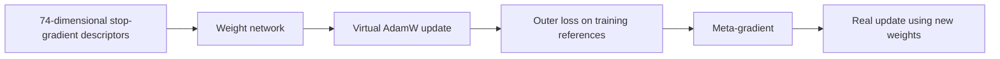
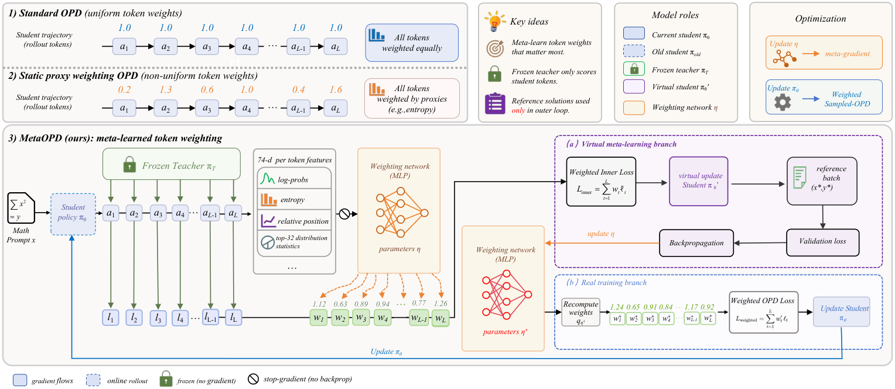

<!-- source-sha256: 40ac4d24d928c46da50f002427272da63fcab1f790aef169134cfdf9c091a2e4 -->

[简体中文](README.md) · English

# MetaOPD: Meta-Learned Token Weighting for On-Policy Distillation

> Core mechanism implementation. A short-budget real-checkpoint run verifies the training path, not capabilities at paper scale.

## Paper information

| Field | Details |
|---|---|
| Paper | [Original paper](https://arxiv.org/abs/2610.11989) |
| Institution | East China Normal University (first author affiliation) |
| First public release | 2026-10-08 (arXiv v1) |
| Original source code | No author code found or released as of 2026-10-10. |
| Local adapter/method | `meta-opd` |
| Local reproduction code | [oct10_objectives.py](https://github.com/daiwk/auto-research/blob/main/src/auto_research/post_training/oct10_objectives.py), [oct10_checkpoint.py](https://github.com/daiwk/auto-research/blob/main/src/auto_research/post_training/oct10_checkpoint.py) |

## Original paper summary

### Background and main changes

A lightweight network learns token supervision weights from student and teacher predictions. It receives a meta-gradient from reference-solution loss after one differentiable virtual student update, then the new weights are used for the real student update.

<!-- paper-figure:start -->
### Key figure from the paper

> **Figure 2:** A frozen teacher scores student-sampled tokens. The weight network receives a meta-gradient from a virtual student update and reference validation loss; then it recomputes token weights and updates the real student. Reference answers occur only on the outer validation branch. From the [paper](https://arxiv.org/abs/2610.11989); copyright belongs to the authors. Click for the source.
<!-- paper-figure:end -->

### Core equations

$\theta'=\operatorname{AdamW}(\theta,\nabla_\theta\mathcal L_{\mathrm{OPD}}(\theta,w_\phi))$; $\phi\leftarrow\phi-\eta\nabla_\phi[\mathcal L_{\mathrm{ref}}(\theta')+\lambda\|w-1\|^2]$. Weights are centered per response, transformed by $1+\rho\tanh$, and normalized to unit mean.

### Offline and online results

The paper reports Avg@8 and Pass@8 improvements at two student sizes. Those are not local measurements. No production A/B is reported.

## Local reproduction

See the [checkpoint running guide](../oct10-checkpoint-guide.md) for full setup, data format and commands.

Core entry points: `meta_opd_descriptor / virtual_adamw / meta_opd_step`. The actual checkpoint command uses `scripts/run_oct10_post_training.py --objective meta-opd`.

Supply local checkpoint paths, public model IDs/revisions, public GSM8K train/validation JSONL, dataset revision and output directory. Run `python scripts/run_oct10_post_training.py --help` for parameters. It does not automatically download or upload private data. Teacher and student vocabularies must match token for token. Only causal LMs with q_proj/v_proj are supported; base parameters are frozen and LoRA actually trains.

### Data protocol and results

The generator reads only questions. Answers are used by the external numeric verifier and a separate training reference-solution stream, not benchmark test data. Overlapping training and validation questions are errors. Isolated validation runs after training and is not used for hyperparameter selection. Output records seed, data hashes, checkpoint revision, token counts, loss and actual parameter changes.

NVIDIA A100 ran LoRA training for a real Qwen3-4B student and public MOPD teacher, seed 42 and 2 steps. Both student gradient steps were effective, with adapter parameter change L2 of 0.019273. Isolated validation has only two questions and 0.5 exact match; no gain claim follows. See [actual metrics](metrics/checkpoint-a100-seed42.json) and [sanitized GPU evidence](../../gpu-validations/meta-opd-a100-20261010.json).

Short truncated generations, a few questions and one seed are a runtime smoke test, not proof of math capability improvement.

### Code map and limits

`oct10_objectives.py` contains formulas and selectors; `oct10_checkpoint.py` runs LoRA, rollouts, teacher scoring, optimization and validation. Contracts are tested in `tests/test_oct10_objectives.py` and `tests/test_oct10_checkpoint_contracts.py`. Original training data, full budget and multi-benchmark comparisons were not completed. The method is not connected to Evolve's multi-round controller; an index label is not integration.
