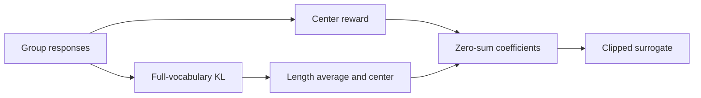
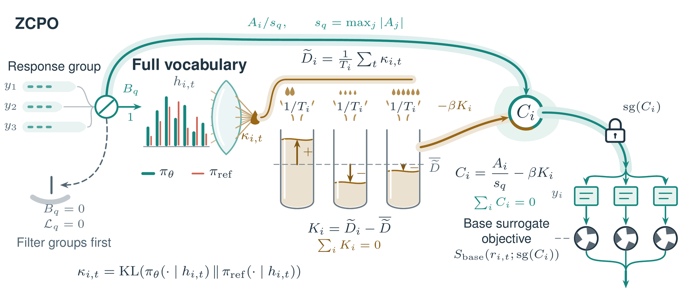

# ZCPO: Reference KL in zero-sum group coefficients

<!-- source-sha256: 7bbacb2c4805c0bb7ac4ed47885fa6c1cf65602767a785d09c0ae8e84a20cc11 -->

[简体中文](README.md)

> Real training chain; a 24-step single-seed diagnostic is not AIME reproduction.

## Paper information

| Field | Details |
|---|---|
| Paper | [When KL Regularization Misfires in Group Policy Optimization](https://arxiv.org/abs/2610.12161) |
| Institution | Alibaba Group; Fei Ding. |
| First public release | 2026-10-08 (arXiv v1) |
| Author code | No public author implementation found. |
| Local adapter or method key | `zcpo` |
| Local reproduction code | `src/auto_research/post_training/oct11_objectives.py`, `oct11_checkpoint.py`; `scripts/run_zcpo_checkpoint.py`. |

## Paper method and evidence

Independent KL penalties may update policy despite tied rewards or canceling reward gradients. Center response-average conditional KL within the group and put it in the frozen reward coefficient, not a standalone loss.

<!-- paper-figure:start -->
### Original paper figure

Figure 2 shows tie filtering, full-vocabulary KL, length averaging, centering, and the frozen coefficient. From the [original paper](https://arxiv.org/abs/2610.12161); copyright remains with the authors.
<!-- paper-figure:end -->

### Core equation

$A_i=R_i-\bar R$, $s=\max_i|A_i|$, $K_i=\overline{D_{KL}(\pi_{old}\|\pi_{ref})}_i-\mathrm{groupmean}$, $C_i=\operatorname{sg}(A_i/s-\beta K_i)$. Skip the entire tied or insufficient group; calling AdamW with zero loss can still decay parameters.

### Reported results

[Table 1](https://arxiv.org/html/2610.12161v1#S5): three-seed AIME24/25 avg@32 56.8%/48.5% versus 47.3%/37.1% for no-KL DAPO. Not comparable to the four-response GSM8K diagnostic; no production A/B.

## Local reproduction

Frozen Qwen3-4B reference, q/v LoRA, group 4, 24 steps, max 256 tokens/response and eight independent validation questions. Execute full-vocabulary KL, valid mask, length averaging, stop-gradient. [Guide](../oct11-checkpoint-guide.md).

~~~bash
python scripts/run_zcpo_checkpoint.py --help
~~~

Answers only reach external reward verifier. No overlap or official test selection. First train-derived holdout: nine valid groups, LoRA L2 0.051158, exact match 0.625, no initial control. [Rerun metrics](metrics/checkpoint-a100-seed42.json), [receipt](../../gpu-validations/zcpo-a100-20261011.json). `oct11_objectives.py` defines loss; `oct11_checkpoint.py` handles generation, reference, optimization and validation. Earlier eight-step run had no valid group and mislabeled official test validation; [audit](../../research-audits/oct11-runtime-audit.md) keeps it out of holdout evidence. No full DAPO, multi-seed AIME, or Evolve.
