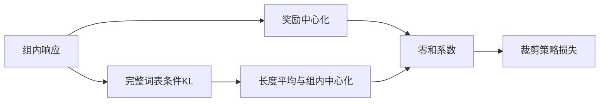
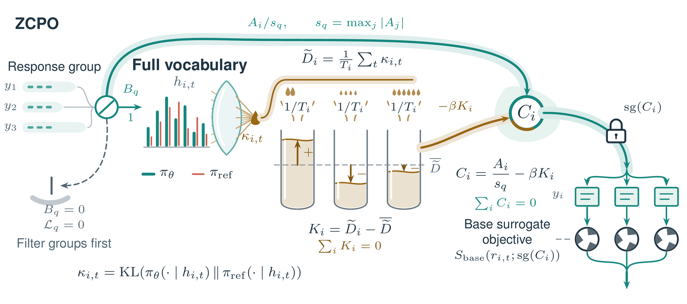

# ZCPO：将参考 KL 校准进组内零和系数

> 实际训练链路和边界检查已实现；24 步单 seed 诊断不是 AIME 收益复现。

## 论文信息

| 字段 | 内容 |
|---|---|
| 论文链接 | [When KL Regularization Misfires in Group Policy Optimization](https://arxiv.org/abs/2610.12161) |
| 公司 / 机构 | Alibaba Group（第一作者 Fei Ding） |
| 首次公开日期 | 2026-10-08（arXiv v1） |
| 原作者代码 | 未找到作者公开实现，不省略该字段 |
| 本地 Adapter | `zcpo` |
| 本地复现代码 | `src/auto_research/post_training/oct11_objectives.py`、`oct11_checkpoint.py`；入口 `scripts/run_zcpo_checkpoint.py` |

## 原始论文总结

### 背景与主要改动

独立 KL 惩罚可能在奖励相同或奖励梯度取消时继续更新策略。ZCPO 用响应平均的条件 KL 相对漂移，校准组内奖励系数；再将该系数放进原策略 surrogate，不另加独立 KL loss。



<!-- paper-figure:start -->
### 原论文关键图

[](https://arxiv.org/html/2610.12161v1/figures/en/zcpo/method.png)

> **原论文 Figure 2（关键图）**：先过滤无奖励差异组，再把完整词表条件 KL 做长度平均和组内中心化，校准进冻结的零和系数，最后进入基础策略 surrogate。图片来自[原论文](https://arxiv.org/abs/2610.12161)，版权归原作者所有；点击图片可查看来源。
<!-- paper-figure:end -->

### 核心公式

$A_i=R_i-\bar R$，$s=\max_i|A_i|$，$K_i=\overline{D_{KL}(\pi_{old}\|\pi_{ref})}_i-\mathrm{groupmean}$；$C_i=\operatorname{sg}(A_i/s-\beta K_i)$。$s=0$ 或组大小不足时整组跳过，避免除零和 AdamW 的额外权重衰减更新。

### 论文离线与线上效果

[原文表 1](https://arxiv.org/html/2610.12161v1#S5)的三 seed AIME24/25 avg@32 为 ZCPO 56.8%/48.5%，无 KL DAPO 47.3%/37.1%。这是论文协议，不能与本地 GSM8K 四响应短跑比较。未报告线上 A/B。

## 本地复现

固定 Qwen3-4B 基础参考，训练 q/v LoRA；group=4、24 步、每响应最多 256 token，8 个独立验证问题。完整词表条件 KL、有效响应 mask、长度平均和 stop-gradient 均实际执行。见[运行说明](../oct11-checkpoint-guide.md)。

```bash
python scripts/run_zcpo_checkpoint.py --help
```

### 数据协议与结果

训练时答案仅供外部验证器打奖励。训练/验证问题不重叠，官方 test 不用于选择。首次训练集派生 holdout 运行有 9 个有效组，LoRA 位移 L2=0.051158，验证 exact match=0.625；没有初始对照，因此不宣称增益。当前可追溯重跑见[指标](metrics/checkpoint-a100-seed42.json)和[GPU 回执](../../gpu-validations/zcpo-a100-20261011.json)。

### 代码映射与复现边界

公式在 `oct11_objectives.py`；rollout、冻结参考、优化和验证在 `oct11_checkpoint.py`。同奖励组不能仅返回零 loss 后仍调用优化器。早期 8 步全部无有效组，且旧运行误将官方 test 称为 validation；记录在[运行审计](../../research-audits/oct11-runtime-audit.md)，不作为 holdout 能力证据。原始 DAPO 训练预算、AIME 多 seed 和 Evolve 未完成。
