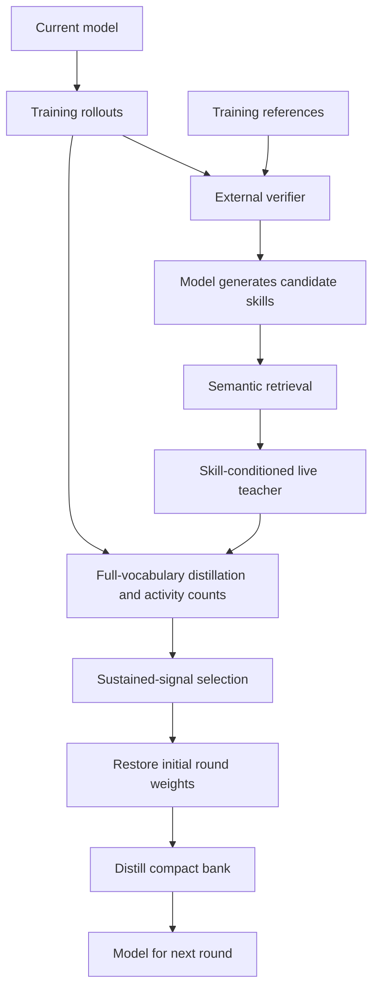
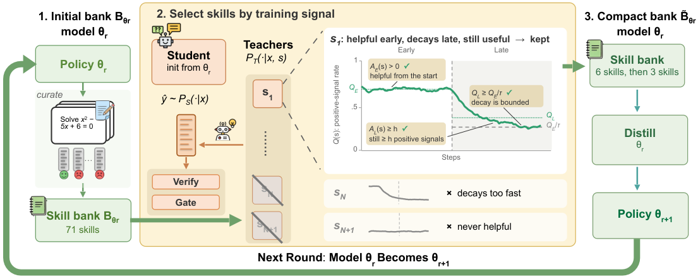

# SGUID: Selecting Skills with Sustained Teaching Signals for Model–Skill Co-Evolution

<!-- source-sha256: 1bea3617d31921ea3956edd5897678671a9de04e2882cb2b9cfcb6808bed3e35 -->

[简体中文](README.md)

> The fixed expanded Qwen3.5-9B protocol completed two rounds and 464 real gradient updates on an A100. Skill selection, restoration, and redistillation passed mechanism checks. **Validation EM on four problems fell from 75% to 25%; two responses were truncated both before and after.** The GPU receipt validates only bounded L1 execution, not capability improvement. Earlier failures are preserved unchanged.

## Paper information

| Field | Value |
| --- | --- |
| Paper | [Which Skill to Distill? SGUID: Selecting a Compact Skill Bank for Model–Skill Co-Evolution](https://arxiv.org/abs/2610.12367) |
| Affiliations | New York University (first author Yuhan Liu); collaborator Amazon |
| First public release | 2026-10-08 (arXiv v1) |
| Authors' code | Not yet released. The paper plans to release code, skill-generation prompts, and the full candidate bank after acceptance. |
| Local adapter | `sguid` |
| Local code | `src/auto_research/post_training/sguid_checkpoint.py`; selection in `oct11_objectives.py`; entry point `scripts/run_sguid_checkpoint.py` |

## Original paper

### Background and contribution

Semantic relevance does not mean a skill can teach the model. SGUID generates candidate skills from verified training trajectories of the current model, then checks whether they provide verifier-aligned signals in both early and late distillation. After probing, restore the round's initial weights and retrain only on the selected compact bank. The updated model generates the next bank rather than reusing fixed handwritten skills.



<!-- paper-figure:start -->
### Key figure from the paper

[](https://arxiv.org/html/2610.12367v1/sguid_overview_cropped.png)

**Original Figure 1:** Training stages and optimization in the [paper](https://arxiv.org/abs/2610.12367); copyright belongs to the authors.
<!-- paper-figure:end -->

### Core equations

Clip the skill teacher's sampled-token log-probability difference from the student to $[-3,3]$, then average over valid response tokens to obtain $a_s$. The verifier gives $r\in\{-1,+1\}$ and the frozen coefficient is $c_s=\operatorname{sign}(r a_s)\mathbf{1}[|a_s|>0.05]$. This implementation uses the generalized full-vocabulary forward KL allowed by Equation 9, $\mathcal L=\operatorname{sg}(c_s) D_{KL}(P_T\|P_S)$, retaining negative signals.

Keep a skill only if $A_E>0$, $A_L\ge h$, and $Q_L\ge Q_E/5$, then rank by $A_L$ and $Q_L$. Retrieval counts do not count as positive teaching events.

### Paper results

In [Table 1](https://arxiv.org/html/2610.12367v1#S4), mean performance on three math evaluations for Qwen3-4B goes from 64.2% with the full bank to 65.1% in the first SGUID round. Qwen3-8B goes from 64.3% to 66.3% in round two. These use DAPO-Math-17K, 200 steps, and AIME/HMMT avg@12, not the local GSM8K run. No online A/B was reported.

## Local reproduction

```bash
PYTHONPATH=src python scripts/run_sguid_checkpoint.py \
  --checkpoint-path "$CHECKPOINT" \
  --checkpoint-id Qwen/Qwen3.5-9B \
  --checkpoint-revision c202236235762e1c871ad0ccb60c8ee5ba337b9a \
  --train-path data/gsm8k-holdout/train.jsonl \
  --validation-path data/gsm8k-holdout/validation.jsonl \
  --split-manifest data/gsm8k-holdout/split.json \
  --dataset-revision 3101c7d5072418e28b9008a6636bde82a006892c \
  --training-examples 200 --validation-examples 4 --rounds 2 \
  --probe-steps 200 --internalization-steps 32 \
  --candidate-count 32 --retrieve-count 6 --late-minimum 2 \
  --max-tokens 1024 --skill-tokens 256 --evaluation-max-tokens 3072 \
  --seed 42 --device cuda --output runs/sguid-expanded-seed42.json
```

Use the text branch of actual `Qwen3_5ForConditionalGeneration` with compatible Transformers, not Qwen3 substituted for the multimodal model. The vision branch is frozen and receives no images. q/v LoRA is installed only in text-decoder full-attention layers with those projections; hybrid linear-attention layers retain their operators. Results record actual model class, type, and replacement counts.

### Data and protocol

Use a verified train/validation split derived from public training data. Official test remains unopened. Training answers are available only to the external numerical verifier and offline skill generation; student training, validation, and retrieval receive questions only. Teacher and student share live updated parameters, with teacher forwards under `no_grad`, not a separate stronger checkpoint.

Both teacher and student score **the same student rollout** by teacher forcing after their respective prompt prefixes, aligning probabilities token by token. Teacher thinking is a prompt mode, not generation and verification of a separate teacher chain. Students use thinking off; teachers and evaluation use thinking on. The entry point renders both `enable_thinking=False/True` chat prefixes, validates closed/open `<think>` blocks, and records prefixes, SHA256s, and requested/effective modes. Unsupported switching fails before model loading/training. Accepting a keyword does not prove the behavior, and reasoning correctness and truncation remain separately measured.

**The first failure was not a sign error.** The public `Qwen3-4B-Instruct-2507` template ignored the thinking argument; old fields recorded only the request. Do not rewrite those artifacts or issue a passing receipt. Of 48 skill events during eight probe steps, 39 coefficients were negative, 9 weak, and none positive. Eight gradient updates moved the adapter by 0.03139, but no skill met early or late positive-teaching counts. The weights were restored exactly; there was no compact training or round two. Four correct validation answers only show this small set was easy. The new protocol still uses preset h=2, gap clip=3, and tau=5, without lowering the gate.

### Initial 9B short run: failure retained

The fixed run used 32 training questions, candidates from the first 16 trajectories, 32 probe steps per round (16 early and 16 late), 16 planned compact steps, response cap 768, skill cap 256, up to 6 retrieved skills, and retention caps 6/3. The same four validation questions were scored externally, not used to select skills, settings, or budgets.

| Stage | Actual updates / nonzero events | Positive events, early / late | Outcome |
| --- | --- | --- | --- |
| Round one probe | 32 / 192 | 18 / 18 | Six skills passed; parameter displacement 0.07695 |
| Round one compact | 16 / 96 | — | Restarted at the round's initial weights; displacement 0.04019 |
| Round two probe | 32 / 192 | 18 / 6 | Bank generated by the updated model; displacement 0.09129 |
| Round two compact | 0 / 0 | — | At most one late positive event per skill, below fixed $h=2$; restored exactly and skipped |

Teacher support was negative throughout both probes. Positive coefficients came from suppressing wrong responses rather than strengthening correct ones. Only one late round-two response was wrong, so its six positive events were spread over six skills. An independent review checked counts, SHA, live-policy chains, and restoration. This was not an accounting error; gradient activity does not replace persistence. All four thinking responses were truncated both before and after, with EM zero both times, so this is neither evidence of zero true capability nor a first-round gain.

The [failure audit](../../research-audits/oct11-sguid-failed-selection.json) binds execution commit and per-file digests, with activity, gradients, skills, and restoration, `result=failed` and `gpu_pass_receipt=false`. The later run does not overwrite this failure.

### Preregistered expansion: two rounds executed, validation worsened

Budgets and gates were specified in the [preregistered protocol](../../research-audits/oct11-sguid-expanded-protocol.md), source frozen at `319008f69ac6224ad0a2dfe3146d551c1999f5e3`. Restart with original checkpoint and zero-output LoRA, seed 42; no continuation from the successful round, error-based question filtering, or seed switching. Use the first 200 questions, 32 candidate skills generated from the first 32 current trajectories each round, 100 early and 100 late probe steps, and 32 compact steps from restored initial weights with a fresh optimizer.

| Stage | Real updates / nonzero events | Positive events, early / late | Result |
| --- | --- | --- | --- |
| Round one probe | 200 / 1200 | 72 / 90 | Six skills selected; displacement 0.656916 |
| Round one compact | 32 / 192 | — | Trained from restored weights; displacement 0.083882 |
| Round two probe | 200 / 1200 | 78 / 84 | Updated policy regenerates bank; three selected; displacement 0.618361 |
| Round two compact | 32 / 96 | — | Trained from round-two restored weights; displacement 0.091965 |

All 464 updates had finite nonzero gradients; final adapter displacement was 0.173899. The strict verifier checked stepwise weight SHA chains, restoration, skill provenance, activity, fixed $h=2$, and sorting. Remote execution and train/validation digests independently matched the frozen source and public split.

Training cap was 1024 tokens; independent baseline/final evaluation cap was 3072. EM **75% → 25% (−50 percentage points)** on four fixed items, EOS 2/4 and truncation 2/4 both times. One seed, four questions, and half truncated do not support statistical comparison. Skill support remained negative; positive coefficients represent suppression of wrong responses. Negative signed-KL terms are unbounded below, so execution is not proof of stability or gains.

[Metrics](metrics/checkpoint-a100-seed42.json) and [GPU receipt](../../gpu-validations/sguid-a100-20261012.json) retain the regression, truncation, and provenance. `result=passed` applies only to the mechanism; `capability_passed=false`, `diagnostic_only=true`, and no Evolve promotion. `--evaluation-max-tokens` controls only external scoring output budget and is not backfilled into old failures.

CPU tests verify that round two uses the updated policy; restoration is exact; compact training resets optimizer momentum; and no valid skills causes explicit failure with candidates, counts, and reason, not fallbacks or weaker gates. Nonzero gate events and actual updates are distinct. Only finite nonzero gradients advance the optimizer, zero gradients do not advance momentum, and nonfinite gradients fail and restore initial round weights.

### Code and reproduction limits

`sguid_checkpoint.py` handles actual generation, verification, live teacher scoring, backpropagation, two rounds, and raw records. `oct11_objectives.py` implements coefficients and persistence. Artifacts record initial/final validation, EOS/truncation, skill signals, and parameter displacement.

This bounded L1 run uses Qwen3.5-9B hybrid text, GSM8K holdout, rank-8 q/v LoRA, and last-layer mean hidden-state cosine instead of Qwen3-Embedding-0.6B. Probe periods are 100/100 rather than 75/100; late minimum is 2 rather than 10. Round two retrieves at most 6 in probe and 3 in compact, not 3 for both. It does not reproduce all-linear rank 64, dropout=0.05, the original prompts, or contest math gains. Signed full-vocabulary KL is allowed by the paper but is not the authors' final bounded SGSD. Clipping and finite gradients do not guarantee long-term stability. Gates are preregistered and not tuned on validation accuracy. Truncated numerical matches and EOS completion are separate. Real CUDA evidence is not original benchmark or Evolve capability evidence.
