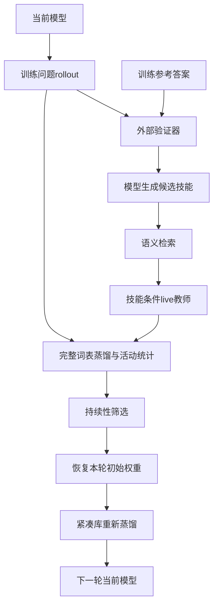
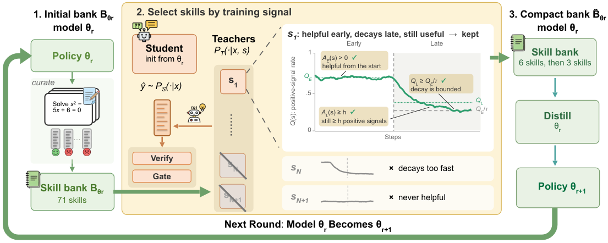

# SGUID：按持续教学信号选择技能，驱动模型—技能共同进化

> 当前实现了真实 checkpoint 两轮链路和 CPU 合同测试。首轮 A100 探测未产生满足持续性门槛的技能，已恢复原权重并保留失败；改用支持真实 thinking 切换的公开模型重跑尚待完成，不宣称论文级能力提升。

## 论文信息

| 字段 | 内容 |
|---|---|
| 论文链接 | [Which Skill to Distill? SGUID: Selecting a Compact Skill Bank for Model–Skill Co-Evolution](https://arxiv.org/abs/2610.12367) |
| 公司 / 机构 | New York University（第一作者 Yuhan Liu）；合作机构 Amazon |
| 首次公开日期 | 2026-10-08（arXiv v1） |
| 原作者代码 | 尚未发布；原文明确计划论文接收后公开源码、技能生成提示和完整候选库 |
| 本地 Adapter | `sguid` |
| 本地复现代码 | `src/auto_research/post_training/sguid_checkpoint.py`；筛选公式 `oct11_objectives.py`；入口 `scripts/run_sguid_checkpoint.py` |

## 原始论文总结

### 背景与主要改动

语义相关不代表技能真正能够教会模型。SGUID 先从当前模型的已验证训练轨迹生成候选技能，再观察技能在蒸馏早期、晚期是否持续提供与验证器一致的信号。探测训练完成后恢复本轮初始权重，只用通过筛选的紧凑库重新训练；下一轮由更新后的模型重新产技能，不沿用固定手写库。



<!-- paper-figure:start -->
### 原论文关键图

[](https://arxiv.org/html/2610.12367v1/sguid_overview_cropped.png)

> **原论文 Figure 1（关键图）**：展示原论文的训练流程与关键优化环节。图片来自[原论文](https://arxiv.org/abs/2610.12367)，版权归原作者所有；点击图片可查看来源。
<!-- paper-figure:end -->

### 核心公式

对学生生成的响应，计算技能教师与学生的 sampled-token log-probability 差，裁剪至 $[-3,3]$ 后在有效响应 token 上平均，得到 $a_s$。验证器给出 $r\in\{-1,+1\}$；冻结的系数为 $c_s=\operatorname{sign}(r a_s)\mathbf{1}[|a_s|>0.05]$。本实现采用论文第 9 式允许的广义完整词表 forward KL：$\mathcal L=\operatorname{sg}(c_s) D_{KL}(P_T\|P_S)$，不把负信号删除。

技能只有在 $A_E>0$、$A_L\ge h$、$Q_L\ge Q_E/5$ 时才能保留，然后按 $A_L$、$Q_L$ 排序。检索次数不能冒充积极教学次数。

### 论文离线与线上效果

[原文表 1](https://arxiv.org/html/2610.12367v1#S4)中，Qwen3-4B 的三项数学评测平均分从全库蒸馏 64.2% 到第一轮 SGUID 65.1%；Qwen3-8B 第二轮从 64.3% 到 66.3%。这是 DAPO-Math-17K、200 步、AIME/HMMT avg@12 原协议，不是本地 GSM8K 短跑结果。未报告线上 A/B。

## 本地复现

```bash
PYTHONPATH=src python scripts/run_sguid_checkpoint.py \
  --checkpoint-path "$CHECKPOINT" \
  --checkpoint-id Qwen/Qwen3.5-9B \
  --checkpoint-revision c202236235762e1c871ad0ccb60c8ee5ba337b9a \
  --train-path data/gsm8k-holdout/train.jsonl \
  --validation-path data/gsm8k-holdout/validation.jsonl \
  --split-manifest data/gsm8k-holdout/split.json \
  --dataset-revision 3101c7d5072418e28b9008a6636bde82a006892c \
  --training-examples 32 --validation-examples 4 \
  --probe-steps 32 --internalization-steps 16 \
  --candidate-count 16 --retrieve-count 6 --late-minimum 2 \
  --max-tokens 768 --skill-tokens 256 --seed 42 --device cuda \
  --output runs/sguid-seed42.json
```

此命令使用真实 `Qwen3_5ForConditionalGeneration` 文本分支（需要支持该类的 Transformers），不是把多模态网络替换为 Qwen3。视觉分支冻结且不输入图像，q/v LoRA 仅安装到文本解码器中具有这两个投影的 full-attention 层；混合 linear-attention 层仍执行原算子。运行记录报告实际模型类、模型类型和替换模块数。

### 数据协议与结果

仅接受已核验的公开训练集派生 train/validation 切分；官方 test 不读取。训练答案仅供外部数值验证器和离线技能生成使用；学生训练与验证输入只有问题，检索也不看答案。教师与学生共用实时更新的参数，教师 forward 在 `no_grad` 下执行，不使用更强外部 checkpoint。

论文要求学生关闭 thinking，教师与验证开启 thinking。入口会分别渲染 `enable_thinking=False/True` 的实际 chat prefix，核验闭合/开启 `<think>` 块，保存原始 prefix、SHA256 以及 requested/effective 模式；不支持真实切换时，在加载模型和训练前失败。接受关键字参数不等于支持该协议，输出 reasoning 是否正确和是否截断仍需另行计量。

**首次失败不是筛选符号错误。** 公开 `Qwen3-4B-Instruct-2507` 的模板忽略 thinking 参数，旧记录里的 teacher/evaluation thinking 字段仅表示请求，不能作为实际协议证据。旧原始产物不重写，也不生成 passed 回执。8 步探测的 48 个技能事件中，39 个负系数、9 个弱信号、0 个正系数；8 次真实梯度更新使 adapter 探测位移为 0.03139，但所有技能的早/晚积极教学次数均为 0，因而无技能入选，精确恢复本轮初始权重，未执行紧凑库训练和第二轮。验证 4 题均正确只说明这组短问题容易，不证明技能有效。保留该失败，不能将负教学或非零梯度计作积极活动；新的 Qwen3.5 运行仍使用预设 h=2、gap clip=3、tau=5，不因失败降低门槛。

**重跑预定预算（尚非测得结果）：** 使用固定的 32 个训练问题，由前 16 个训练轨迹生成候选库；每轮 32 步探测（早/晚各 16 步）、16 步紧凑库训练，响应上限 768 token，技能上限 256 token，检索上限 6，两轮保留上限仍为 6/3。扩大的是训练覆盖和统计窗口，不修改系数符号、门控或持续性门槛；validation 固定 4 题，只外部评分，不挑技能、参数或运行预算。若仍无 eligible bank 或第二轮失败，继续保留失败，不用回退技能、不宣称两轮完成。

本次 CPU 测试已核验：第二轮由更新后的策略产生新库；探测后精确恢复本轮权重；重新建立优化器，不继承探测 momentum；无有效技能时显式失败并保存候选技能、真实活动计数和失败原因，不塞回退技能或降低阈值。非零门控信号与实际更新分别统计，只有测得有限且非零的梯度才推进优化器；零梯度不推进 momentum，非有限梯度直接失败并恢复本轮初始权重。

### 代码映射与复现边界

`sguid_checkpoint.py` 负责真实生成、外部验证、live 教师评分、反向传播、两轮生命周期及原始运行记录；`oct11_objectives.py` 负责系数和持久性筛选。运行产物保存 baseline/final validation、EOS/截断、逐技能正负/弱信号及真实参数位移。

这是 L1 有界机制验证。区别于原论文：使用 Qwen3.5-9B 混合文本网络而非原 Qwen3、GSM8K holdout、q/v rank-8 LoRA、当前 LM 的平均末层 hidden-state cosine 检索而非 Qwen3-Embedding-0.6B；预定 32 步探测按前/后半段划分、晚期门槛缩为 2（原论文为 10），而非原始 200 步统计；不复现原 all-linear rank-64、dropout=0.05、原技能生成提示或数学大赛收益。门槛只由预设训练预算决定，不根据验证准确率调整。截断响应的数值匹配与 EOS 完成分开报告。GPU 回执、稳定指标与目录登记必须在实跑核验后补入，不能用 CPU 测试代替。
