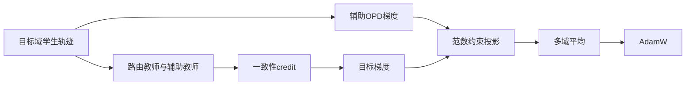
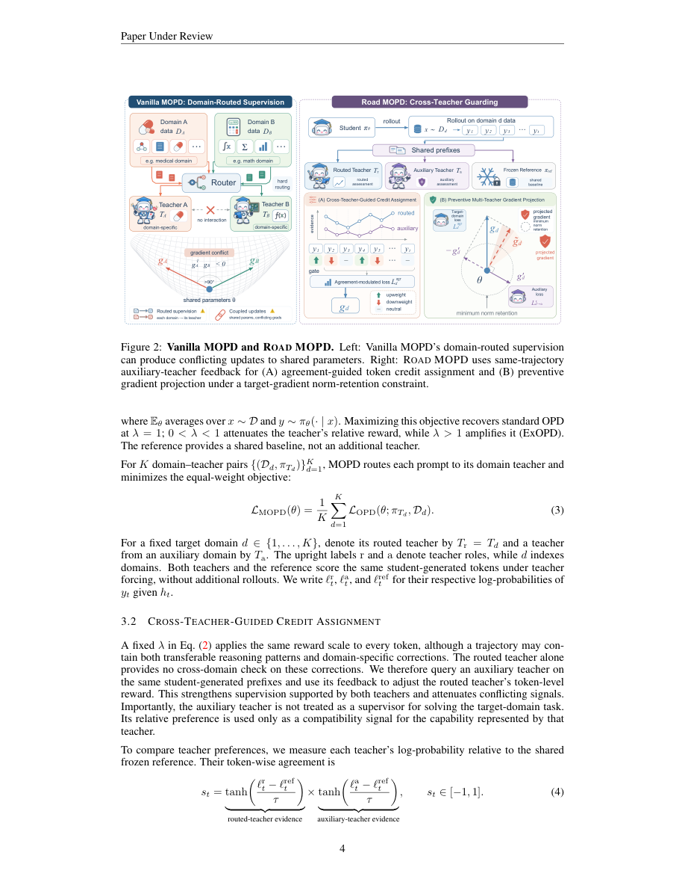

# road-mopd：Beyond Domain-Routed Supervision: Cross-Teacher Guarding for Multi-Teacher On-Policy Distillation

> 核心机制代码路径；短预算 checkpoint 结果只支持 runtime 诊断，不支持论文规模能力结论。

## 论文信息

| 字段 | 内容 |
|---|---|
| 论文链接 | [arXiv v1](https://arxiv.org/abs/2610.13521v1) / [全文](https://arxiv.org/html/2610.13521v1) |
| 公司 / 机构 | Nanjing University / JD.com |
| 首次公开日期 | 2026-10-09（arXiv v1） |
| 原作者代码 | 未发现 / 未发布官方代码（截至 2026-10-12）；原文未提供可验证官方实现 |
| 本地 adapter / 方法（Adapter） | `road-mopd` |
| 本地复现代码 | [packaged adapter](../../../src/auto_research/reproductions/road_mopd/adapter.py)、[objectives](../../../src/auto_research/post_training/oct12_objectives.py)、[checkpoint runner](../../../src/auto_research/post_training/oct12_checkpoint.py) |

## 原始论文总结

### 背景与主要改动

多域只路由各自教师，不能防止共享参数更新损害其他能力。Road 用未路由教师在当前目标域的同一学生轨迹上给出兼容性证据，调节 token credit，再求真实辅助梯度，投影目标梯度但保留其范数下限。

### 原论文关键图

原版 PDF 第 4 页 Figure 2（HTML 标号与 PDF 不同，以 PDF 为准） 全页截图，已检查图题、算法流程与正文，非本地重绘或实验产物。版权归原作者；截图来源为官方 arXiv PDF v1。

### 核心公式

$s_t=\tanh((\ell_t^r-\ell_t^{ref})/\tau)\tanh((\ell_t^a-\ell_t^{ref})/\tau)$，$\lambda_t=\mathrm{clip}(1+\rho_gs_t,\lambda_{min},\lambda_{max})$。目标 credit 为 $\lambda_t(\ell_t^r-\ell_t^{ref})-(\ell_t^\theta-\ell_t^{ref})$。冲突时 $\tilde g=g-\alpha\langle g,g'\rangle g'/\|g'\|^2$；取可行最大 $\alpha\in[0,1]$，满足 $\|\tilde g\|\ge m\|g\|$。

### 论文离线与线上效果

原文 Table 1 Math×Medical / Qwen3-4B：Vanilla MOPD 综合 42.71%，Road 47.92%；Medical 域平均从 39.45% 到 48.23%。论文也报告低冲突与三域设置；本地不据公式证明这些能力结论。未报告线上 A/B。 原论文标量摘录见 [paper-results.json](metrics/paper-results.json)，`paper_reported=true`、`measured_locally=false`；不能作为本地复现指标。

## 本地复现

入口：`PYTHONPATH=src python scripts/run_oct12_post_training.py --objective road-mopd --help`。

必须提供本地 student/teacher checkpoint 路径与公开 ID/revision、公开 train/validation JSONL、dataset revision、train-only split manifest 和 output 路径。还需 auxiliary 的 path/ID/revision。 CLI 不下载模型，不上传数据，实际训练 q_proj/v_proj LoRA。

`road-mopd` packaged adapter 读取数据目录中的 `oct12-road-mopd.json`，字段对应 CLI 的 snake_case 参数；没有真实 checkpoint 配置时明确报错，不回退到合成 fixture。

### 数据协议与结果

必须复用 `public_holdout.validate_holdout` 校验公开 source train、revision、文件 SHA256、条数、规范化 question 去重及 train/validation 不重叠。学生生成只接收问题；gold 不进入 solver rollout/retrieval。validation 仅训练后报告，本短跑没有据 validation 选超参；test 无入口且不读取。正式实验的选参必须仅使用 train/validation。

本地支持恰好 2 个显式 domain、不同 frozen teacher 身份、完全一致 token identities。domain 按字符串排序：第一域→teacher，第二域→auxiliary；另一位是非路由 critic。默认范数保留 m=0.6、advantage clipping=[-10,10]，沿原文配置。不得把同一 dataset 的任意分片写成论文 Math×Medical 能力复现。

目前未完成真实 NVIDIA A100/A30 执行，GPU gate 尚未通过；不写本地稳定指标或伪造 receipt。运行保存真实 loss/token 数/参数变化/validation 口径和角色 revisions；少量截断响应、单 seed 只能支持 L1 runtime smoke。planned receipt：`docs/gpu-validations/road-mopd-a100-20261012.json`，须由真实执行生成。

### 代码映射与复现边界

`road_credit / preventive_projection` 对应 Eq. 4-9；`road_step` 每域真实 `autograd.grad`，辅助损失只约束同轨迹目标梯度，不额外优化辅助梯度，然后平均投影目标梯度。

契约与行为测试：[test_oct12_post_training.py](../../../tests/test_oct12_post_training.py)。小因果模型测试仅验证真实梯度、masked prefix、参考恢复、边界更新及 gold 隔离；不是 reasoning 能力比较。尚未完成论文规模数据/模型/长推理预算、多 seed 同预算能力对照、线上系统或 Evolve 控制器集成。
