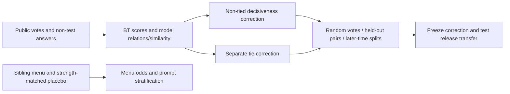
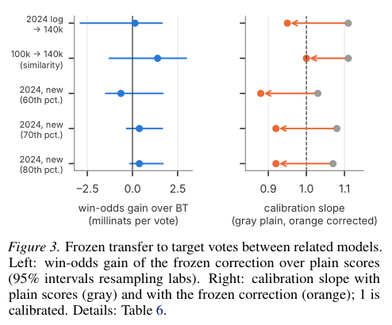

# Similar Models, Broken Odds: auditing similarity-dependent odds

<!-- source-sha256: caa772f2b5225bc790fb8cba188ba337752e78f0c74bbd698ce60a238974c8ef -->

[简体中文](README.md)

> **CPU L1 arithmetic/audit component; diagnostic only.** It computes conditional win probabilities, menu log-odds shifts and interval decisions. It does not fit an Arena ranking, generate judge votes or establish model improvement. The full vote-fitting and 138,400-judgment campaign is **not reproduced due to cost (review DONE)**.

## Paper information

| Field | Value |
| --- | --- |
| Paper | [arXiv:2610.19095](https://arxiv.org/abs/2610.19095); [fixed v3](https://arxiv.org/html/2610.19095v3) |
| Original title | Similar Models, Broken Odds: Where Luce's Axiom Fails in Chatbot Arena |
| Institution/company | First author Soovadeep Bakshi: **Independent Researcher**, explicitly in the byline; no university affiliation is inferred from an email domain |
| Original publication | **October 13, 2026, 19:33:25 UTC**, arXiv v1; reviewed v3 updated November 13, 2026, 04:17:37 UTC |
| Authors' code | **No verifiable released source link found.** Software and Data in v3 says code, generated answers and judgments will be released. Public Arena data are not the authors' implementation |
| License | No released source-code license; paper/original figure CC BY 4.0 |
| Local adapter/key | `luce-similarity-audit`; `adapter=null`, `promotion_eligible=false`, `evolve_integrated=false` |
| Local code | `src/auto_research/post_training/luce_similarity_audit.py`: `corrected_win_probability`, `menu_log_odds_shift`, `heldout_log_loss`, `transfer_improvement_established` |

## Original paper

### Motivation and changes

Bradley–Terry assigns each model a score and derives pairwise odds. The paper investigates where related versions, sizes and laboratories induce more decisive preferences than global score gaps predict. The Luce/IIA menu property additionally requires odds between two options to remain unchanged when a third option is replaced. The authors separately correct **decisiveness among non-ties** and **tie propensity**, examining wording similarity, length gaps and formatting.

This is an evaluation correction, not a method for training a stronger model. Better vote predictions neither establish capability gains nor imply a substantially different leaderboard. Similarity features must not come from the predicted test battle; rival ridge parameters are selected on validation data.

### Architecture and protocol



### Core equations

Equations 1–2 give

$$
\operatorname{logit}P(i\succ j\mid\mathrm{non\mbox{-}tie})=s_i-s_j,
\qquad
\operatorname{logit}P(i\succ j\mid\mathrm{non\mbox{-}tie})=k_{ij}(s_i-s_j).
$$

`k=1` recovers the baseline; `k>1` moves odds away from 50% without changing the sign of the score gap. The paper additionally models ties. The local binary log loss **does not implement or replace its three-outcome likelihood**. Equation 3 defines

$$
\delta=\log\frac{P(T)}{P(S_1)}\Big|_{\{S_1,S_2,T\}}
-\log\frac{P(T)}{P(S_1)}\Big|_{\{S_1,U,T\}}.
$$

Zero counts are rejected rather than silently adding pseudocounts. Callers must disclose a separate smoothing/statistical procedure. A positive shift pooled across prompts does not establish within-prompt IIA failure.

### Reported results and limits

On about 1.8 million votes, v3 reports decisiveness multipliers of 1.37/1.26/1.12 for versions/sizes/same-lab relations. Most predictive gain comes from ties: ties-only contributes +0.91 of the +0.96 millinats/vote overall gain on random 2024 votes. Rank correlation is 0.9999. These are not production A/B results.

The important negative result remains explicit: the frozen 2024→140k lineage correction gains +0.14 millinats in non-tied odds, with a 95% interval **[-2.92,+1.68]**. Transfer improvement is not established; some frozen multipliers overcorrect. The pooled three-menu shift is +0.10 [0.05,0.16], but the within-prompt estimate attenuates to +0.03 [-0.03,0.09], leaving prompt heterogeneity important.

<!-- paper-figure:start -->
### Key original figure

[](https://arxiv.org/pdf/2610.19095v3#page=7)

Fixed v3, page 7, Figure 3 and its original caption, without redrawing. Copyright remains with the authors; CC BY 4.0. [Source, crop and SHA256](assets/provenance.json). The crossing-zero interval is an author-reported limitation, not a local experiment.

Image from the [original paper](https://arxiv.org/html/2610.19095v3); copyright belongs to the original authors.
<!-- paper-figure:end -->

## Local implementation

### Data contract and mapping

Inputs are supplied score gaps, multipliers, counts and intervals. `corrected_win_probability` evaluates Equation 2 stably; `menu_log_odds_shift` evaluates Equation 3; `heldout_log_loss` handles non-ties only; `transfer_improvement_established` requires a strictly positive lower interval bound. There is no vote download, parameter fitting, bootstrap, joint six-parameter tie model or paid judge call.

```bash
PYTHONPATH=src python -c 'from auto_research.post_training.luce_similarity_audit import diagnostic; print(diagnostic(42, device="cpu"))'
PYTHONPATH=src python -m pytest tests/test_nov18_eval_protocols.py -q
```

### Checks and evidence boundary

Negative controls cover baseline degeneration, equal scores, reversed-pair complements, identical menus, zero counts and inconclusive transfer intervals. All examples are teaching arithmetic, not new Arena measurements; three seeds do not turn fixed inputs into a capability evaluation. Actual execution is recorded in component diagnostic artifacts rather than prefilled here. `REQUIRES_GPU_VALIDATION=False`; there is no CUDA path or GPU capability claim.

### High-cost full experiment

The paper jointly fits million-scale votes over several splits/resampling procedures and obtains 138,400 judgments from eight answer models and four laboratory-specific judges. That complete processing/API campaign exceeds the short single-device/local budget and is **not reproduced due to cost (review DONE)**. It is not automatically retried or presented as a completed full reproduction.
