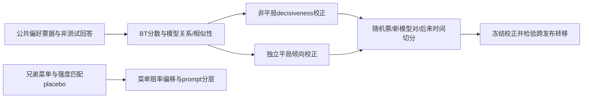
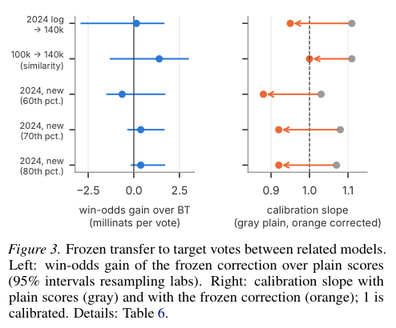

# Similar Models, Broken Odds：相似模型的胜率校准与 Luce 失效审计

[English](README-en.md)

> 状态：CPU **L1 数值/审计组件，diagnostic only**。复算条件胜率、菜单 log-odds 和转移区间判定，不拟合 Arena 排名，不生成裁判投票，不声称模型能力提升。完整票据拟合和 138,400 次模型裁判实验：**成本过高，不复现（审查 DONE）**。

## 论文信息

| 字段 | 内容 |
| --- | --- |
| 论文链接 | [arXiv 2610.19095](https://arxiv.org/abs/2610.19095)；[固定 v3 全文](https://arxiv.org/html/2610.19095v3) |
| 原文标题 | Similar Models, Broken Odds: Where Luce's Axiom Fails in Chatbot Arena |
| 公司 / 作者机构 | 一作 Soovadeep Bakshi；论文明确署名 **Independent Researcher（独立研究者）**，不根据邮箱域名推断大学任职 |
| 首次公开日期 | **2026-10-13 19:33:25 UTC**，arXiv v1；核查版本 v3 更新于 2026-11-13 04:17:37 UTC |
| 原作者开源代码 | **尚未发布可核验源码链接**；v3 的 Software and Data 明确写代码、生成回答和裁判结果将发布，不把公共 Arena 数据当作作者已开源实现 |
| 原作者代码许可 | 源码未发布；论文与本页原图 CC BY 4.0 |
| 本地 Adapter / key | `luce-similarity-audit`；`adapter=null`，`promotion_eligible=false`，`evolve_integrated=false` |
| 本地复现代码 | `src/auto_research/post_training/luce_similarity_audit.py`；入口 `corrected_win_probability`、`menu_log_odds_shift`、`heldout_log_loss`、`transfer_improvement_established` |

## 原始论文总结

### 背景与主要改动

Bradley–Terry 用每个模型一个分数推导任意两模型胜率，隐含“加入相似选项不应改变现有两者赔率”的 Luce/IIA 思路。作者发现，同系列版本、同代不同尺寸和同实验室模型之间的投票比全局分差预测得更果断。论文分别修正 **非平局胜率的 decisiveness** 与 **平局倾向**，并检查相似措辞、长度差和格式是否解释偏差。

这不是训练更强模型的方法。六参数校正改善预测投票，并不意味着发布版能力提高或榜单大换位。答案相似性不能取自被预测的 test battle；对照模型的 ridge 必须在 validation 上选。

### 架构与流程



### 核心公式

原文 Eq.1–2：

$$
\operatorname{logit}P(i\succ j\mid\text{非平局})=s_i-s_j,
\qquad
\operatorname{logit}P(i\succ j\mid\text{非平局})=k_{ij}(s_i-s_j).
$$

`k=1` 恢复基线；`k>1` 将既有赔率推离 50%，但不改变分差符号。原文模型另有平局项；本地的二元 log loss **不包含、也不替代三结果似然**。Eq.3 的菜单偏移为：

$$
\delta=\log\frac{P(T)}{P(S_1)}\Big|_{\{S_1,S_2,T\}}
-\log\frac{P(T)}{P(S_1)}\Big|_{\{S_1,U,T\}}.
$$

本地不悄悄对零计数加 pseudocount，而是要求调用方声明另外的平滑/统计方案。跨 prompt 合并的正偏移不能直接当作单个 prompt 内的 IIA 违反证据。

### 论文离线与线上效果

v3 在约 180 万票上报告版本/尺寸/同实验室 decisiveness 倍率为 1.37/1.26/1.12。改善主要来自平局：随机 2024 票的总体三结果增益 +0.96 millinats/vote 中，ties-only 为 +0.91。榜单 Spearman 相关为 0.9999；这不是线上 A/B。

关键负结果必须保留：冻结的 2024→140k lineage 校正，主指标非平局赔率增益 +0.14 millinats，95% 区间 **[-2.92,+1.68]**，不能建立转移有效；部分 frozen multiplier 反而过校正。三菜单平均合并偏移 +0.10 [0.05,0.16]，prompt 内估计降至 +0.03 [-0.03,0.09]，异质性仍重要。

<!-- paper-figure:start -->
### 原论文关键图

[](https://arxiv.org/pdf/2610.19095v3#page=7)

固定 v3 第 7 页 Figure 3 与原图注，未重绘；版权归原作者，CC BY 4.0。[来源、裁剪和 SHA256](assets/provenance.json)。跨零区间不是本地实验失败或成功，而是原论文报告的限制。
<!-- paper-figure:end -->

## 本地复现

### 数据协议与代码映射

只读取调用方提供的分差、倍率、计数和区间。`corrected_win_probability` 是 Eq.2 的稳定 sigmoid；`menu_log_odds_shift` 是 Eq.3；`heldout_log_loss` 只评非平局；`transfer_improvement_established` 要求区间下界严格大于零。没有票据下载、参数拟合、bootstrap 实现、六参数 joint tie 模型或付费裁判调用。

```bash
PYTHONPATH=src python -c 'from auto_research.post_training.luce_similarity_audit import diagnostic; print(diagnostic(42, device="cpu"))'
PYTHONPATH=src python -m pytest tests/test_nov18_eval_protocols.py -q
```

### 结果、负控与边界

检查倍率为 1 的退化、零分差 50%、交换模型互补、相同菜单零偏移、零计数拒绝和跨零转移区间。所有示例都是教学算术，不是新的 Arena 测量；三种子也不会把固定输入变成能力评测。实际执行记录由本轮组件指标产物保存；本页不预填实测结果。`REQUIRES_GPU_VALIDATION=False`，没有 CUDA 路径或 GPU 能力声明。

### 高成本完整实验

原文联合拟合百万级票据、多个切分和重采样，并用 8 个回答模型、4 个独立实验室裁判完成 138,400 次判断。完整数据处理/多 API 采样矩阵超出短时单卡/本地预算，**成本过高，不复现（审查 DONE）**。不自动重试，也不把该决定改写成完整复现完成。
