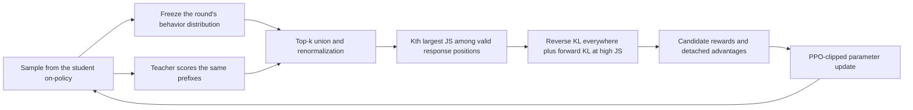
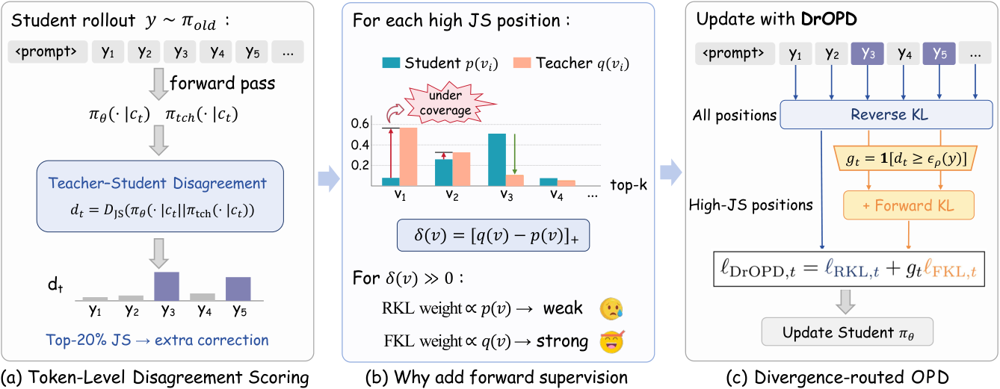

<!-- source-sha256: 4c235386d1ad4b692c8d0f9132abcc54c64c71a5a0475e26aac931474d796a24 -->

[简体中文](README.md) · English

# DrOPD: On-policy distillation routed by student–teacher divergence

> **L1 algorithm component and actual on-policy update diagnostic.** The local implementation runs the candidate union, JS routing, and PPO updates. Full paper training is **too costly to reproduce (review DONE)**. This is distinct from [Dr. OPD (2609.38025)](../2609.38025-dr-opd/README.md), and uses a separate method key.

## Paper information

| Field | Details |
|---|---|
| Paper | [Divergence-Routed On-Policy Distillation](https://arxiv.org/abs/2610.19572v1) |
| Institution | First author Tiantian Peng: Peking University; collaborators include Kuaishou and Tsinghua University. |
| First public release | 2026-10-14 04:39:35 UTC (arXiv v1) |
| Original source code | No repository released by the authors for this method was found. Third-party or related-work repositories do not count. |
| Local adapter/method key | `divergence-routed-opd`, a standalone component not registered under the old fixed-candidate diagnostic route. |
| Local reproduction code | [`src/auto_research/post_training/divergence_routed_opd.py`](https://github.com/daiwk/auto-research/blob/main/src/auto_research/post_training/divergence_routed_opd.py) |
| Local code directory | [`src/auto_research/post_training/`](https://github.com/daiwk/auto-research/tree/main/src/auto_research/post_training) |
| Runner | [`scripts/run_divergence_routed_tiny.py`](https://github.com/daiwk/auto-research/blob/main/scripts/run_divergence_routed_tiny.py) |

## Original paper summary

### Background and main changes

DrOPD compares teacher and student distributions on student-generated trajectories. JS divergence flags positions where the teacher has modes poorly covered by the student. It retains reverse KL at every position and adds a forward-KL correction only at high-divergence positions. PPO clipping uses candidate-level advantages for the update.

The reverse-KL logit gradient contains the student probability factor, so correction weakens when the student assigns a teacher token almost no mass. The forward-KL gradient is the difference between student and teacher probabilities and can still push toward those teacher modes. Routing restricts where this extra supervision applies instead of replacing the entire objective with forward KL.



<!-- paper-figure:start -->
### Key figure from the paper



> Figure 2: Teacher–student disagreement, undercoverage of teacher modes and position-routed hybrid supervision. From the [paper](https://arxiv.org/html/2610.19572v1); copyright belongs to the authors. This is not a local result.
<!-- paper-figure:end -->

### Core equations

At each position, take the **deduplicated union** of the student and teacher top 16 and renormalize over it to get $p_t,q_t$. Following Appendix B.1, compute $d_t=JS(p_t,q_t)$ for the batch's $|B|$ valid response positions and set $K=\operatorname{round}(0.2|B|)$. If $K=0$, add no forward KL. Otherwise the threshold is the actual $K$th largest JS score and $g_t=\mathbf1[d_t\geq\epsilon_K]$. For 32 positions, for example, $K=6$, not 7 as from an interpolated quantile; for one position the default is $K=0$. Keep every tie at the threshold, even if it makes the routed count exceed $K$. Do not interpolate a quantile or break ties to force a fixed count.

$$
\ell_t=KL(p_t\Vert q_t)+g_t KL(q_t\Vert p_t),\quad
R_t(v)=-p_t(v)\log\frac{p_t(v)}{q_t(v)}+g_tq_t(v).
$$

Actual optimization does not substitute a static double-KL objective for training. Freeze the current $A_t(v)=\operatorname{sg}[R_t(v)]$, candidate sets, and behavior probabilities, and minimize the candidate-summed PPO surrogate:

$$
-\frac1{|B|}\sum_{t\in B}\sum_{v\in C_t}
\min\left[r_t(v)A_t(v),\operatorname{clip}(r_t(v),1-\epsilon,1+\epsilon)A_t(v)\right].
$$

A candidate from the teacher's top-k can therefore receive a correction even if it was not sampled in the rollout. The teacher, behavior probabilities, routing gate and advantage are all outside the gradient path.

### Paper results

The authors report Avg@8 over six math benchmarks. With a 1.7B student and 4B teacher, the average rises from 31.57% with OPD to 33.41%; these are not local scores. There is no production A/B test. In Appendix A.3, 279 DrOPD steps already take 11.83 hours for the smaller model pair, excluding initialization, saving and offline evaluation. This repository does not start the full training run.

## Local reproduction

### Runnable low-cost path

The runner uses a tiny byte-level autoregressive model on fixed public text. The teacher first performs bounded next-token training and is frozen. An independently randomly initialized student then generates fresh tokens and performs the DrOPD parameter updates above. It does not predefine response candidates or expose gold answers. The 256-byte vocabulary only reduces the backbone size.

```bash
PYTHONPATH=src python scripts/run_divergence_routed_tiny.py \
  --corpus-path /path/to/public-domain-text.txt \
  --corpus-id PUBLIC_CORPUS_ID --corpus-revision FIXED_REVISION \
  --device cuda --seeds 42,43,44 --teacher-steps 16 \
  --steps 2 --max-tokens 16 --output runs/dropd-component.json
```

The runner downloads nothing and caps input at 2 MB of text, 64 teacher warmup steps, 20 on-policy updates and 32 generated tokens. The first 90% of the original text is training data; a disjoint final 10% byte interval supplies final NLL only, never routing or training selection. The output records the content hash, pinned revision, byte ranges, actual generation count, teacher and student parameter changes, and per-step statistics.

### Results and acceptance

See the [sanitized GPU receipt](../../gpu-validations/divergence-routed-opd-a100-20261016.json) and [component metrics](metrics/component-seeds42-44.json) for actual CUDA runs. These establish execution of the L1 on-policy algorithm, gradient updates and device path, not mathematical reasoning ability, a stable gain, or compatibility with pretrained checkpoints. Three seeds do not raise this evidence level.

### Code map and scope

| Code | Implemented mechanism |
|---|---|
| `prepare_routing` | Deduplicate teacher/student candidates, normalize top-k, use the Kth largest valid-position JS gate, and handle K=0 |
| `candidate_rewards` | Forward-KL signal for unsampled candidates; strict detach |
| `routed_ppo_loss` | Fixed behavior distribution, PPO clipping, and per-position KL diagnostics |
| `run_divergence_routed_tiny.py` | Actual autoregressive sampling and parameter updates, frozen teacher, and isolated NLL |

Only the validated tiny autoregressive runner above is offered; there is **no Hugging Face checkpoint runner lacking end-to-end acceptance on actual weights**. Full 1.7B/4B and 4B/8B long rollouts and six-benchmark experiments are not reproduced and do not enter Evolve capability rankings.
