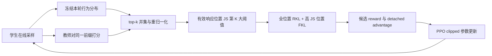
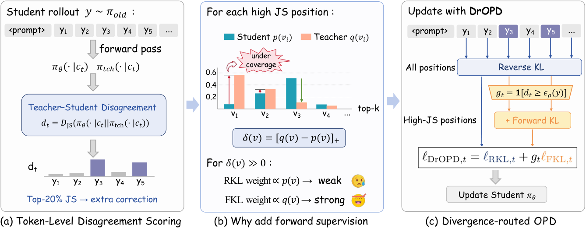

# DrOPD：按师生分歧路由的在线蒸馏

> **L1 算法组件与真实在线更新诊断。** 本地执行候选并集、JS 路由和 PPO 更新；完整论文训练**成本过高，不复现（审查 DONE）**。与 [Dr. OPD（2609.38025）](../2609.38025-dr-opd/README.md) 是不同论文，方法键不复用。

## 论文信息

| 字段 | 内容 |
|---|---|
| 论文链接 | [Divergence-Routed On-Policy Distillation](https://arxiv.org/abs/2610.19572v1) |
| 公司 / 机构 | 第一作者 Tiantian Peng：Peking University；合作单位包括快手、清华大学 |
| 首次公开日期 | 2026-10-14 04:39:35 UTC（arXiv v1） |
| 原作者代码 | 未找到已发布的原作者方法仓库；不把第三方实现或相关工作的仓库当成本文代码 |
| 本地 adapter / 方法键 | `divergence-routed-opd`；独立组件入口，不注册旧版固定候选诊断路由 |
| 本地复现代码 | [`src/auto_research/post_training/divergence_routed_opd.py`](https://github.com/daiwk/auto-research/blob/main/src/auto_research/post_training/divergence_routed_opd.py) |
| 本地复现代码目录 | [`src/auto_research/post_training/`](https://github.com/daiwk/auto-research/tree/main/src/auto_research/post_training) |
| 运行入口 | [`scripts/run_divergence_routed_tiny.py`](https://github.com/daiwk/auto-research/blob/main/scripts/run_divergence_routed_tiny.py) |

## 原始论文总结

### 背景与主要改动

DrOPD 在学生自己生成的轨迹上比较师生分布，以 JS 散度识别教师支持而学生严重欠覆盖的位置。它在所有位置保留 reverse-KL，并仅向高分歧位置增加 forward-KL 的纠正信号，通过候选级优势执行 PPO clipped 更新。

reverse-KL 的 logit 梯度包含学生概率因子，学生几乎不给某个教师 token 概率时，纠正信号会变弱。forward-KL 的梯度为学生与教师概率之差，能继续推动这些教师模式；路由限制额外监督的位置，而不是直接把整个损失换成 forward-KL。



<!-- paper-figure:start -->
### 原论文关键图



> 原论文 Figure 2：师生分歧、教师模式欠覆盖与按位置路由的混合监督。图片来自[原论文](https://arxiv.org/html/2610.19572v1)，版权归原作者所有；不是本地实验结果。
<!-- paper-figure:end -->

### 核心公式

每个位置取师生 top-16 的**去重并集**，并在并集上重归一化为 $p_t,q_t$。按原文附录 B.1，在当前 batch 的 $|B|$ 个有效响应位置计算 $d_t=JS(p_t,q_t)$，先取 $K=\operatorname{round}(0.2|B|)$；$K=0$ 时不增加 FKL，否则以实际第 $K$ 大 JS 分数为阈值，$g_t=\mathbf1[d_t\geq\epsilon_K]$。例如 32 个位置取 $K=6$，不是插值分位数得到的 7 个；单个位置默认 $K=0$。阈值 ties 全部保留，实际路由数可能超过 $K$，但不能使用插值 quantile 或强行打破 ties 取固定个数。

$$
\ell_t=KL(p_t\Vert q_t)+g_t KL(q_t\Vert p_t),\quad
R_t(v)=-p_t(v)\log\frac{p_t(v)}{q_t(v)}+g_tq_t(v).
$$

实际优化不以静态双 KL 代替原文训练：冻结本轮 $A_t(v)=\operatorname{sg}[R_t(v)]$、候选集和行为概率，最小化候选求和的 PPO surrogate：

$$
-\frac1{|B|}\sum_{t\in B}\sum_{v\in C_t}
\min\left[r_t(v)A_t(v),\operatorname{clip}(r_t(v),1-\epsilon,1+\epsilon)A_t(v)\right].
$$

因此没有被 rollout 采到、但属于教师 top-k 的候选也可以收到纠正信号。教师、行为概率、路由门和 advantage 均不接收梯度。

### 论文离线与线上效果

原文在六个数学基准报告 Avg@8：1.7B 学生 / 4B 教师平均从 OPD 的 31.57% 到 33.41%；这不是本地成绩。未报告生产线上 A/B。附录 A.3 的较小模型对 279 步 DrOPD 已记录 11.83 小时，且排除了初始化、保存与离线评测，因此本库不启动完整训练。

## 本地复现

### 可直接执行的低成本路径

微型 byte 自回归模型在固定公开文本上运行：教师先执行有界 next-token 训练后冻结，学生独立随机初始化，真实采样新 token，再执行上述 DrOPD 参数更新。没有预先固定响应候选、没有向模型返回标准答案；256 byte 词表只是缩小 backbone。

```bash
PYTHONPATH=src python scripts/run_divergence_routed_tiny.py \
  --corpus-path /path/to/public-domain-text.txt \
  --corpus-id PUBLIC_CORPUS_ID --corpus-revision FIXED_REVISION \
  --device cuda --seeds 42,43,44 --teacher-steps 16 \
  --steps 2 --max-tokens 16 --output runs/dropd-component.json
```

入口不下载资源，最多 2 MB 文本、64 次教师预热、20 次在线更新和 32 个生成 token。原始文本前 90% 用于训练，末 10% 的不相交 byte 区间只计算最终 NLL，不用于路由或训练选择。产物记录内容 hash、固定版本、区间、实际生成量、冻结教师参数变化、学生参数变化和逐步统计。

### 结果与验收

实际 CUDA 执行以[脱敏 GPU 回执](../../gpu-validations/divergence-routed-opd-a100-20261016.json)和[组件指标](metrics/component-seeds42-44.json)为准。这些只证明 L1 在线算法、梯度与设备路径真实执行，不证明数学推理能力、稳定提升或预训练 checkpoint 的兼容性。三个 seed 不能提升这一证据等级。

### 代码映射与边界

| 代码 | 保留的机制 |
|---|---|
| `prepare_routing` | 师生候选去重、top-k 归一化、有效位置第 K 大 JS 门及 K=0 |
| `candidate_rewards` | 未采样候选的 FKL 信号、严格 detach |
| `routed_ppo_loss` | 固定行为分布与 PPO 裁剪、逐位置 KL 诊断 |
| `run_divergence_routed_tiny.py` | 真实自回归采样、参数更新、冻结教师与隔离 NLL |

本轮只提供上述已验收的微型自回归入口，**不提供未经真实权重端到端验收的 Hugging Face checkpoint runner**。完整 1.7B/4B、4B/8B 长 rollout 和六基准实验均不复现，不进入 evolve 能力排名。
