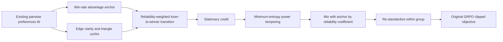
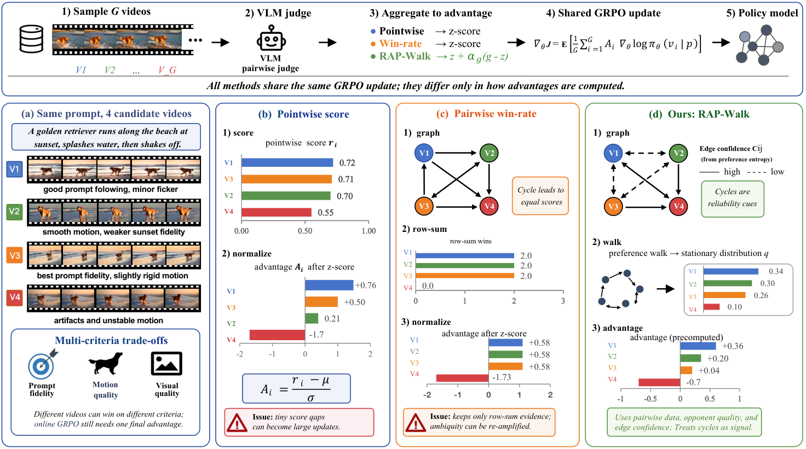

# RAP-Walk: Correcting GRPO Advantages with a Reliable Preference Graph

<!-- source-sha256: 3b5ef835fdf8a8b4014d8116e6c0a33633f0d6c7eb81f627c469bc4799624121 -->

[简体中文](README.md) · English

> **L1 graph operator and policy-update interface.** Default small graphs are explicitly mechanism diagnostics. No video was generated and no video judge was called. Full Wan training and large VLM evaluation exceed the cost budget and were not reproduced (review complete).

## Paper information

| Field | Details |
| --- | --- |
| Paper | [When Pairwise Preferences Cycle](https://arxiv.org/abs/2610.20089v1) |
| Affiliation | First author Xinrui Lin; the inspected arXiv HTML did not list affiliations. Not confirmed; not inferred from the name. |
| First public release | 2026-10-14 12:30:39 UTC (arXiv v1) |
| Authors' code | No released author method repository was found. |
| Local adapter / method key | `rap-walk`; standalone graph aggregation and GRPO loss interface |
| Local implementation | [`src/auto_research/post_training/rap_walk.py`](https://github.com/daiwk/auto-research/blob/main/src/auto_research/post_training/rap_walk.py) |
| Local implementation directory | [`src/auto_research/post_training/`](https://github.com/daiwk/auto-research/tree/main/src/auto_research/post_training) |
| Runner | [`scripts/run_rap_walk.py`](https://github.com/daiwk/auto-research/blob/main/scripts/run_rap_walk.py) |

## Original paper summary

### Background and main changes

Instead of reducing pairwise video preferences to independent win rates, RAP-Walk retains opponent identity, cycles, and edge clarity. A reliability-weighted random walk from losers to winners yields stationary preference credit. After calibration with a minimum entropy, that credit adjusts original win-rate advantages before the same GRPO update.

A preference cycle does not necessarily mean low video quality. Different videos may excel at prompt adherence, visual quality, or motion. The method treats local inconsistency as a signal about propagation reliability, not a reason to delete cycles or assign them directly as negative rewards.



<!-- paper-figure:start -->
### Key figure from the paper



> Figure 1 compares pointwise, win-rate, and RAP-Walk advantage construction under the same video GRPO workflow. The figure comes from the [original paper](https://arxiv.org/html/2610.20089v1), © the original authors. Its videos are not local generations.
<!-- paper-figure:end -->

### Core equations

$W_{ij}$ is the probability that $i$ beats $j$, with $W_{ij}+W_{ji}=1$. Edge clarity is $c_{ij}=1-H_b(W_{ij})/\log2$. Mean absolute triangle log-odds sums form node cycle inconsistency $L_i$. After within-group standardization:

$$
r_{ij}=e^{-L_j}(c_{ij}+\epsilon)^{1/4},\qquad
T_{ij}\propto W_{ji}e^{A_j}r_{ij},\quad T_{ii}=0.
$$

Use $W_{ji}$; the direction is not winner-to-loser. Initialize uniformly and iterate $\pi\leftarrow\pi T$. Failure to converge is reported as an error, without undeclared teleportation or a PageRank fallback.

Calibrate stationary credit by $q_i\propto\pi_i^a$ using the largest $a\in[0,1]$ that meets the minimum normalized entropy. Set $g_i=Gq_i-1$ and derive a bounded coefficient $\alpha_g$ from group edge clarity:

$$
\widetilde A_i=(1-\alpha_g)A_i+\alpha_g g_i.
$$

Re-standardize within the group after mixing and before tokenwise GRPO clipping. The optional frozen-reference KL term remains separate. Preference inputs, the random walk, and advantages receive no policy gradients.

### Reported offline and online results

The authors audit 6,976 on-policy comparison graphs and compare video quality with matched judges, pairwise comparison counts, and training budgets. They report cross-generator results, VBench, and blinded human evaluation. No production online A/B test was reported. These are not local results.

The original configuration includes Wan2.1 1.3B/14B and Wan2.2 5B, frozen Qwen3-VL 30B/235B judges, 200 steps, 12 videos of 41 frames per group, and 480p/720p. Full generation and judging alone exceed the usual low-cost single-A100/A30 budget. No full training, smaller fake videos, or rule-judge substitute.

## Local reproduction

### Execution and data contract

```bash
PYTHONPATH=src python scripts/run_rap_walk.py \
  --device cpu --seeds 42,43,44 --output runs/rap-walk-mechanism.json
```

With no input, artifacts are labeled `explicit_mechanism_fixtures` and only verify graph direction, cycles, calibration, and a differentiable GRPO update interface. Pass `--input-path observed-graphs.json` to supply previously observed judge probabilities:

```json
[{"id":"recorded-group-id","pairwise":[[0.5,0.8,0.9],[0.2,0.5,0.8],[0.1,0.2,0.5]]}]
```

This JSON illustrates the format, not real video judgments from the paper. Input mode supports at most 64 graphs and 32 rollouts per graph. It does not use the network, generate video, or fabricate real win rates. The caller must isolate raw data and judge artifacts for training, validation, and test.

### Results and acceptance

See [component metrics](metrics/component-seeds42-44.json) and the [sanitized receipt](../../gpu-validations/rap-walk-a100-20261016.json) for actual CUDA backward execution. The default diagnostic contains no videos or capability findings. Three seeds cover only independent tiny-policy initialization; they do not turn fixed graphs into a formal capability comparison.

### Code mapping and limits

| Code | Mechanism retained |
| --- | --- |
| `rap_walk_advantages` | Clarity, triangle cycles, directed reliability transitions, stationary credit, mixing, and re-standardization |
| `power_temper` | Largest exponent satisfying the entropy floor, not a fixed temperature |
| `rap_walk_grpo_loss` | Detached graph advantages, actual clipping, and optional frozen KL |
| `run_rap_walk.py` | Explicit graph provenance and actual differentiable policy-parameter update diagnostic |

Large judges, video rollouts, video diffusion log-likelihood, Wan LoRA training, and the paper's blinded evaluation were not reproduced. This is a component and interface, not an executable video Evolve operator or evidence of improved video quality.
