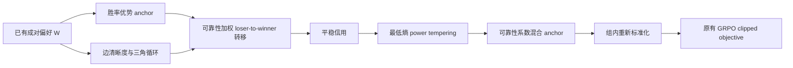
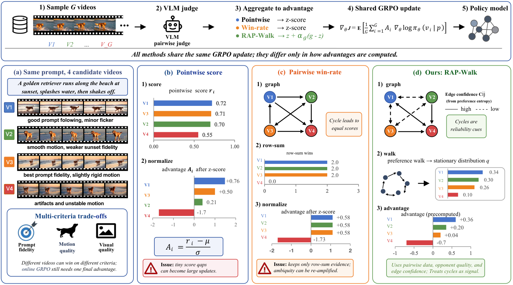

# RAP-Walk：用可靠偏好图修正 GRPO 优势

> **L1 图算子与策略更新接口。** 默认小图是显式机制诊断，未生成视频、未调用视频评审模型。完整 Wan 训练与大型 VLM 评估**成本过高，不复现（审查 DONE）**。

## 论文信息

| 字段 | 内容 |
|---|---|
| 论文链接 | [When Pairwise Preferences Cycle](https://arxiv.org/abs/2610.20089v1) |
| 公司 / 机构 | 第一作者 Xinrui Lin；已读 arXiv HTML 未列机构，当前未确认，不依据姓名猜测 |
| 首次公开日期 | 2026-10-14 12:30:39 UTC（arXiv v1） |
| 原作者代码 | 未找到已发布的原作者方法代码仓库 |
| 本地 adapter / 方法键 | `rap-walk`；独立图聚合与 GRPO loss 接口 |
| 本地复现代码 | [`src/auto_research/post_training/rap_walk.py`](https://github.com/daiwk/auto-research/blob/main/src/auto_research/post_training/rap_walk.py) |
| 本地复现代码目录 | [`src/auto_research/post_training/`](https://github.com/daiwk/auto-research/tree/main/src/auto_research/post_training) |
| 运行入口 | [`scripts/run_rap_walk.py`](https://github.com/daiwk/auto-research/blob/main/scripts/run_rap_walk.py) |

## 原始论文总结

### 背景与主要改动

RAP-Walk 不把成对视频偏好压成相互独立的胜率，而保留对手身份、循环关系和边清晰度。它在从输者到赢家的可靠随机游走中计算平稳偏好信用，经最低熵校准后修正原始胜率优势，最后仍交给同一 GRPO 更新。

偏好循环并不自动表示视频质量差；可能是不同视频各擅长提示遵循、画面或运动。该方法把局部不一致当作传播可靠性线索，而不是删除循环或把循环直接写成负奖励。



<!-- paper-figure:start -->
### 原论文关键图



> 原论文 Figure 1：共享视频 GRPO 流程下，pointwise、win-rate 与 RAP-Walk 的优势构造区别。图片来自[原论文](https://arxiv.org/html/2610.20089v1)，版权归原作者所有；图中的视频不是本地生成结果。
<!-- paper-figure:end -->

### 核心公式

输入 $W_{ij}$ 表示 $i$ 战胜 $j$ 的概率，需满足 $W_{ij}+W_{ji}=1$。边清晰度 $c_{ij}=1-H_b(W_{ij})/\log2$；三角 log-odds 和的绝对值均值构成节点循环不一致 $L_i$，经组内标准化后形成：

$$
r_{ij}=e^{-L_j}(c_{ij}+\epsilon)^{1/4},\qquad
T_{ij}\propto W_{ji}e^{A_j}r_{ij},\quad T_{ii}=0.
$$

注意方向是 $W_{ji}$，不是把“赢家向输家”倒置。用均匀初值迭代 $\pi\leftarrow\pi T$；不收敛则明确报错，不用未声明的 teleportation 或 PageRank 替代。

将平稳信用以 $q_i\propto\pi_i^a$ 校准，选择满足最低归一化熵的最大 $a\in[0,1]$。随后 $g_i=Gq_i-1$，以组边清晰度得到有界系数 $\alpha_g$：

$$
\widetilde A_i=(1-\alpha_g)A_i+\alpha_g g_i.
$$

混合后必须再按组标准化，再用于逐 token GRPO clipping；可选冻结 reference 的 KL 项保持独立。偏好输入、随机游走和优势不接收策略梯度。

### 论文离线与线上效果

原文审计 6,976 张 on-policy 比较图，采用匹配评审器、成对比较次数和训练预算比较视频质量，并报告跨生成器、VBench 与盲人评。未报告生产线上 A/B；本库不把这些原文结果复制成本地效果。

原配置涉及 Wan2.1 1.3B/14B、Wan2.2 5B，冻结 Qwen3-VL 30B/235B 评审器，200 步、每组 12 个 41 帧视频、480p/720p；仅完整生成与评审就超出单 A100/A30 的默认低成本预算。因此完整训练不运行，也不通过更小假视频或规则评审冒充。

## 本地复现

### 运行方式与数据合同

```bash
PYTHONPATH=src python scripts/run_rap_walk.py \
  --device cpu --seeds 42,43,44 --output runs/rap-walk-mechanism.json
```

不提供输入时，产物明确标为 `explicit_mechanism_fixtures`，只验证图方向、循环、校准和可微 GRPO 更新接口。可通过 `--input-path observed-graphs.json` 提供已有真实评审概率：

```json
[{"id":"recorded-group-id","pairwise":[[0.5,0.8,0.9],[0.2,0.5,0.8],[0.1,0.2,0.5]]}]
```

以上 JSON 也只是格式示例，不是论文真实视频评审结果。输入模式最多 64 张图、每图 32 个 rollout；本入口不联网、不生成视频、不合成所谓真实胜率。调用方负责隔离训练、验证和 test 的原始数据及评审产物。

### 结果与验收

组件统计见[指标产物](metrics/component-seeds42-44.json)，CUDA backward 接口的实际执行见[脱敏回执](../../gpu-validations/rap-walk-a100-20261016.json)。默认诊断不含视频或能力结论；三个随机 seed 只覆盖微型策略的独立初始化，不把固定图变成正式能力比较。

### 代码映射与边界

| 代码 | 保留的机制 |
|---|---|
| `rap_walk_advantages` | clarity、三角循环、定向可靠转移、平稳信用及混合再标准化 |
| `power_temper` | 满足最低熵的最大幂指数，而非固定温度 |
| `rap_walk_grpo_loss` | detached 图优势、实际 clipping 与可选冻结 KL |
| `run_rap_walk.py` | 显式图来源和真实可微策略参数更新诊断 |

未复现大型评审器、视频 rollout、视频扩散 log-likelihood、Wan LoRA 训练与论文盲评。当前是组件与接口，不作为可执行的视频 evolve 算子，不宣称视频效果提升。
