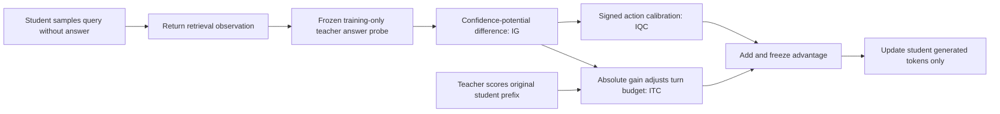
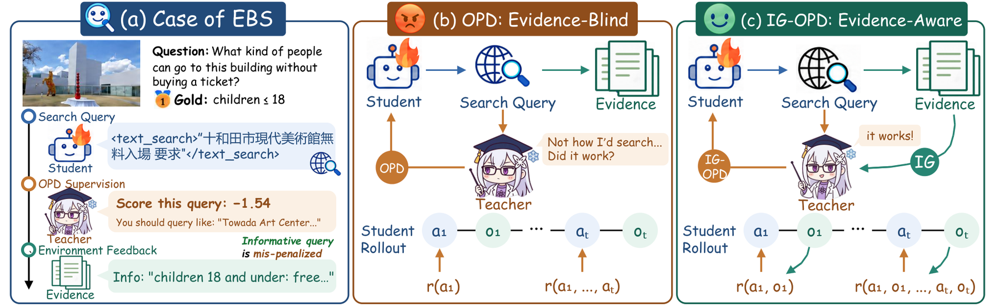

# IG-OPD: Calibrating Distillation by the Information Gain of Retrieval Results

<!-- source-sha256: 5a0818723ce63ffa8827b2bd3557b7499c89603ce99306f8fd3e9dd863b27fa0 -->

[简体中文](README.md) · English

> **L1 algorithm component and gradient diagnostic, not a reproduction of a multimodal search agent.** The full experiments exceed the cost budget and were not reproduced (review complete). Not eligible for Evolve promotion.

## Paper information

| Field | Details |
| --- | --- |
| Paper | [arXiv 2610.20664](https://arxiv.org/abs/2610.20664); [pinned v1 full text](https://arxiv.org/html/2610.20664v1); [PDF](https://arxiv.org/pdf/2610.20664v1) |
| Affiliations | First author Chenxi Li, The Chinese University of Hong Kong, Shenzhen, confirmed from superscripts on the PDF title page. Collaborators include Renmin University of China, Beijing University of Posts and Telecommunications, and BAAI. Do not inherit the misaligned author affiliations in the HTML. |
| First public release | 2026-10-14T08:39:52Z (UTC, arXiv v1) |
| Authors' code | No official IG-OPD method repository was found in the paper or author searches. Framework dependencies do not establish an open-source release of the method. |
| License | Method-code license unconfirmed because the code was not found. |
| Local adapter / method key | `ig-opd`; `adapter: null`, standalone component |
| Local implementation | [`src/auto_research/post_training/reviewed_oct18.py`](https://github.com/daiwk/auto-research/blob/main/src/auto_research/post_training/reviewed_oct18.py): `information_gains` and `ig_calibrated_advantages` |
| Runner | [`scripts/run_oct18_post_components.py`](https://github.com/daiwk/auto-research/blob/main/scripts/run_oct18_post_components.py) |

## Original paper summary

### Background and main changes

Ordinary OPD scores a query by teacher preference before retrieval, without knowing whether the results will help. Allocating budget by token count can also let a long final answer overwhelm a short but crucial search call. IG-OPD corrects both using changes in answer confidence after retrieval. ITC reallocates turn budget; IQC uses signed gain to correct credit direction for action-critical tokens. References are only for a **training-only frozen teacher probe** and never enter student sampling context. [§4](https://arxiv.org/html/2610.20664v1#S4)



Figure 1 shows a query that the teacher disfavors but which retrieves evidence. Figure 2 analyzes the mismatch between supervision budget and information gain. See the [method diagrams](https://arxiv.org/html/2610.20664v1#S4).

<!-- paper-figure:start -->
### Key figure from the paper

[](https://arxiv.org/html/2610.20664v1/fig_motivation.png)

> **Figure 1 from the paper:** Overall method design and key components. The figure comes from the [original paper](https://arxiv.org/abs/2610.20664), © the original authors. Select the image to see the source.
<!-- paper-figure:end -->

### Core equations

For mean answer-token log-probability $\bar\ell_t$, the stabilized potential and information gain are

$$
\Phi_t=\log(e^{\bar\ell_t}+10^{-3}),\quad g_t=\Phi_t-\Phi_{t-1},\quad
q_t=\frac{1+\lambda\tanh(|g_t|/\sigma_g)}{\sum_j[1+\lambda\tanh(|g_j|/\sigma_g)]}.
$$

$\sigma_g$ is the batch RMS. The final synthesis answer explicitly has zero gain but still receives a base distillation budget. Let a trajectory have $N$ generated tokens, turn $t$ have $n_t$ tokens, and $m_t$ be the action-critical subset size:

$$
A_{t,i}=\frac{Nq_t}{n_t}\operatorname{sg}[\log p_T(u_{t,i})-\log p_S(u_{t,i})]
+\mathbf1_{i\in M_t}\frac{\alpha_k g_t}{m_t},\quad
\alpha_k=\frac{\alpha_{max}}2[1-\cos(\pi\min(k/K,1))].
$$

IQC is **outside** the ITC factor, with total action credit exactly $\alpha_k g_t$. Formatting, prompt, and observation tokens receive no IQC share. Training uses a clipped policy surrogate with frozen advantages. $\lambda=0$ yields equal turn budgets, not equal token budgets.

### Reported offline and online results

Across six multimodal search benchmarks, mean accuracy rose from 46.0 with ordinary OPD to 49.4 for the 2B student, and from 53.3 to 55.0 for the 4B student. The paper's retrieval stack, 8B teacher, and judge are not part of the local diagnostic. No online A/B test was reported. [Table 1](https://arxiv.org/html/2610.20664v1#S5)

## Local reproduction

### Data protocol and execution

A random 32-token-vocabulary policy actually samples three turns, two tokens each, and receives an external artificial observation after each of the first two turns. The frozen teacher scores a training-only reference token in the initial and post-observation contexts to compute actual potential differences. The student sees only the prompt, sampled response, and observations, not the reference. This checks information-calibration algebra, not web-search quality.

```bash
PYTHONPATH=src python scripts/run_oct18_post_components.py \
  --methods ig-opd --device cpu --seeds 42,43,44 \
  --output runs/ig-opd-component.json
```

Set `--device cuda` for CUDA; no fallback if unavailable. Each seed defaults to 3 updates and is capped at 8. Immutable outputs retain the commit, source SHA256, device, and per-seed metrics.

### Results, code mapping, and limits

On 2026-10-18, a real NVIDIA A100 completed seeds 42/43/44, 3 updates per seed. All three passed component acceptance: [receipt](../../gpu-validations/ig-opd-a100-20261018.json), [per-seed results](metrics/component-cuda-seeds42-44.json). Mean $L_2$ student-parameter change was 0.032245, with nonzero gradients and updates for each seed. Maximum advantage error against an independent reference was about $4.44\times10^{-16}$, and maximum stabilized-potential telescoping error was about $8.88\times10^{-16}$. Macro-action IQC credit, zero credit for formatting tokens, and the zero-advantage control with no gain and identical teachers all matched exactly. Frozen-teacher parameter change was 0. The training reference did not enter student context. No local search accuracy or paper-gain claim is made.

**Full experiments not reproduced:** The paper uses 2B/4B students, an 8B teacher, eight-GPU FSDP, prompts up to 20K and generations up to 70K, 20 turns, and real search/vision tools. Full training is beyond the single-GPU budget. These runs were not started and their large resources were not downloaded. Standalone fixed algorithm diagnostic only, not promotable or integrated into Evolve.
