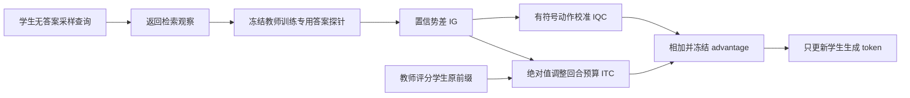
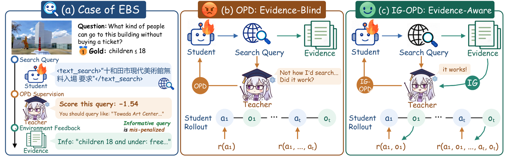

# IG-OPD：按检索结果的信息增益校准蒸馏

> **L1 算法组件／梯度诊断，不是多模态搜索 Agent 复现。** 完整实验成本过高，不复现（审查 DONE）；不进入 evolve 晋级。

## 论文信息

| 字段 | 内容 |
|---|---|
| 论文链接 | [arXiv 2610.20664](https://arxiv.org/abs/2610.20664)；[固定 v1 全文](https://arxiv.org/html/2610.20664v1)；[PDF](https://arxiv.org/pdf/2610.20664v1) |
| 公司 / 机构 | 一作 Chenxi Li 属 The Chinese University of Hong Kong, Shenzhen；已核对 PDF 首页上标。合作机构包括人大、北邮、BAAI；不能沿用 HTML 作者机构错位 |
| 首次公开日期 | 2026-10-14T08:39:52Z（UTC，arXiv v1） |
| 原作者代码 | 未在论文或作者检索结果中找到 IG-OPD 官方方法仓库；依赖框架不等于方法已开源 |
| 代码许可 | 未找到方法代码，许可未确认 |
| 本地 adapter / 方法键 | `ig-opd`；`adapter: null`，独立组件 |
| 本地代码位置 | [`src/auto_research/post_training/reviewed_oct18.py`](https://github.com/daiwk/auto-research/blob/main/src/auto_research/post_training/reviewed_oct18.py)：`information_gains`、`ig_calibrated_advantages` |
| 运行入口 | [`scripts/run_oct18_post_components.py`](https://github.com/daiwk/auto-research/blob/main/scripts/run_oct18_post_components.py) |

## 原始论文总结

### 背景与主要改动

普通 OPD 在检索前按教师偏好评分 query，却不知道检索结果是否有用；又按 token 数量分配预算，容易让很长的最终回答压过短而关键的搜索调用。IG-OPD 用检索后的答案置信变化校正两点：ITC 重新分配回合预算，IQC 用有符号增益修正动作关键 token 的方向。参考答案只供**训练专用冻结教师探针**使用，不进入学生采样上下文。[原文 §4](https://arxiv.org/html/2610.20664v1#S4)



原文 Figure 1 展示“教师不喜欢但能找到证据”的查询；Figure 2 分析 supervision budget 与信息增益失配。见[原文方法图](https://arxiv.org/html/2610.20664v1#S4)。

<!-- paper-figure:start -->
### 原论文关键图

[](https://arxiv.org/html/2610.20664v1/fig_motivation.png)

> **原论文 Figure 1（关键图）**：展示原论文方法的总体设计和关键组成。图片来自[原论文](https://arxiv.org/abs/2610.20664)，版权归原作者所有；点击图片可查看来源。
<!-- paper-figure:end -->

### 核心公式

答案 token 平均 log-prob 为 $\bar\ell_t$，稳定势与信息增益为

$$
\Phi_t=\log(e^{\bar\ell_t}+10^{-3}),\quad g_t=\Phi_t-\Phi_{t-1},\quad
q_t=\frac{1+\lambda\tanh(|g_t|/\sigma_g)}{\sum_j[1+\lambda\tanh(|g_j|/\sigma_g)]}.
$$

$\sigma_g$ 是 batch RMS；最终综合回答的增益显式为0，但仍有基础蒸馏预算。令一条轨迹有 $N$ 个生成 token、第 $t$ 回合有 $n_t$ 个，其中 $m_t$ 个为动作关键 token：

$$
A_{t,i}=\frac{Nq_t}{n_t}\operatorname{sg}[\log p_T(u_{t,i})-\log p_S(u_{t,i})]
+\mathbf1_{i\in M_t}\frac{\alpha_k g_t}{m_t},\quad
\alpha_k=\frac{\alpha_{max}}2[1-\cos(\pi\min(k/K,1))].
$$

IQC 在 ITC 因子**外部**，总动作信用恰为 $\alpha_k g_t$；格式、提示和观察 token 不分摊 IQC。训练采用冻结优势的 clipped policy surrogate；$\lambda=0$ 对应等回合而非等 token 预算。

### 论文离线与线上效果

六个多模态搜索 benchmark 的平均准确率中，2B学生从普通 OPD 的46.0到49.4，4B从53.3到55.0。论文中的检索栈、8B教师和 judge 均不在本地诊断中。未报告线上 A/B。[原文表1](https://arxiv.org/html/2610.20664v1#S5)

## 本地复现

### 数据协议与运行

随机32词表策略真实采样三个回合，每回合2个 token，前两回合之后加入外部人工观察。冻结教师在初始与观察后上下文分别评分一个训练专用 reference token，真正计算势差；学生只能读提示、已采样响应和观察，不读 reference。这里只验证信息校准代数，不模拟真实 web search 的质量。

```bash
PYTHONPATH=src python scripts/run_oct18_post_components.py \
  --methods ig-opd --device cpu --seeds 42,43,44 \
  --output runs/ig-opd-component.json
```

CUDA 改为 `--device cuda`，不可用时不回退。每种子默认3次、最多8次更新；不可变输出保留 commit、源码 SHA256、设备和逐 seed 指标。

### 结果、代码映射与边界

2026-10-18 已在真实 NVIDIA A100 上完成 seeds 42/43/44，各3次更新，三种子组件验收通过：[回执](../../gpu-validations/ig-opd-a100-20261018.json)、[逐 seed 结果](metrics/component-cuda-seeds42-44.json)。学生参数变化 $L_2$ 均值0.032245，各 seed 均有非零梯度及参数更新；advantage 独立参考最大误差约 $4.44\times10^{-16}$，稳定势 telescoping 最大误差约 $8.88\times10^{-16}$。IQC 宏动作信用、格式 token 零信用、无增益且相同教师的零优势负对照均精确符合预期，冻结教师参数变化为0。训练参考答案未进入学生上下文。没有本地搜索准确率或论文增益声明。

**完整实验不复现：** 原文2B/4B学生、8B教师、8卡FSDP、最高20K提示/70K生成、20回合以及真实搜索/视觉工具栈，完整训练明显超出现有单卡预算。未启动这些实验，不下载其大资源。仅算法组件，固定诊断、不可晋级、未接 evolve。
