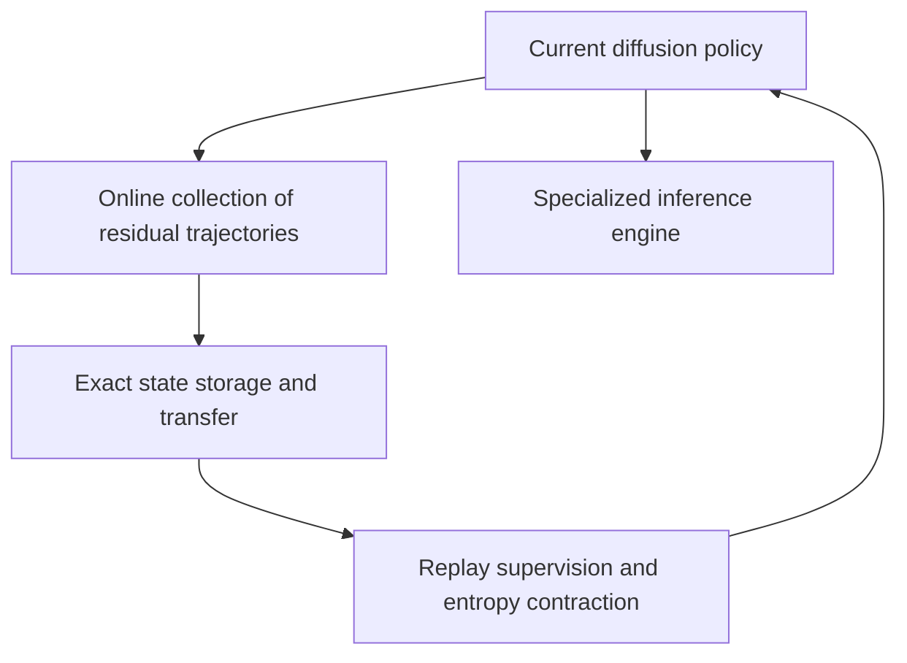
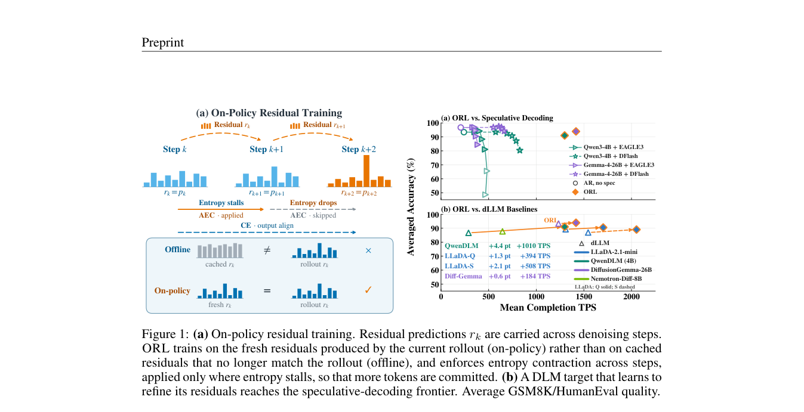

# On-Policy Residual Learning for Diffusion Language Models

<!-- source-sha256: 61fd35c2b6c66949846328e6ea75437083da79c96dae789e9f1594ce96d22df7 -->

[简体中文](README.md) · English

> Research reference only. **The experiments exceed the cost budget and were not reproduced (review complete).** No local capability metrics, training results, or executable Evolve operator.

## Paper information

| Field | Details |
| --- | --- |
| Paper | [arXiv 2610.20687](https://arxiv.org/abs/2610.20687); [pinned v1 full text](https://arxiv.org/html/2610.20687v1) |
| Affiliations | Together AI / University of Illinois Urbana-Champaign; first author Yifan Yu |
| First public release | 2026-10-14 17:13:17 UTC (arXiv v1; announced October 16) |
| Authors' code | [Public author/upstream code](https://github.com/Introspective-Diffusion/ORL). The authors released ORL code, but system kernels and full experiments still require the corresponding accelerator, model, and training budget. |
| Local adapter / stable key | `orl-diffusion` (reference key, no executable adapter) |
| Local implementation | No algorithm implementation; only this write-up and [catalog metadata](https://github.com/daiwk/auto-research/blob/main/src/auto_research/paper_specs/catalog/post-training/orl-diffusion.json). |
| Acceptance status | Full experiments not reproduced, review complete; does not block other papers or enter an automatic retry queue. |

## Original paper summary

### Background and main changes

Using a previous prediction distribution as residual context is not simple postprocessing. Training must see residual trajectories induced by the model itself. ORL combines online collection, state transfer, exact replay, and entropy contraction to narrow the residual-state distribution gap between training and inference.

### Architecture and data flow

<!-- paper-figure:start -->
### Key figure from the paper

> **Figure 1 from the paper:** Training pipeline and key optimization stages. The figure comes from the [original paper](https://arxiv.org/abs/2610.20687), © the original authors. Select the image to see the source.
<!-- paper-figure:end -->

### Core equations

This is shorthand for the paper's mechanism, not a local run result. See the [pinned v1 paper](https://arxiv.org/html/2610.20687v1) for full definitions and training details.

$$
r_{t+1}=\mathcal R(p_\theta(\cdot\mid x_t,r_t)),\qquad\mathcal L=\mathcal L_{\mathrm{replay}}+\lambda\mathcal L_{\mathrm{entropy\ contraction}}.
$$

### Reported offline and online results

For a diffusion LM converted from Qwen3-4B, the authors report up to 6.2× tokens per forward and about 6.9× throughput. LLaDA transfer used 36 H100-hours. Speeds measured with other precisions, engines, or hardware cannot be transferred directly to an A100.

No randomized online A/B test on production user traffic was reported. System measurements, robot tasks, and language-model benchmarks are not online recommendation/search/advertising A/B tests.

## Local reproduction

This round records only the method, resource needs, public-code status, and original figure. It did not run the full experiments, download checkpoints, or create simulated capability scores.

### Cost decision

Training a 4B diffusion model requires 36–60 H100-hours. The paper also has B200/NVFP4 and multi-GPU inference experiments. One A100 or A30 is not equivalent to that setup. The judgment comes from the paper's configuration, not a locally measured estimate. Available resources are one A100 or A30, or a Mac; no multi-GPU access or simultaneous use of both GPU hosts is assumed.

**The full experiments were not reproduced (review complete).** Static logits and reduced numeric fixtures do not stand in for online residual training or the specialized inference engine's gains. No automatic retry.

## Reproduction limits

No local adapter, metric file, or GPU receipt, and no executable Evolve operator. The paper's results are reading material only. See the [implementation and review contract (Chinese)](../../research-audits/oct18-components/README.md).
