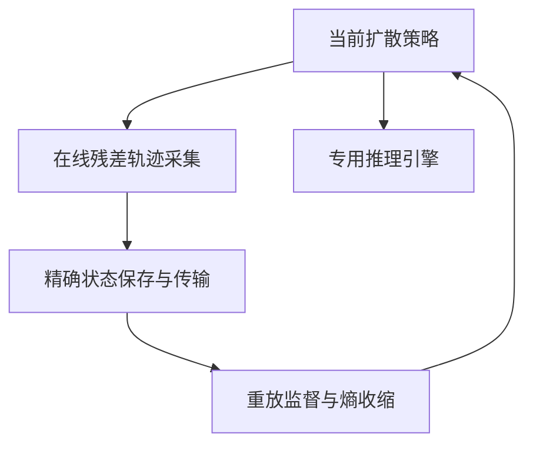
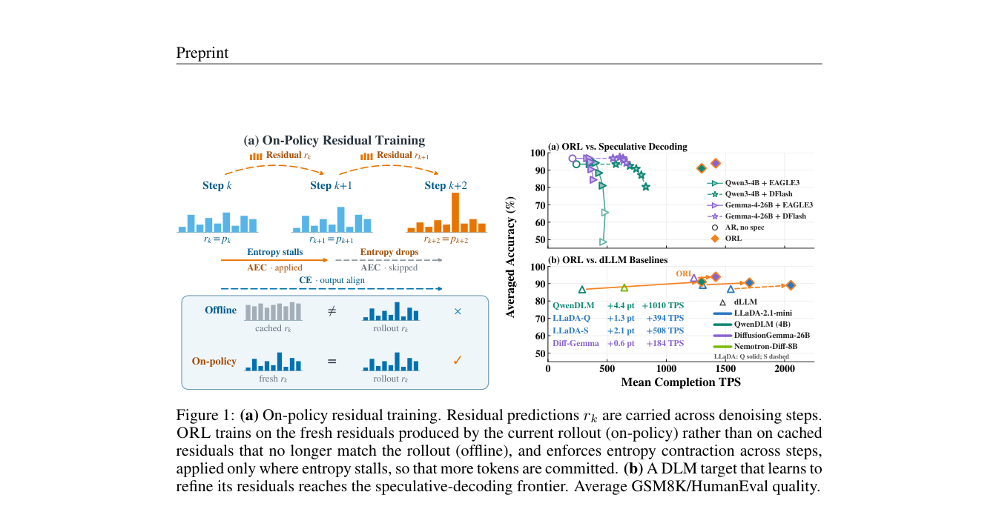

# On-Policy Residual Learning for Diffusion Language Models

> 仅研究资料；**成本过高，不复现（审查 DONE）**。无本地能力指标、训练结果或可执行 Evolve 算子。

## 论文信息

| 字段 | 内容 |
| --- | --- |
| 论文链接 | [arXiv 2610.20687](https://arxiv.org/abs/2610.20687)；[固定v1全文](https://arxiv.org/html/2610.20687v1) |
| 公司 / 机构 | Together AI / University of Illinois Urbana-Champaign；一作 Yifan Yu |
| 首次公开日期 | 2026-10-14 17:13:17 UTC（arXiv v1；10月16日公告） |
| 原作者代码 | [作者/上游公开代码](https://github.com/Introspective-Diffusion/ORL)；已发布作者ORL代码；系统内核和完整实验仍需对应加速器、模型与训练预算 |
| 本地 adapter / 稳定键 | `orl-diffusion`（资料键，无可执行 adapter） |
| 本地复现代码 | 无算法实现；仅本文及 [catalog元数据](https://github.com/daiwk/auto-research/blob/main/src/auto_research/paper_specs/catalog/post-training/orl-diffusion.json) |
| 验收状态 | 完整实验不复现 / 审查 DONE；不阻塞其他论文，不进入自动重试队列 |

## 原始论文总结

### 背景与主要改动

将上一步预测分布作为残差上下文不是简单后处理：训练时必须看到模型自己诱导的残差轨迹。ORL联合在线采集、状态传输、精确重放及熵收缩，减少训练与推理残差状态分布差异。

### 架构与数据流

<!-- paper-figure:start -->
### 原论文关键图

> **原论文 Figure 1（关键图）**：展示原论文的训练流程与关键优化环节。图片来自[原论文](https://arxiv.org/abs/2610.20687)，版权归原作者所有；点击图片可查看来源。
<!-- paper-figure:end -->

### 核心公式

以下为原文机制的简写阅读记号，不是本地执行结果；完整定义和训练细节见[固定v1原文](https://arxiv.org/html/2610.20687v1)。

$$
r_{t+1}=\mathcal R(p_\theta(\cdot\mid x_t,r_t)),\qquad\mathcal L=\mathcal L_{\mathrm{replay}}+\lambda\mathcal L_{\mathrm{entropy\ contraction}}.
$$

### 论文离线与线上效果

作者在从Qwen3-4B转换的DLM上报告最高6.2倍tokens-per-forward和约6.9倍吞吐；LLaDA迁移使用36 H100-hours。不同精度、推理引擎与硬件下的速度不能直接移植到A100。

生产用户流量随机线上A/B：未报告。系统测量、机器人任务和语言模型benchmark不等同于搜广推用户A/B。

## 本地复现

本轮只完成方法、资源需求、公开代码状态及原图收录，没有运行完整实验、下载checkpoint或制造模拟能力分数。

### 成本判断

4B扩散模型训练包含36–60 H100-hours；论文另有B200/NVFP4及多卡推理实验，单卡A100/A30并不等同该配置。依据来自原文的实验配置，不是本机实测估算。可用资源为单张A100或A30、或本地Mac，不假设多卡或同时使用两台GPU机器。

结论：**成本过高，不复现（审查 DONE）**。不以静态logits或缩小的数值fixture冒充在线残差训练与专用推理引擎收益；不会自动重试。

## 复现边界

无本地adapter、指标文件或GPU回执，也不登记可执行Evolve算子。原论文结果仅作为阅读资料。范围见[本轮实现与审查合同](../../research-audits/oct18-components/README.md)。
