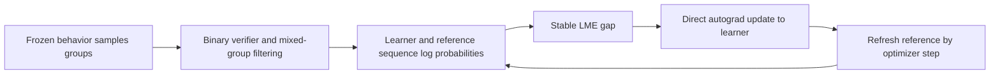
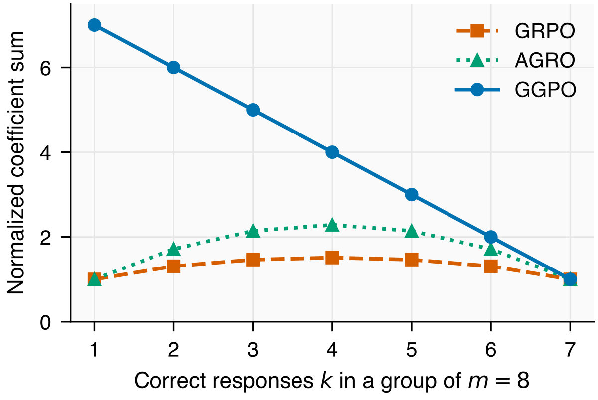

# GGPO: A Stable Gibbs Gap for KL-Adjusted Rewards

<!-- source-sha256: a20bc077e04ebbb84b3bfb2d067ff0860a24fa8eca212df4bf889710953f06c4 -->

[简体中文](README.md) · English

> **L1 objective/refresh component and small-policy update diagnostic.** Full multi-GPU training exceeds the cost budget and was not reproduced (review complete). A rule-based verifier is not evidence of mathematical capability.

## Paper information

| Field | Details |
| --- | --- |
| Paper | [arXiv 2610.20814](https://arxiv.org/abs/2610.20814); [pinned v1 full text](https://arxiv.org/html/2610.20814v1) |
| Affiliation | University of Illinois Urbana-Champaign; Xuanchang Zhang and Tong Zhang |
| First public release | 2026-10-14T18:59:29Z (UTC, arXiv v1) |
| Authors' code | [thunderous77/GGPO](https://github.com/thunderous77/GGPO), public under Apache-2.0. The local component independently implements the equations and does not vendor upstream training code. |
| Local adapter / method key | `ggpo`; `adapter: null` |
| Local implementation | [`ggpo.py`](https://github.com/daiwk/auto-research/blob/main/src/auto_research/post_training/ggpo.py) |
| Local implementation directory | [`src/auto_research/post_training/`](https://github.com/daiwk/auto-research/tree/main/src/auto_research/post_training) |
| Runner | [`run_oct16_post_components.py`](https://github.com/daiwk/auto-research/blob/main/scripts/run_oct16_post_components.py) |

## Original paper summary

### Background and main changes

The behavior policy generates samples; the reference policy is the KL anchor. These roles are distinct. If all within-group adjusted rewards are equal, the policy meets the Gibbs target for that reference. GGPO measures deviation by the difference between log-mean-exp and the arithmetic mean. It does not multiply updates by learner/behavior importance weights and periodically refreshes the reference to change subsequent targets.



<!-- paper-figure:start -->
### Key figure from the paper



> Figure 6 compares analytic coefficients. The figure comes from the [original paper](https://arxiv.org/html/2610.20814v1), © the original authors. The original `figD_group_weight.svg` was rasterized. Neither this figure nor its reward definition is the local byte-parity experiment.
<!-- paper-figure:end -->

### Core equations

For $m$ responses from fixed behavior, let $s_i=\sum_tM_{it}\log\pi_\theta(a_{it}|h_{it})$ and $R_i=r_i-\beta(s_i-s_i^{ref})$:

$$
J=\beta\log\left(\frac1m\sum_i e^{R_i/\beta}\right)-\frac1m\sum_iR_i,\quad
q_i=\operatorname{softmax}_i(R_i/\beta),\quad
\nabla J=-\beta\sum_i(q_i-1/m)\nabla s_i.
$$

By default, differentiate the stable, centered LME directly. The training loss divides by $\beta\bar\ell\sqrt{m-1}$, where $\bar\ell$ is mean response length over the complete learner minibatch. In practice, retain mixed binary-reward groups. A theoretical bound on the paper's raw unfiltered loss does not apply to filtered or normalized training logs.

Optional clipping is a distinct interface. First clip each token's **learner/reference** log ratio to a radius, then calculate detached $c_i=(mq_i-1)/\sqrt{m-1}$ and update with $-\sum_i c_i s_i/T_{tok}$. Directly differentiating the clamped LME would incorrectly zero saturated-token gradients.

### Reported offline and online results

On the problem-weighted mean@32 over five mathematics benchmarks, default Qwen3-1.7B GGPO scores 46.58% and a fixed-reference ablation scores 32.96%. Both are paper statistics. No online A/B test was reported. The paper uses 8,000 optimizer updates, 1.7B/4B models, eight responses per prompt, and an upstream 4×GH200 configuration, beyond this round's low-cost full reproduction scope.

## Local reproduction

### Data protocol and execution

Public [Hamlet 1524](https://www.gutenberg.org/ebooks/1524) is pinned to content revision `sha256:31584c19795779431b5933499a45b9cecb03e8c246b6ea7e245a2b6d65e8e784`. A 257-token byte policy uses disjoint 80%/10%/10% raw byte ranges for train, validation, and test. Frozen behavior actually generates the groups. A binary verifier checks whether the first generated byte ID is even, and bounded resampling keeps mixed groups without reading a gold answer. This reward diagnoses policy optimization, not text quality or mathematical correctness.

```bash
PYTHONPATH=src python scripts/run_oct16_post_components.py \
  --methods ggpo --corpus-path /path/to/hamlet.txt \
  --corpus-id gutenberg:1524 \
  --corpus-revision sha256:31584c19795779431b5933499a45b9cecb03e8c246b6ea7e245a2b6d65e8e784 \
  --corpus-sha256 31584c19795779431b5933499a45b9cecb03e8c246b6ea7e245a2b6d65e8e784 \
  --device cpu --seeds 42,43,44 --output runs/ggpo-component.json
```

### Results, code mapping, and limits

The [three-seed CPU component metrics](metrics/component-cpu-seeds42-44.json) show real nonzero parameter updates and one reference refresh. Behavior retains the old collection policy and does not change when the reference refreshes. `ggpo_loss` is the default direct-autograd branch; `clipped_coefficient_surrogate` is optional; `GGPOPolicies` manages the two independent frozen copies.

Unit tests cover analytic gradients, masks, reward-translation stability, branch-gradient agreement without clipping, nonzero surrogate gradients for saturated tokens, reference refresh without behavior changes, and a real small categorical policy lowering the gap on fixed groups. No mathematical verifier, pretrained checkpoint, asynchronous training service, full staleness ladder, or paper offline pool was run. NLL and three seeds verify only L1 execution. **The full experiments exceed the cost budget and were not reproduced (review complete)**; `component_only`, `evolve_integrated: false`.
