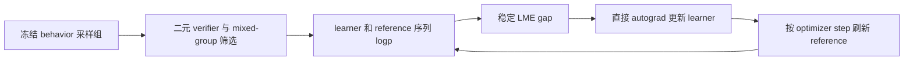
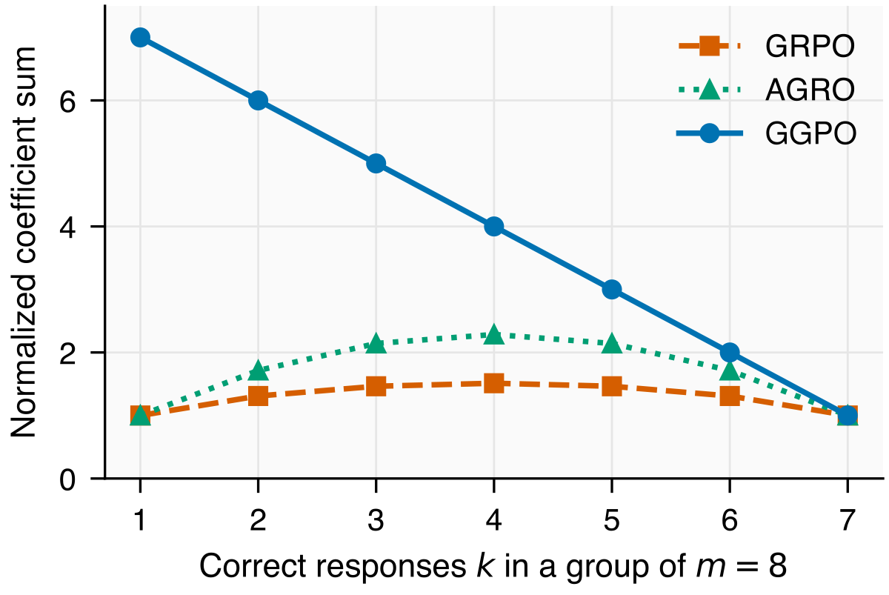

# GGPO：KL-adjusted reward 的稳定 Gibbs gap

> **L1 objective / refresh 组件及微型策略更新诊断。** 完整多 GPU 训练成本过高，不复现（审查 DONE）；不把规则 verifier 当数学能力证据。

## 论文信息

| 字段 | 内容 |
|---|---|
| 论文链接 | [arXiv 2610.20814](https://arxiv.org/abs/2610.20814)；[固定 v1 全文](https://arxiv.org/html/2610.20814v1) |
| 公司 / 机构 | University of Illinois Urbana-Champaign；Xuanchang Zhang、Tong Zhang |
| 首次公开日期 | 2026-10-14T18:59:29Z（UTC，arXiv v1） |
| 原作者代码 | [thunderous77/GGPO](https://github.com/thunderous77/GGPO)，公开 Apache-2.0；本组件独立按公式实现，未 vendor 上游训练代码 |
| 本地 adapter / 方法键 | `ggpo`；`adapter: null` |
| 本地复现代码 | [`ggpo.py`](https://github.com/daiwk/auto-research/blob/main/src/auto_research/post_training/ggpo.py) |
| 本地复现代码目录 | [`src/auto_research/post_training/`](https://github.com/daiwk/auto-research/tree/main/src/auto_research/post_training) |
| 运行入口 | [`run_oct16_post_components.py`](https://github.com/daiwk/auto-research/blob/main/scripts/run_oct16_post_components.py) |

## 原始论文总结

### 背景与主要改动

behavior policy 负责产生样本，reference policy 负责 KL anchor，两者不是同一角色。组内 adjusted reward 全相同时，策略满足该 reference 的 Gibbs 目标。GGPO 用 log-mean-exp 与算术平均的差量度偏离，不给更新乘 learner/behavior importance weight，并周期刷新 reference 以改变后续目标。



<!-- paper-figure:start -->
### 原论文关键图



> 原文 Figure 6 的解析系数对比，图片来自[原论文](https://arxiv.org/html/2610.20814v1)，版权归原作者所有。原 `figD_group_weight.svg` 栅格化；这张图和其 reward 口径不是本地 byte-parity 实验。
<!-- paper-figure:end -->

### 核心公式

对固定 behavior 采到的 $m$ 个响应，$s_i=\sum_tM_{it}\log\pi_\theta(a_{it}|h_{it})$，$R_i=r_i-\beta(s_i-s_i^{ref})$：

$$
J=\beta\log\left(\frac1m\sum_i e^{R_i/\beta}\right)-\frac1m\sum_iR_i,\quad
q_i=\operatorname{softmax}_i(R_i/\beta),\quad
\nabla J=-\beta\sum_i(q_i-1/m)\nabla s_i.
$$

默认直接对稳定、先中心化的 LME 求导。训练 loss 除以 $\beta\bar\ell\sqrt{m-1}$，其中 $\bar\ell$ 是完整 learner minibatch 的平均响应长度。实践保留 mixed binary reward groups；原文 raw unfiltered loss 的理论界不能套在过滤/归一后的训练日志上。

可选 clipping 是另一个明确接口：先将每 token **learner/reference** log-ratio 裁到半径，再计算 detached $c_i=(mq_i-1)/\sqrt{m-1}$，用 $-\sum_i c_i s_i/T_{tok}$ 更新。不能直接对 clamp 后的 LME 求导，否则饱和 token 的梯度会被错误清零。

### 论文离线与线上效果

五数学基准 problem-weighted mean@32，默认 Qwen3-1.7B GGPO 为 46.58%，固定 reference 的 ablation 为 32.96%；两者是原文统计。线上 A/B：未报告。原文 8,000 optimizer updates、1.7B/4B、每 prompt 8 响应，上游配置为 4×GH200，超出本轮低成本完整复现范围。

## 本地复现

### 数据协议与运行

公开 [Hamlet 1524](https://www.gutenberg.org/ebooks/1524) 固定内容 revision `sha256:31584c19795779431b5933499a45b9cecb03e8c246b6ea7e245a2b6d65e8e784`；257-token byte policy，训练/validation/test 为不相交 80%/10%/10% 原始 byte 区间。冻结 behavior 真正生成组，二元 verifier 检查首个生成 byte ID 偶数与否，采用有界 mixed-group 重采，不读取标准答案。该 reward 是策略优化机制诊断，绝非文本质量或数学正确性。

```bash
PYTHONPATH=src python scripts/run_oct16_post_components.py \
  --methods ggpo --corpus-path /path/to/hamlet.txt \
  --corpus-id gutenberg:1524 \
  --corpus-revision sha256:31584c19795779431b5933499a45b9cecb03e8c246b6ea7e245a2b6d65e8e784 \
  --corpus-sha256 31584c19795779431b5933499a45b9cecb03e8c246b6ea7e245a2b6d65e8e784 \
  --device cpu --seeds 42,43,44 --output runs/ggpo-component.json
```

### 结果、代码映射与边界

[CPU 三 seed 组件指标](metrics/component-cpu-seeds42-44.json)有非零真实参数更新和一次 reference refresh；behavior 保留旧 collection，不随 reference 刷新。`ggpo_loss` 为默认直接 autograd 分支，`clipped_coefficient_surrogate` 为可选分支，`GGPOPolicies` 管理两个独立冻结副本。

单测核对解析 gradient、mask、奖励常量平移稳定性、无 clipping 时两分支 gradient 一致、饱和 token 的 surrogate gradient 非零、reference refresh 不改 behavior，以及真实小 categorical 策略降低固定组 gap。未运行数学 verifier、预训练 checkpoint、异步训练服务、完整 staleness ladder 或原文 offline pool；NLL 与三 seed 只证明 L1 执行。完整实验**成本过高，不复现（审查 DONE）**，`component_only`、`evolve_integrated: false`。
