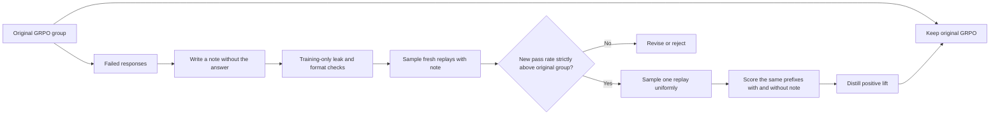
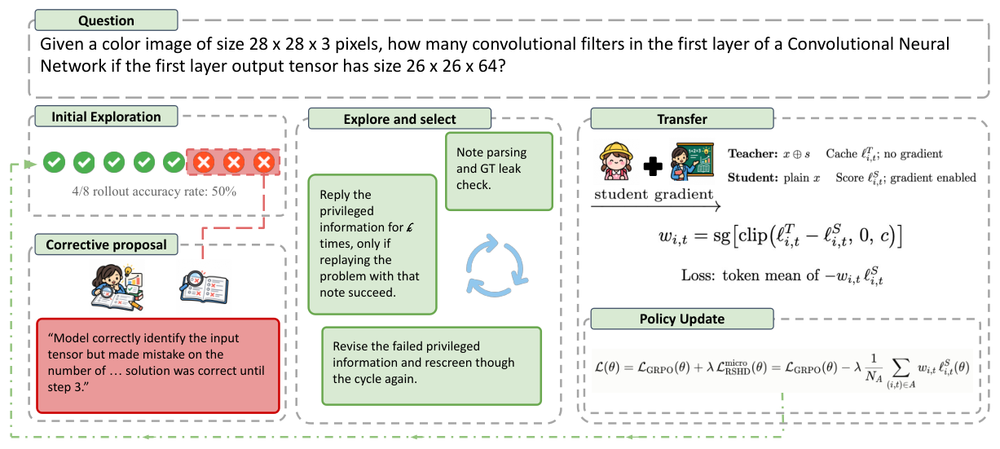

# RSHD: Distill Failure Reflections Only When Fresh Replays Verify Them

<!-- source-sha256: 890cd34b2d26bb817022ec1d86667057fafe7df203f24ef4fa5f20b3dc3f0151 -->

[简体中文](README.md) · English

> **L1 algorithm component and token-gradient diagnostic, not a reproduction of natural-language reflection or reasoning capability.** The full experiments exceed the cost budget and were not reproduced (review complete). Not eligible for Evolve promotion.

## Paper information

| Field | Details |
| --- | --- |
| Paper | [arXiv 2610.21018](https://arxiv.org/abs/2610.21018); [pinned v1 full text](https://arxiv.org/html/2610.21018v1); [PDF](https://arxiv.org/pdf/2610.21018v1) |
| Affiliations | First author Sheldon Yu, University of California, San Diego, verified on the PDF title page; collaborators include Adobe Research, Virginia, Toronto, and UNSW. |
| First public release | 2026-10-14T23:33:22Z (UTC, arXiv v1) |
| Authors' code | No official RSHD method repository was found in the paper or author searches. |
| License | Method-code license unconfirmed because no code was found; paper CC BY-NC-SA 4.0. |
| Local adapter / method key | `rshd`; `adapter: null`, standalone component |
| Local implementation | [`src/auto_research/post_training/reviewed_oct18.py`](https://github.com/daiwk/auto-research/blob/main/src/auto_research/post_training/reviewed_oct18.py): `note_has_answer`, `admit_note`, and `rshd_aux_loss` |
| Runner | [`scripts/run_oct18_post_components.py`](https://github.com/daiwk/auto-research/blob/main/scripts/run_oct18_post_components.py) |

## Original paper summary

### Background and main changes

When every rollout in a GRPO group fails, all within-group advantages are zero. Rather than telling the model the reference answer, RSHD has the same policy write a corrective note from a failed response, then generate **fresh** replays with the note. A note is accepted only when the replay pass rate strictly exceeds the original group's rate. Distillation uses the new continuation actually elicited by the note, not the old failed response. Inference uses only the student without a note. [Algorithms 1–2](https://arxiv.org/html/2610.21018v1#S4)



Figure 2 shows the full data flow. Figure 1 shows the fraction of difficult groups that fail completely, not the local data distribution.

<!-- paper-figure:start -->
### Key figure from the paper

[](https://arxiv.org/html/2610.21018v1/Oct14_main_cropped.png)

> **Figure 2 from the paper:** Overall method design and key components. The figure comes from the [original paper](https://arxiv.org/abs/2610.21018), © the original authors. Select the image to see the source.
<!-- paper-figure:end -->

### Core equations

The original group pass rate is $\hat p=n^{-1}\sum_iR(y_i)$; $\hat r(s)$ is the pass rate of $k$ fresh note-conditioned replays. Accept only when $\hat r(s)>\hat p$. Equality or mere executability is not improvement, and choosing a successful replay is not uniform sampling.

For an accepted replay $\tilde y$, let $\ell^T_t$ and $\ell^S_t$ be the log-probabilities of the same response prefix under the frozen note-conditioned policy and the note-free student:

$$
w_t=\operatorname{sg}[clip(\ell^T_t-\ell^S_t,0,c)],\quad
L_{aux}=-\frac{1}{|\mathcal A|}\sum_{(i,t)\in\mathcal A}w_{i,t}\ell^S_{i,t},\quad L=L_{GRPO}+\lambda L_{aux}.
$$

The denominator counts **all valid tokens of every accepted replay**, including zero lift. If no note is accepted, the auxiliary term is exactly zero. It does not fall back to self-imitation of an old failed response. All teacher values and lift values are stop-gradient.

### Reported offline and online results

For the 4B model, MATH-500 accuracy rose from 76.9 for GRPO to 84.5, and mean generated tokens fell from 2545 to 1979. GPQA reports both exact matching and model-based matching; they are not one metric. Full training approximately doubles generation, so the improvement is not free. No online A/B test was reported. [§6](https://arxiv.org/html/2610.21018v1#S6)

## Local reproduction

### Data protocol and execution

A random causal model with a 32-token vocabulary samples 8 responses per question. A remainder condition on the final token serves only as an artificial binary verifier. The note writer receives only the original prompt, the failed response, and a failure marker, not the reference token. The diagnostic checks exact token-subsequence leakage, samples two replays per note, strictly compares their pass rate to the original group's, and uniformly samples one replay for actual paired same-prefix scoring and a gradient update.

```bash
PYTHONPATH=src python scripts/run_oct18_post_components.py \
  --methods rshd --device cpu --seeds 42,43,44 \
  --output runs/rshd-component.json
```

For CUDA, set `--device cuda`. Each seed defaults to 3 updates, capped at 8. The runner refuses output overwrite and retains the full commit, source SHA256, and per-seed metrics. Failed, rejected, and leaking notes are counted rather than filtered out of negative results.

### Results, code mapping, and limits

On 2026-10-18, a real NVIDIA A100 completed seeds 42/43/44 with 3 updates each. All three seeds passed component acceptance: [receipt](../../gpu-validations/rshd-a100-20261018.json), [per-seed metrics](metrics/component-cuda-seeds42-44.json). Mean student-parameter change in $L_2$ was 0.017943; all seeds had nonzero gradients and parameter updates. Maximum error against an independent reference for clipped positive lift and the all-accepted-token denominator was about $1.11\times10^{-16}$. Auxiliary loss was exactly zero with no accepted notes. Equal pass rates and leaking notes were rejected. Frozen-policy parameter change and teacher-gradient count were both 0.

All accepts and rejects are retained. The three seeds accepted 37/44/32 notes and rejected 59/48/63. Of those, 6/6/7 notes containing reference tokens were filtered out. Positive-lift tokens numbered 55/63/41. These all come from artificial token conditions, not natural-language reflection pass rates or real reasoning gains. The writer did not receive the reference answer.

**Key limits:** Random tokens are not meaningful corrective notes. Only exact-subsequence leakage screening is implemented; **semantic leakage and malformed natural-language note review are not implemented**. The bounded runner does not execute the paper's second round of note revision. Real gradients and multiple seeds cannot upgrade these omissions to full reflection capability; there is no Evolve integration.

**Full experiments not reproduced:** The paper runs 1.7B, 4B, and 8B models in two domains each, with 150 steps, 14 questions × 8 rollouts per step, 3072-token generations, additional note/replay generation, and several out-of-domain evaluations. The complete multi-arm training exceeds the single-GPU budget and was not started. Review completion does not mean the paper's effects were validated.
