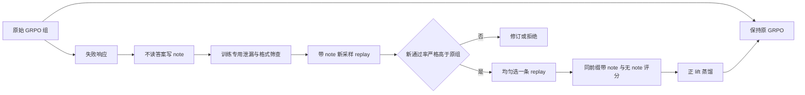
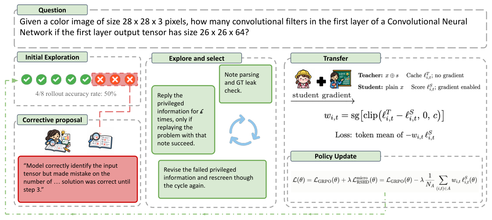

# RSHD：只蒸馏经新重放验证有效的失败复盘

> **L1 算法组件／token 梯度诊断，不是自然语言反思或推理能力复现。** 完整实验成本过高，不复现（审查 DONE）；不进入 evolve 晋级。

## 论文信息

| 字段 | 内容 |
|---|---|
| 论文链接 | [arXiv 2610.21018](https://arxiv.org/abs/2610.21018)；[固定 v1 全文](https://arxiv.org/html/2610.21018v1)；[PDF](https://arxiv.org/pdf/2610.21018v1) |
| 公司 / 机构 | 一作 Sheldon Yu 属 University of California, San Diego，已核对 PDF 首页；合作机构含 Adobe Research、Virginia、Toronto、UNSW |
| 首次公开日期 | 2026-10-14T23:33:22Z（UTC，arXiv v1） |
| 原作者代码 | 未在论文或作者检索结果中找到 RSHD 官方方法仓库 |
| 代码许可 | 未找到方法代码，许可未确认；论文 CC BY-NC-SA 4.0 |
| 本地 adapter / 方法键 | `rshd`；`adapter: null`，独立组件 |
| 本地代码位置 | [`src/auto_research/post_training/reviewed_oct18.py`](https://github.com/daiwk/auto-research/blob/main/src/auto_research/post_training/reviewed_oct18.py)：`note_has_answer`、`admit_note`、`rshd_aux_loss` |
| 运行入口 | [`scripts/run_oct18_post_components.py`](https://github.com/daiwk/auto-research/blob/main/scripts/run_oct18_post_components.py) |

## 原始论文总结

### 背景与主要改动

一组 GRPO rollout 全部失败时，组内 advantage 全为0。RSHD 不把参考答案告诉模型，而让同一策略根据失败响应写纠错 note，再用 note 生成**新的** replay。只有 replay 通过率严格超过原组，note 才被接纳；之后蒸馏的也不是旧失败响应，而是 note 实际诱导的新续写。推理时只需无 note 学生。[原文算法1–2](https://arxiv.org/html/2610.21018v1#S4)



原文 Figure 2 展示上述完整数据流；Figure 1 说明难题组出现全失败的比例，不能拿它作为本地数据分布。

<!-- paper-figure:start -->
### 原论文关键图

[](https://arxiv.org/html/2610.21018v1/Oct14_main_cropped.png)

> **原论文 Figure 2（关键图）**：展示原论文方法的总体设计和关键组成。图片来自[原论文](https://arxiv.org/abs/2610.21018)，版权归原作者所有；点击图片可查看来源。
<!-- paper-figure:end -->

### 核心公式

原始组通过率 $\hat p=n^{-1}\sum_iR(y_i)$；note 诱导的 $k$ 条新 replay 通过率为 $\hat r(s)$。接纳要求 $\hat r(s)>\hat p$，不能把相等或仅“能运行”当成改进，也不能直接从 replay 中挑成功的一条冒充均匀抽样。

对接纳的 replay $\tilde y$，相同响应前缀在带 note 冻结策略和无 note 学生下的 log-prob 分别是 $\ell^T_t$、$\ell^S_t$：

$$
w_t=\operatorname{sg}[clip(\ell^T_t-\ell^S_t,0,c)],\quad
L_{aux}=-\frac{1}{|\mathcal A|}\sum_{(i,t)\in\mathcal A}w_{i,t}\ell^S_{i,t},\quad L=L_{GRPO}+\lambda L_{aux}.
$$

分母包含每条接纳 replay 的**所有有效 token，零 lift 也计数**。没有接纳 note 时附加项精确为0，不退化成旧失败响应的自模仿；所有 teacher/lift 均 stop-gradient。

### 论文离线与线上效果

原文4B模型的 MATH-500准确率从 GRPO 的76.9到84.5；平均生成 token 从2545降至1979。GPQA 同时报告 exact 和模型匹配结果，不能混成一个口径。完整训练约增加一倍生成量，而非免费改进。未报告线上 A/B。[原文 §6](https://arxiv.org/html/2610.21018v1#S6)

## 本地复现

### 数据协议与运行

随机32词表因果模型按每题8条响应真实采样；末 token 余数条件只作人工二值 verifier。note writer 的输入只有原提示、失败响应和“失败”标记，不包含 reference token。诊断用精确 token 子序列筛查答案泄漏，重放每 note 两条、严格比较原组通过率，再均匀选取一条 replay 做真实同前缀双评分与梯度更新。

```bash
PYTHONPATH=src python scripts/run_oct18_post_components.py \
  --methods rshd --device cpu --seeds 42,43,44 \
  --output runs/rshd-component.json
```

CUDA 改为 `--device cuda`；默认每 seed 3次、最多8次更新，输出拒绝覆盖并保留完整 commit、源码 SHA256 和逐 seed 指标。失败、拒绝与泄漏 note 计数保留，不通过筛选删除负结果。

### 结果、代码映射与边界

2026-10-18 已在真实 NVIDIA A100 上完成 seeds 42/43/44，各3次更新，三种子组件验收通过：[回执](../../gpu-validations/rshd-a100-20261018.json)、[逐 seed 指标](metrics/component-cuda-seeds42-44.json)。学生参数变化 $L_2$ 均值0.017943，各 seed 均有非零梯度及参数更新；截断正 lift 和全接纳 token 分母的独立参考最大误差约 $1.11\times10^{-16}$。空接纳的附加 loss 精确为0，相等通过率和泄漏 note 均被拒绝，冻结策略参数变化和教师梯度数均为0。

保留全部接纳与拒绝：三个 seed 分别接纳37/44/32个 note，拒绝59/48/63个；其中6/6/7个含 reference token 的 note 被筛掉。正 lift token 分别为55/63/41个。它们都来自人工 token 条件，不能解释成自然语言反思通过率或真实推理收益；writer 未接收参考答案。

**关键限制：** 随机 token 不是有语义的纠错 note。只实现精确子序列泄漏筛查，**未实现自然语言语义泄漏/畸形 note 审核**；有界 runner 不运行论文的第二轮 note 修订。这些缺口不能被真实梯度和多种子“升级”为完整反思能力复现，也不接 evolve。

**完整实验不复现：** 原文1.7B、4B、8B模型各两个领域，150步、每步14题×8 rollout、3072-token生成、额外 note/replay及多组外域评测；完整多臂训练对单卡预算成本过高。未启动完整复现，审查 DONE 不代表已验证论文效果。
