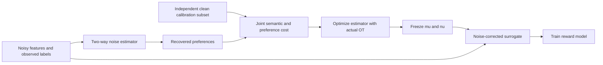
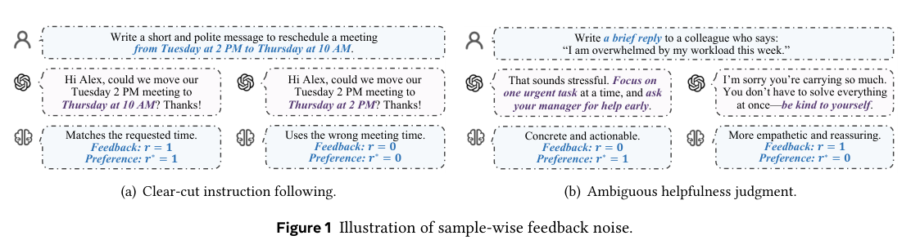

# CleanRM: Estimate Noise with Joint Optimal Transport, Then Correct Reward-Model Risk

<!-- source-sha256: cb89673dd1b8693093d1d3b68f55c307180d311a51a5234cf8026154abb69763 -->

[简体中文](README.md) · English

> **L1 small-feature component with actual joint optimal transport and a signed corrected loss.** Known noise rates do not stand in for the core estimator, and synthetic mechanism results are not evidence of actual RLHF safety. Full reward-model and RLHF experiments exceed the cost budget and were not reproduced (review complete).

## Paper information

| Field | Details |
| --- | --- |
| Paper | [arXiv 2610.21138](https://arxiv.org/abs/2610.21138); [pinned v1 full text](https://arxiv.org/html/2610.21138v1) |
| Affiliations | First author Licheng Pan, Zhejiang University; collaboration with Xiaohongshu, NUS, NYU, UIUC, and MBZUAI. |
| First public release | 2026-10-15T02:49:51Z (UTC, arXiv v1) |
| Authors' code | The paper links to [anonymous CAN-RM-46BB](https://anonymous.4open.science/r/CAN-RM-46BB), but it was inaccessible during this review. Its contents, license, and executability were not verified, so it is not marked as integrated. |
| Local adapter / method key | `clean-rm`; `adapter: null` |
| Local implementation | [`clean_rm.py`](https://github.com/daiwk/auto-research/blob/main/src/auto_research/post_training/clean_rm.py) |
| Local implementation directory | [`src/auto_research/post_training/`](https://github.com/daiwk/auto-research/tree/main/src/auto_research/post_training) |
| Runner | [`run_oct17_post_components.py`](https://github.com/daiwk/auto-research/blob/main/scripts/run_oct17_post_components.py) |

## Original paper summary

### Background and main changes

Label noise need not be uniform across preference examples. CleanRM uses a small amount of clean feedback to calibrate two example-level noise rates, one for each flip direction. It performs optimal transport on the **joint distribution** of semantics and recovered preferences instead of matching only preference histograms. It then freezes the estimator and trains a reward model with a debiased surrogate.



<!-- paper-figure:start -->
### Key figure from the paper

[](https://arxiv.org/pdf/2610.21138v1#page=3)

> **Figure 1 from the paper:** Both examples are retained: clear and ambiguous instructions produce different example-level feedback noise. These are not local model outputs. The figure comes from the [original paper](https://arxiv.org/abs/2610.21138), © the original authors. Select the image to see the source.
<!-- paper-figure:end -->

### Core equations

Let $\mu=P(r=0|r^*=1,x)$, $\nu=P(r=1|r^*=0,x)$, and $\epsilon=1-\mu-\nu>0$:

$$
\widehat r^*=\frac{r-\widehat\nu}{1-\widehat\mu-\widehat\nu},\qquad
C_{ij}=\operatorname{MinMax}(\ell(\widehat r_i^*,r_j^*))+\operatorname{MinMax}(\|z_i-z_j\|_2^2).
$$

The two terms are min–max normalized separately over the entire transport batch. Recovered preferences can lie outside $[0,1]$ and must not be silently clipped. The estimator minimizes $\min_{T\in\Pi}\langle C,T\rangle$. The reward model uses

$$
\widetilde\ell_1=\frac{(1-\nu)\ell_1-\mu\ell_0}{\epsilon},\qquad
\widetilde\ell_0=\frac{(1-\mu)\ell_0-\nu\ell_1}{\epsilon},\qquad
L=\frac1N\sum_i[r_i\widetilde\ell_{1,i}+(1-r_i)\widetilde\ell_{0,i}].
$$

This is a signed loss; negative values can be valid. Clamping the loss would invalidate the unbiasedness claim. Unbiasedness depends on correct noise rates and does not guarantee accurate finite-sample estimates.

### Reported offline and online results

The paper compares Naive, TrainRef, and other methods on HelpSteer, UltraFeedback, and PKU-SafeRLHF. It reports $R^2$ gains of .052/.013/.032 over the strongest comparator. It also evaluates multiple backbones and downstream RLHF safety. No online A/B test was reported. The paper's results are not directly comparable to local numerical diagnostics.

## Local reproduction

### Data protocol and execution

`NoiseEstimator` uses a three-way softmax to keep both noise rates nonnegative and their sum at most .95. `noise_estimation_loss` sees only noisy features, observed feedback, and the independent clean calibration subset. It **does not receive ground-truth noise rates**. Encoded features are treated as fixed; the paper's LLM backbone was not downloaded.

The local solver uses subset DP to find an exact assignment for unregularized OT between equal-mass batches of the same length. It handles at most 12 points in $O(n2^n)$ and does not import a large-scale OT service. The optimal plan is detached, while $\langle C,T^*\rangle$ retains the actual cost gradient. Same-length uniform empirical measures admit an optimal permutation, so this is not a nearest-neighbor or diagonal-matrix proxy for OT. However, the solver **does not support the paper's arbitrary batch sizes on either side**.

```bash
PYTHONPATH=src python scripts/run_oct17_post_components.py \
  --methods clean-rm --device cpu --seeds 42,43,44 \
  --output runs/clean-rm-component.json
```

The runner has six noisy points and six clean calibration points. Under the same model initialization it first updates the noise estimator, then freezes its output to train a small linear reward model. It also trains a Naive comparator without using its result for selection. Each stage runs four updates by default, capped at 12. For CUDA, change only `--device cuda`. No public language dataset or benchmark is used, so this is not a formal reward-model comparison.

### Results, code mapping, and limits

On 2026-10-17, a real NVIDIA A100 completed seeds 42/43/44: [per-seed metrics](metrics/component-cuda-seeds42-44.json), [sanitized GPU receipt](../../gpu-validations/clean-rm-a100-20261017.json). The mean $L_2$ parameter changes of the noise estimator and reward model were .28969/.32828, respectively. The exact OT reference and marginal errors were 0, and the estimator change in the reward-model stage was 0. This is not noise-rate recovery accuracy or the $R^2$ of a real reward model. Known noise rates were not training inputs, and no clean held-out labels were used to select configurations.

- `joint_cost` preserves both semantic identity and preferences. A unit test shows that matching preference marginals alone misses semantic mismatches.
- `exact_uniform_transport` is compared with an independent exhaustive-permutation reference, checking row and column marginals and the envelope gradient.
- `corrected_reward_loss` supports square and logistic base losses with detached noise rates. A unit test enumerates both true feedback states and checks that the conditional expectation recovers the clean loss.
- The runner records nonzero estimator and reward-model updates, zero frozen-estimator changes, OT residuals, the no-noise reduction control, and signed final losses. It does not cherry-pick favorable seeds or discard negative results.

**Full experiments not reproduced:** The paper covers 8–70B reward-model backbones, two stages with up to 600 epochs and hyperparameter search, plus an 8B policy, 256 prompts × 4 rollouts, 20 GRPO steps, and an external safety judge. The full multi-model pipeline is estimated to take hours on one A100/A30 and requires substantial resources and API access. It was closed under the cost policy without a probe run. The component remains `diagnostic_only: true`, `promotion_eligible: false`, and `evolve_integrated: false`.
