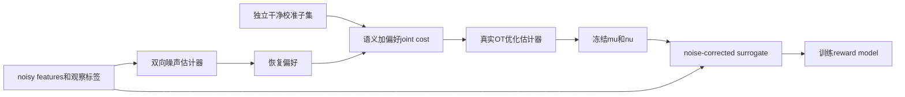
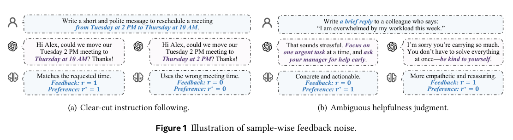

# CleanRM：联合最优传输估计噪声，再校正奖励模型风险

> **L1 小特征、真实 joint OT 与 signed corrected loss 组件。** 不用预知噪声率代替核心估计器；不把合成机制结果称为真实 RLHF 安全能力。完整 RM/RLHF 实验成本过高，不复现（审查 DONE）。

## 论文信息

| 字段 | 内容 |
|---|---|
| 论文链接 | [arXiv 2610.21138](https://arxiv.org/abs/2610.21138)；[固定 v1 全文](https://arxiv.org/html/2610.21138v1) |
| 公司 / 机构 | 第一作者 Licheng Pan，Zhejiang University；Xiaohongshu、NUS、NYU、UIUC、MBZUAI 合作 |
| 首次公开日期 | 2026-10-15T02:49:51Z（UTC，arXiv v1） |
| 原作者代码 | 论文提供[匿名入口 CAN-RM-46BB](https://anonymous.4open.science/r/CAN-RM-46BB)，但本轮访问失败，未核验代码内容、许可证或可运行性；不标记为已成功接入 |
| 本地 adapter / 方法键 | `clean-rm`；`adapter: null` |
| 本地复现代码 | [`clean_rm.py`](https://github.com/daiwk/auto-research/blob/main/src/auto_research/post_training/clean_rm.py) |
| 本地复现代码目录 | [`src/auto_research/post_training/`](https://github.com/daiwk/auto-research/tree/main/src/auto_research/post_training) |
| 运行入口 | [`run_oct17_post_components.py`](https://github.com/daiwk/auto-research/blob/main/scripts/run_oct17_post_components.py) |

## 原始论文总结

### 背景与主要改动

不同偏好样本的标注噪声不一定相同。CleanRM 用少量干净反馈校准两个方向的样本级噪声率；以语义与恢复偏好的**联合分布**作最优传输，而不是只匹配偏好直方图。随后固定估计器，用去偏 surrogate 训练 RM。



<!-- paper-figure:start -->
### 原论文关键图

[](https://arxiv.org/pdf/2610.21138v1#page=3)

> **原论文 Figure 1（关键图）**：完整保留两侧案例：明确指令与模糊指令产生不同的样本级反馈噪声；不是本地模型输出。图片来自[原论文](https://arxiv.org/abs/2610.21138)，版权归原作者所有；点击图片可查看来源。
<!-- paper-figure:end -->

### 核心公式

令 $\mu=P(r=0|r^*=1,x)$、$\nu=P(r=1|r^*=0,x)$，$\epsilon=1-\mu-\nu>0$：

$$
\widehat r^*=\frac{r-\widehat\nu}{1-\widehat\mu-\widehat\nu},\qquad
C_{ij}=\operatorname{MinMax}(\ell(\widehat r_i^*,r_j^*))+\operatorname{MinMax}(\|z_i-z_j\|_2^2).
$$

两项分别按整个 transport batch 做 min–max。恢复偏好可能落在 $[0,1]$ 之外，不可偷偷截断。估计器优化 $\min_{T\in\Pi}\langle C,T\rangle$；RM 使用

$$
\widetilde\ell_1=\frac{(1-\nu)\ell_1-\mu\ell_0}{\epsilon},\qquad
\widetilde\ell_0=\frac{(1-\mu)\ell_0-\nu\ell_1}{\epsilon},\qquad
L=\frac1N\sum_i[r_i\widetilde\ell_{1,i}+(1-r_i)\widetilde\ell_{0,i}].
$$

这是 signed loss，负值可能合法；不可 clamp 后宣称仍然无偏。无偏保证依赖噪声率正确，不意味着有限小样本估计一定正确。

### 论文离线与线上效果

原文在 HelpSteer、UltraFeedback、PKU-SafeRLHF 比较 Naive、TrainRef 等，报告相对最强对照的 $R^2$ 增量 .052/.013/.032；另有不同 backbone 和下游 RLHF 安全评测。线上 A/B：未报告。论文结果和本地数值诊断不可直接比较。

## 本地复现

### 数据协议与运行

`NoiseEstimator` 通过三路 softmax 保证两向噪声率非负、总和至多 .95。`noise_estimation_loss` 只读取 noisy features/观察反馈以及独立 clean calibration 子集，**不接收已知真实噪声率**。编码特征在组件中视为固定，未下载原文 LLM backbone。

本地等质量、等长 batch 的未正则 OT 用 subset-DP 求精确 assignment；最多12点，$O(n2^n)$，不导入大规模 OT 服务。最优 plan detach，而 $\langle C,T^*\rangle$ 保留真实 cost 梯度。等长均匀 empirical measure 有 permutation 最优解，因此不是 nearest-neighbor 或对角矩阵冒充 OT；但该求解器**不支持论文任意大小的两侧 batch**。

```bash
PYTHONPATH=src python scripts/run_oct17_post_components.py \
  --methods clean-rm --device cpu --seeds 42,43,44 \
  --output runs/clean-rm-component.json
```

runner 的 noisy 与 clean 校准各6点，在相同模型初始化下先真实更新 noise estimator，再冻结其输出训练小线性 RM；另训 Naive 对照，不用其结果做选择。每阶段默认四次更新、上限12；CUDA 仅改 `--device cuda`。没有公共语言数据或 benchmark，所以不能称正式 RM 比较。

### 结果、代码映射与边界

2026-10-17 已在真实 NVIDIA A100 上完成 seeds 42/43/44：[逐 seed 指标](metrics/component-cuda-seeds42-44.json)、[净化 GPU 收据](../../gpu-validations/clean-rm-a100-20261017.json)。噪声估计器与 RM 参数变化 $L_2$ 均值分别 .28969/.32828；精确 OT reference 与边际误差为0，RM阶段估计器变化为0。这不是噪声率恢复精度或真实 RM 的 $R^2$；无已知噪声率充当训练输入，也没有用 clean held-out label 选择任何配置。

- `joint_cost` 同时保留 semantic identity 与 preference；单测证明仅匹配边际偏好会漏掉语义错配。
- `exact_uniform_transport` 与全排列独立 reference 对比，检查行列边际及 envelope gradient。
- `corrected_reward_loss` 支持 square 与 logistic 两种基损失，噪声率 detach；单测枚举两种真实反馈状态验证条件期望恢复 clean loss。
- runner 记录 estimator/RM 非零更新、冻结 estimator 零变化、OT residual、无噪声退化对照和带符号最终 loss；不挑选“好看”种子、不删负结果。

**不复现的完整实验：** 原文 RM backbone覆盖8–70B，两阶段最多600 epochs与超参搜索，另有8B策略、256 prompts×4 rollouts、20步GRPO及外部安全judge。完整多模型链路对单张 A100/A30 预计为小时级且需大资源/API，按成本门槛关闭而未探跑。局部实现保持 `diagnostic_only: true`、`promotion_eligible: false`、`evolve_integrated: false`。
