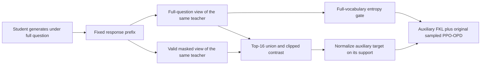
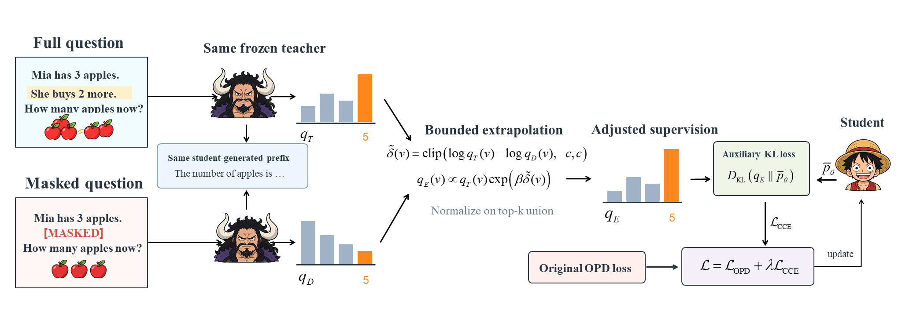

# CCE-OPD: Conditional Contrastive Extrapolation on the Same Student Prefix

<!-- source-sha256: f580ad51f0e9ad250a434691b06ed8f034b309063279477ce4642a6636241d1d -->

[简体中文](README.md) · English

> **L1 component for dual views, candidate union, auxiliary KL, and sampled PPO.** It accepts only reviewed, valid condition spans and does not supply a stand-in semantic extractor. The full experiments exceed the cost budget and were not reproduced (review complete).

## Paper information

| Field | Details |
| --- | --- |
| Paper | [arXiv 2610.21195](https://arxiv.org/abs/2610.21195); [pinned v1 full text](https://arxiv.org/html/2610.21195v1) |
| Affiliations | First author Wenxuan Luo, The Chinese University of Hong Kong, Shenzhen; collaboration with FNii-Shenzhen and ByteDance. |
| First public release | 2026-10-15T03:55:34Z (UTC, arXiv v1) |
| Authors' code | An official repository for the method was not found or confirmed as released. Independently implemented from the published equations. |
| Local adapter / method key | `cce-opd`; `adapter: null` |
| Local implementation | [`cce_opd.py`](https://github.com/daiwk/auto-research/blob/main/src/auto_research/post_training/cce_opd.py) |
| Local implementation directory | [`src/auto_research/post_training/`](https://github.com/daiwk/auto-research/tree/main/src/auto_research/post_training) |
| Runner | [`run_oct16_post_components.py`](https://github.com/daiwk/auto-research/blob/main/scripts/run_oct16_post_components.py) |

## Original paper summary

### Background and main changes

A teacher may follow a student's incorrect reasoning prefix while overlooking a condition in the question. With the **exact same student response prefix** in both views, CCE lets the same frozen teacher read the full question and a version with one valid premise masked. It adjusts an auxiliary target with a clipped log-probability contrast. The student always generates from the full question. Positions that fail condition eligibility or the entropy gate still use the original sampled PPO-OPD objective.



<!-- paper-figure:start -->
### Key figure from the paper



> Figure 1 from the [original paper](https://arxiv.org/html/2610.21195v1), © the original authors. The original asset is `cce4.png`; its apple example is not a local training item or result.
<!-- paper-figure:end -->

### Core equations

Let $q_T=q(\cdot|x,y_{<t})$ and $q_D=q(\cdot|x^-,y_{<t})$, and let $V_t$ be the deduplicated union of the top 16 tokens under each full or masked teacher view:

$$
\widetilde\delta(v)=\operatorname{clip}(\log q_T(v)-\log q_D(v),-5,5),\quad
q_E(v)=\operatorname{softmax}_{V_t}[\log q_T(v)+0.2\widetilde\delta(v)].
$$

Compute entropy across the full vocabulary **before** constructing the support: $H(q_T)=-\sum_vq_T(v)\log q_T(v)$. The auxiliary mask requires a valid question pair, a valid response token, and $H\ge0.8$ nats.

$$
L=L_{OPD}+\frac1N\sum_tm_t KL(q_E\Vert p_{\theta,t}),\quad
A_t=\operatorname{sg}[\log q_T(\hat y_t)-\log p_{old}(\hat y_t)].
$$

$N$ counts **all valid response tokens**, not just those that pass the gate. $q_E$ is normalized within its support and zero outside it. The student $p_\theta$ retains its full-vocabulary softmax. Renormalizing it over the support would discard gradients for tokens outside the candidate set.

### Reported offline and online results

On six mathematics benchmarks, the paper reports mean avg@8 gains of 1.60/1.95 percentage points over OPD for 0.6B/1.7B students. Across 200 diagnostic states, the preference rate for condition-violating continuations dropped from 27% to 16%. No online A/B test was reported. The paper uses a Qwen3-8B teacher. A commercial annotator constructed and reviewed masks for 3,402 of 7,498 training questions. The protocol also includes multiple training arms and ten evaluations. Cheap checks could not determine the full cost, so the experiments were closed under the cost policy without launching a probe to establish that they were expensive.

## Local reproduction

### Data protocol and execution

Public [Hamlet 1524](https://www.gutenberg.org/ebooks/1524) content revision: `sha256:31584c19795779431b5933499a45b9cecb03e8c246b6ea7e245a2b6d65e8e784`. Raw byte ranges for train/validation/test are disjoint at 80%/10%/10%. The tiny teacher is trained only on public text next-token prediction, not on mathematics.

The runner uses an explicitly controlled **mathematical premise fixture**: “Let n be a positive integer. The number n is even. What is n modulo 2?” It masks the complete evenness premise only. After deletion, the answer is no longer determined, but the question remains recognizable. The public text fragments are additional context only. The fixture contains no gold answer. It is not equivalent to the paper's commercial semantic annotations and does not use a tiny teacher's preferences as evidence of condition understanding. `ConditionPair` requires external `semantic_reviewed=True` and an exact span. There is no automatic local condition extractor.

```bash
PYTHONPATH=src python scripts/run_oct16_post_components.py \
  --methods cce-opd --corpus-path /path/to/hamlet.txt \
  --corpus-id gutenberg:1524 \
  --corpus-revision sha256:31584c19795779431b5933499a45b9cecb03e8c246b6ea7e245a2b6d65e8e784 \
  --corpus-sha256 31584c19795779431b5933499a45b9cecb03e8c246b6ea7e245a2b6d65e8e784 \
  --device cpu --seeds 42,43,44 --output runs/cce-component.json
```

### Results, code mapping, and limits

The [three-seed CPU metrics](metrics/component-cpu-seeds42-44.json) show actual student sampling, nonzero updates, no changes to the frozen teacher, gate counts, and union sizes. They are not mathematics avg@8. `score_teacher_views` enforces a shared prefix and prevents the scorer from modifying it. `prepare_credit` implements the union, extrapolation, and full-vocabulary entropy. `cce_ppo_loss` combines sampled PPO over all valid positions with gated FKL.

Unit tests use exact logit gradients to verify the all-token denominator and full-softmax gradients outside the support. They also check shared prefixes, teacher detachment, and rejection of invalid or unreviewed spans. The full commercial annotation protocol, pretrained 8B teacher, multi-arm training, and benchmarks **exceed the cost budget and were not reproduced (review complete)**. `component_only`; `evolve_integrated: false`.
