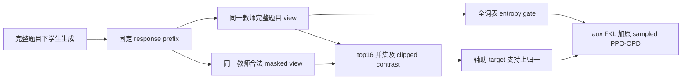
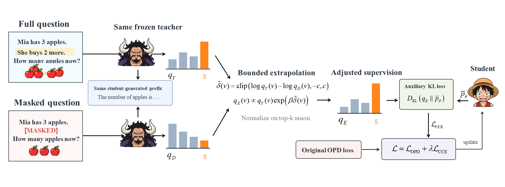

# CCE-OPD：同一学生前缀上的条件对比外推

> **L1 双视图 / union / auxiliary-KL / sampled PPO 组件。** 只接受已审阅的合法 condition span，不提供伪造的语义抽取器。完整实验成本过高，不复现（审查 DONE）。

## 论文信息

| 字段 | 内容 |
|---|---|
| 论文链接 | [arXiv 2610.21195](https://arxiv.org/abs/2610.21195)；[固定 v1 全文](https://arxiv.org/html/2610.21195v1) |
| 公司 / 机构 | The Chinese University of Hong Kong, Shenzhen 第一作者 Wenxuan Luo；FNii-Shenzhen、ByteDance 合作 |
| 首次公开日期 | 2026-10-15T03:55:34Z（UTC，arXiv v1） |
| 原作者代码 | 未找到 / 未确认已发布的原作者方法仓库；独立按公开公式实现 |
| 本地 adapter / 方法键 | `cce-opd`；`adapter: null` |
| 本地复现代码 | [`cce_opd.py`](https://github.com/daiwk/auto-research/blob/main/src/auto_research/post_training/cce_opd.py) |
| 本地复现代码目录 | [`src/auto_research/post_training/`](https://github.com/daiwk/auto-research/tree/main/src/auto_research/post_training) |
| 运行入口 | [`run_oct16_post_components.py`](https://github.com/daiwk/auto-research/blob/main/scripts/run_oct16_post_components.py) |

## 原始论文总结

### 背景与主要改动

教师可能跟随学生错误 reasoning prefix，而忽略题目条件。CCE 在**完全相同的学生 response prefix**上，让同一冻结教师分别读取完整题目与遮蔽一个有效前提的题目，以 clipped log-prob contrast 调整辅助 target。学生始终从完整题目生成；未通过 condition eligibility 或 entropy gate 的位置仍保留原 sampled PPO-OPD。



<!-- paper-figure:start -->
### 原论文关键图



> 原文 Figure 1，图片来自[原论文](https://arxiv.org/html/2610.21195v1)，版权归原作者所有。原始 `cce4.png`；图中苹果例子不是本地训练题目或结果。
<!-- paper-figure:end -->

### 核心公式

设 $q_T=q(\cdot|x,y_{<t})$、$q_D=q(\cdot|x^-,y_{<t})$，完整/遮罩 teacher 的 top-16 去重并集为 $V_t$，

$$
\widetilde\delta(v)=\operatorname{clip}(\log q_T(v)-\log q_D(v),-5,5),\quad
q_E(v)=\operatorname{softmax}_{V_t}[\log q_T(v)+0.2\widetilde\delta(v)].
$$

entropy 在构建 support **之前**对全词表计算：$H(q_T)=-\sum_vq_T(v)\log q_T(v)$。辅助 mask 同时要求合法题目对、有效 response token、$H\ge0.8$ nats。

$$
L=L_{OPD}+\frac1N\sum_tm_t KL(q_E\Vert p_{\theta,t}),\quad
A_t=\operatorname{sg}[\log q_T(\hat y_t)-\log p_{old}(\hat y_t)].
$$

$N$ 是**全部有效 response token 数**，不是 gate 通过数。$q_E$ 在 support 内归一且外部为零；学生 $p_\theta$ 始终保持 full-vocabulary softmax，不能一起重归一，否则丢失非候选 token 的梯度。

### 论文离线与线上效果

原文六数学基准 avg@8 相对 OPD 平均增加 1.60/1.95 个百分点（0.6B/1.7B 学生）；200 个诊断状态的 condition-violating continuation 偏好率从 27% 降至 16%。线上 A/B：未报告。原文 Qwen3-8B 教师、7,498 训练题中的 3,402 题由商业 annotator 构造并复核 mask，另有多臂训练与十个评测；完整成本无法由廉价检查确定，按成本门槛关闭，不启动试跑证明昂贵。

## 本地复现

### 数据协议与运行

公开 [Hamlet 1524](https://www.gutenberg.org/ebooks/1524) 内容 revision `sha256:31584c19795779431b5933499a45b9cecb03e8c246b6ea7e245a2b6d65e8e784`，train/validation/test 原始 byte 区间 80%/10%/10% 分离。微型教师只作公开文本 next-token 训练，并非数学教师。

runner 使用明确受控的**数学前提 fixture**：“Let n be a positive integer. The number n is even. What is n modulo 2?”，仅遮蔽完整 evenness 前提；删除后答案不再确定而所求保持可辨认。公开文本片段只作为额外上下文。此 fixture 不含标准答案，不声称等价于原文商业语义标注集，更不以 tiny teacher 的偏好证明条件理解。`ConditionPair` 要求外部 `semantic_reviewed=True` 与精确 span；本地没有自动 condition extractor。

```bash
PYTHONPATH=src python scripts/run_oct16_post_components.py \
  --methods cce-opd --corpus-path /path/to/hamlet.txt \
  --corpus-id gutenberg:1524 \
  --corpus-revision sha256:31584c19795779431b5933499a45b9cecb03e8c246b6ea7e245a2b6d65e8e784 \
  --corpus-sha256 31584c19795779431b5933499a45b9cecb03e8c246b6ea7e245a2b6d65e8e784 \
  --device cpu --seeds 42,43,44 --output runs/cce-component.json
```

### 结果、代码映射与边界

[CPU 三 seed 指标](metrics/component-cpu-seeds42-44.json)证明真实学生采样与非零更新、冻结教师零变化，记录 gate 数量与 union 大小；不是数学 avg@8。`score_teacher_views` 强制同一 prefix、禁止 scorer 修改 prefix；`prepare_credit` 实现并集、外推及 full-vocab entropy；`cce_ppo_loss` 合并全有效位置的 sampled PPO 与门控 FKL。

单测以精确 logit gradient 验证 all-token denominator 和 support 外的 full-softmax 梯度，另测双视图 prefix 一致、teacher detach 与非法未审查 span 拒绝。完整商业标注、预训练 8B 教师、多臂训练及 benchmark **成本过高，不复现（审查 DONE）**；`component_only`、`evolve_integrated: false`。
