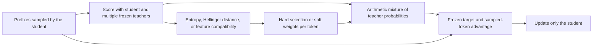
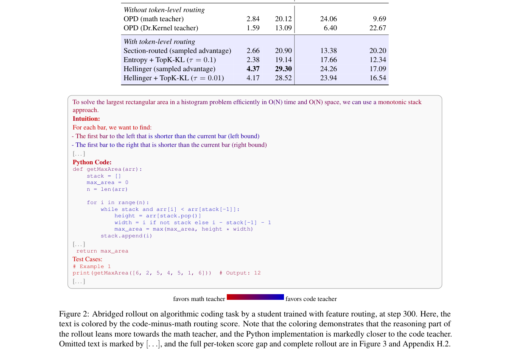

# Token-Level Teacher Selection: Choosing a Distillation Teacher for Each Token

<!-- source-sha256: ed84847a6d6e1fff1f6f4e296738f06e617939e3abfb1774151381967e96d173 -->

[简体中文](README.md) · English

> **L1 algorithm component and gradient diagnostic, not a reproduction of code, mathematical, or multimodal reasoning.** The full experiments exceed the cost budget and were not reproduced (review complete). Not eligible for Evolve promotion.

## Paper information

| Field | Details |
| --- | --- |
| Paper | [arXiv 2610.21234](https://arxiv.org/abs/2610.21234); [pinned v1 full text](https://arxiv.org/html/2610.21234v1) |
| Affiliations | First author Stanley Wei is affiliated with Princeton University; the work was done during an internship at Amazon Annapurna Labs, which the other authors are affiliated with. |
| First public release | 2026-10-15T04:26:33Z (UTC, arXiv v1) |
| Authors' code | No official repository for this method was found in the paper or through author searches. |
| License | Method-code license unconfirmed because the code was not found; paper CC BY 4.0. |
| Local adapter / method key | `token-teacher-selection`; `adapter: null`, standalone component |
| Local implementation | [`src/auto_research/post_training/reviewed_oct18.py`](https://github.com/daiwk/auto-research/blob/main/src/auto_research/post_training/reviewed_oct18.py): `route_teachers` and `routed_opd_loss` |
| Runner | [`scripts/run_oct18_post_components.py`](https://github.com/daiwk/auto-research/blob/main/scripts/run_oct18_post_components.py) |

## Original paper summary

### Background and main changes

One teacher may not suit an entire student reasoning trace. Mathematical derivation and code generation can need different specialists, and a strong teacher's distribution may be too distant from the student's. The paper selects an OPD teacher at each prefix the student actually visits. Routing can use teacher confidence, the Hellinger distance between student and teacher distributions, or squared feature distance in an aligned hidden space. Soft routing mixes **probabilities**, not average logits or log-probabilities. [Paper §3](https://arxiv.org/html/2610.21234v1#S3)



The paper's theoretical decomposition and experiment tables discuss teacher capability, student-teacher distance, and diversity separately. A result about the existence of a non-inferior routing strategy does not guarantee that every routing heuristic improves performance.

<!-- paper-figure:start -->
### Key figure from the paper

[](https://arxiv.org/pdf/2610.21234#page=9)

> **Figure 2 from the paper:** Overall design and key components. The figure comes from the [original paper](https://arxiv.org/abs/2610.21234); copyright remains with the original authors. Select the image to see the source.
<!-- paper-figure:end -->

### Core equations

For teacher $i$, the three scores are $-H(p_i)$, $-\sqrt{\frac12\sum_v(\sqrt{p_S(v)}-\sqrt{p_i(v)})^2}$, and $-\|h_S-h_i\|_2^2$. The third applies only in an aligned feature space; vectors with different dimensions cannot be subtracted directly.

$$
w_i=softmax_i(S_i/\tau),\qquad p_T(v)=\sum_iw_i p_i(v),\qquad
L=-\mathbb E_y\frac1{|y|}\sum_t\operatorname{sg}[\log p_T(y_t)-\log p_S(y_t)]\log p_S(y_t).
$$

$\tau=0$ means hard argmax selection. Routing scores, weights, and teacher targets are all stop-gradient. The student log-probability inside the advantage is also detached; gradients flow only through the final student log-probability. This implements the sampled-token version in Appendix E, **not the Top-K KL version**.

### Reported offline and online results

On the Triton-only task, entropy routing scored 22.44/82.00 for pass@1/pass@16; OPD with only Dr.Kernel as teacher scored 4.50/49.00. Gains vary by routing rule on visual reasoning, and the paper does not identify one universally best rule. No online A/B test was reported. [Table 2 and Appendix H](https://arxiv.org/html/2610.21234v1#S5.SS2)

## Local reproduction

### Data protocol and execution

Three randomly initialized causal policies, with a 32-token vocabulary and 8 dimensions, act as the student and two frozen teachers. The student actually samples 4-token responses; all teachers score the same prefixes. The default three updates use entropy, Hellinger, and feature routing in that order. Random models cannot measure real teacher capability or kernel correctness.

```bash
PYTHONPATH=src python scripts/run_oct18_post_components.py \
  --methods token-teacher-selection --device cpu --seeds 42,43,44 \
  --output runs/teacher-routing-component.json
```

For CUDA, set `--device cuda`; the runner errors if it is unavailable. It refuses to overwrite output and records the source SHA256, full commit, seeds, and device.

### Results, code mapping, and limits

On 2026-10-18, a real NVIDIA A100 completed seeds 42/43/44, with three updates per seed covering the three routing rules in order. All three seeds passed component acceptance: [receipt](../../gpu-validations/token-teacher-selection-a100-20261018.json), [per-seed results](metrics/component-cuda-seeds42-44.json). The mean student-parameter change in $L_2$ was 0.028698. Every seed had nonzero gradients and parameter updates. The arithmetic mixture's maximum reference error was approximately $4.16\times10^{-17}$, and the sampled objective's maximum scalar reference error was approximately $2.22\times10^{-16}$. The identical-teacher zero-target control, teacher-parameter change, and number of teacher gradients were all 0. This does not establish that random teachers can reason and is not a result on the paper's tasks.

**Full experiments not reproduced:** The paper uses teachers up to 30B, a 4B student, 300–400 updates, batch size 128, generations up to 16K tokens, and multiple domains including code, kernels, and vision. That exceeds the available single-GPU budget for a short diagnostic. These models were not downloaded; curricula, teacher training, and the full benchmark were not implemented. Fixed diagnostic only, not promotable or integrated into Evolve.
