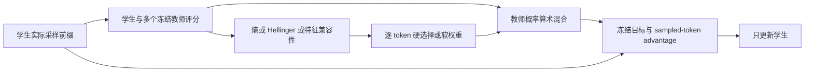
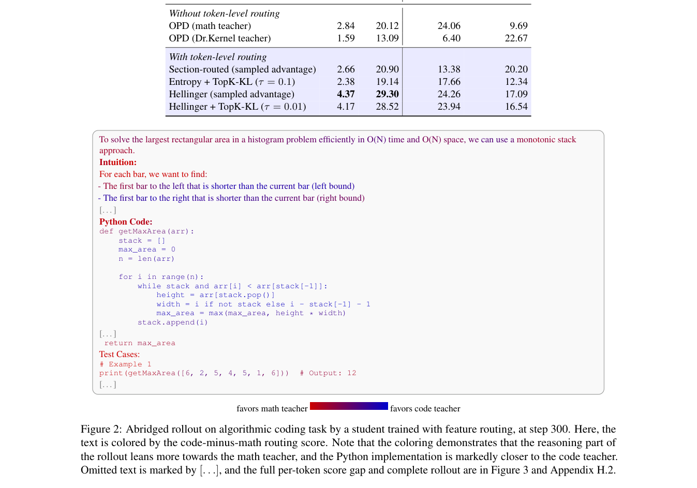

# Token-Level Teacher Selection：逐 token 选择合适的蒸馏教师

> **L1 算法组件／梯度诊断，不是代码、数学或多模态推理复现。** 完整实验成本过高，不复现（审查 DONE）；不进入 evolve 晋级。

## 论文信息

| 字段 | 内容 |
|---|---|
| 论文链接 | [arXiv 2610.21234](https://arxiv.org/abs/2610.21234)；[固定 v1 全文](https://arxiv.org/html/2610.21234v1) |
| 公司 / 机构 | 一作 Stanley Wei 属 Princeton University；在 Amazon Annapurna Labs 实习期间完成工作，其他作者来自该实验室 |
| 首次公开日期 | 2026-10-15T04:26:33Z（UTC，arXiv v1） |
| 原作者代码 | 未在论文或作者检索结果中找到本方法官方仓库 |
| 代码许可 | 未找到方法代码，许可未确认；论文 CC BY 4.0 |
| 本地 adapter / 方法键 | `token-teacher-selection`；`adapter: null`，独立组件 |
| 本地代码位置 | [`src/auto_research/post_training/reviewed_oct18.py`](https://github.com/daiwk/auto-research/blob/main/src/auto_research/post_training/reviewed_oct18.py)：`route_teachers`、`routed_opd_loss` |
| 运行入口 | [`scripts/run_oct18_post_components.py`](https://github.com/daiwk/auto-research/blob/main/scripts/run_oct18_post_components.py) |

## 原始论文总结

### 背景与主要改动

一个教师未必适合学生整段推理：数学推导和代码生成可能需要不同专家，强教师与学生的分布差距也可能太大。论文把 OPD 的教师选择细化到每个学生实际访问的前缀。路由依据可以是教师置信度、师生分布 Hellinger 距离，或对齐隐藏空间的特征平方距离。软路由混合的是**概率**，不是 logits 或 log-prob 的平均。[原文 §3](https://arxiv.org/html/2610.21234v1#S3)



原文中理论分解和实验表分别讨论教师能力、师生距离和多样性；不要把原文“存在不劣路由”的可能性结论读成每个路由启发式都保证更优。

<!-- paper-figure:start -->
### 原论文关键图

[](https://arxiv.org/pdf/2610.21234#page=9)

> **原论文 Figure 2（关键图）**：展示原论文方法的总体设计和关键组成。图片来自[原论文](https://arxiv.org/abs/2610.21234)，版权归原作者所有；点击图片可查看来源。
<!-- paper-figure:end -->

### 核心公式

对教师 $i$，三种得分为 $-H(p_i)$、$-\sqrt{\frac12\sum_v(\sqrt{p_S(v)}-\sqrt{p_i(v)})^2}$，以及 $-\|h_S-h_i\|_2^2$。后者只适用于对齐特征空间；维度不同不能直接相减。

$$
w_i=softmax_i(S_i/\tau),\qquad p_T(v)=\sum_iw_i p_i(v),\qquad
L=-\mathbb E_y\frac1{|y|}\sum_t\operatorname{sg}[\log p_T(y_t)-\log p_S(y_t)]\log p_S(y_t).
$$

$\tau=0$ 表示硬 argmax 选择。路由分数、权重和教师目标全部 stop-gradient；优势中的学生 log-prob 也分离，只对末尾学生 log-prob 求导。实现原文附录E的 sampled-token 版本，**没有实现或宣称 Top-K KL 版本**。

### 论文离线与线上效果

在 Triton-only 任务，原文 entropy 路由的 pass@1/pass@16 为22.44/82.00；单 Dr.Kernel 教师 OPD 为4.50/49.00。视觉推理中不同路由收益不同，论文并未说一种路由普遍最强。未报告线上 A/B。[原文表2及附录H](https://arxiv.org/html/2610.21234v1#S5.SS2)

## 本地复现

### 数据协议与运行

三个随机初始化的32词表、8维 causal 策略分别作为学生和两个冻结教师。学生真实采样4-token响应，所有教师评分相同前缀；默认三次更新依次执行 entropy、Hellinger、features 三个准则。使用随机模型，不能衡量真实教师能力或 kernel 正确率。

```bash
PYTHONPATH=src python scripts/run_oct18_post_components.py \
  --methods token-teacher-selection --device cpu --seeds 42,43,44 \
  --output runs/teacher-routing-component.json
```

CUDA 使用 `--device cuda`，不可用时报错；输出不可覆盖，保存源代码 SHA256、完整 commit、seed 和设备。

### 结果、代码映射与边界

2026-10-18 已在真实 NVIDIA A100 上完成 seeds 42/43/44，各3次更新并依次执行三种路由准则，三种子组件验收通过：[回执](../../gpu-validations/token-teacher-selection-a100-20261018.json)、[逐 seed 结果](metrics/component-cuda-seeds42-44.json)。学生参数变化 $L_2$ 均值0.028698，各 seed 均有非零梯度及参数更新；算术混合概率最大参考误差约 $4.16\times10^{-17}$，采样目标标量参考最大误差约 $2.22\times10^{-16}$。相同教师的零目标负对照、教师参数变化和教师梯度数均为0。这些不表示随机教师具有推理能力，也不是论文任务成绩。

**完整实验不复现：** 原文包含最高30B教师、4B学生、300–400更新、batch128、最高16K生成以及代码/kernel/视觉多个领域；超出现有单卡短诊断预算。未下载这些模型，未实现课程、教师训练或完整 benchmark。固定诊断、不可晋级、未接 evolve。
