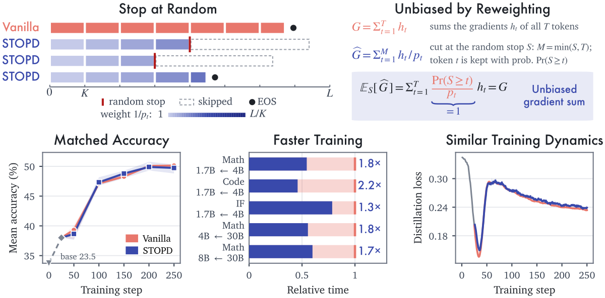

# STOPD: Random pre-generation truncation with token-level inverse probability weighting

<!-- source-sha256: 4559f7fe1cfb53fb0603b4845177f4138b6d07f3e6f9a5a236f4be6f4496cfc5 -->

[简体中文](README.md)

> L1 cutoff, inverse probability weighting, and lagged-normalizer component with genuine short-policy updates. Full long-rollout training was not reproduced due to cost; review is complete. This is not a fixed prefix cutoff.

## Paper information

| Field | Details |
|---|---|
| Paper | [arXiv 2610.21337](https://arxiv.org/abs/2610.21337); [pinned v1 full text](https://arxiv.org/html/2610.21337v1) |
| Institution | First author Zhengxin Zhang, Cornell University; collaborators from Georgia Tech and Alibaba Group. |
| First public release | 2026-10-15T06:22:08Z (arXiv v1, UTC) |
| Author code | No author method repository was found or confirmed; independently implemented from the public equations. |
| Local adapter or method key | `stopd`; `adapter: null`. |
| Local reproduction code | [`stopd.py`](https://github.com/daiwk/auto-research/blob/main/src/auto_research/post_training/stopd.py) under [`src/auto_research/post_training/`](https://github.com/daiwk/auto-research/tree/main/src/auto_research/post_training). |
| Runner | [`scripts/run_oct16_post_components.py`](https://github.com/daiwk/auto-research/blob/main/scripts/run_oct16_post_components.py) |

## Paper method and evidence

Sample an independent anchor for each response before generation and round it up to the end of its block. The student generates until that cutoff or natural EOS. Every retained token receives teacher supervision weighted by its exact inclusion probability; natural EOS is an ordinary valid token. Dividing by the current batch's random token count would invalidate the gradient-sum argument, so training uses the previous batch's weighted token count.




Original Figure 1 from the [paper](https://arxiv.org/html/2610.21337v1), rasterized from `fig_overview.svg`. Accuracy and runtime in the figure are author-reported, not local results. Copyright remains with the authors.

### Core equations

For maximum length $L$, block width $K$, and $A\sim\operatorname{Uniform}\{0,\ldots,L-1\}$:

$$
S=\min\{K(\lfloor A/K\rfloor+1),L\},\quad
p_t=P(S\ge t)=\frac{L-K\lfloor(t-1)/K\rfloor}{L},\quad w_t=1/p_t.
$$

This also covers a final block shorter than $K$. For a response that would end naturally at $T_i$, only $\min(T_i,S_i)$ is observed. The weighted sum $\widehat G=\sum_{i,t} I_{it}h_{it}/p_t$ satisfies $E_S\widehat G=G$ conditional on full trajectories. This does not imply equality of individual normalized SGD or Adam updates.

$$
\widehat L_k=\frac1{C_k}\sum_{i,t\le M_i}w_t\ell_{it},\quad
C_{W+1}=N_W,\quad C_k=\widehat N_{k-1}\ (k>W+1).
$$

Weights and normalizer are constants for differentiation. `STOPDSchedule` uses `begin_batch`, `loss`, and `finish_batch` to prevent sampling cutoffs after rollout, reusing a plan, or dividing by the current random count.

### Reported results

The authors report 25–48% token savings and 1.3–2.2× training speedups across math, coding, and instruction following, not measured locally. No production A/B was reported. Section 4 uses a 1.7B student and 4B teacher, batch 256, 250 steps × three seeds, 16K context, and two H100s per run; larger experiments use two H200s or GB200s.

## Local reproduction

The public [Hamlet 1524](https://www.gutenberg.org/ebooks/1524) text is pinned below and split by disjoint byte ranges (80%/10%/10%). A tiny next-token teacher is trained and frozen; the student generates online. After one vanilla warmup update, it uses actual random cutoffs and full-vocabulary reverse KL. No extra EOS is fabricated for truncated responses.

```bash
PYTHONPATH=src python scripts/run_oct16_post_components.py \
  --methods stopd --corpus-path /path/to/hamlet.txt \
  --corpus-id gutenberg:1524 \
  --corpus-revision sha256:31584c19795779431b5933499a45b9cecb03e8c246b6ea7e245a2b6d65e8e784 \
  --corpus-sha256 31584c19795779431b5933499a45b9cecb03e8c246b6ea7e245a2b6d65e8e784 \
  --device cpu --seeds 42,43,44 --output runs/stopd-component.json
```

[Three-seed CPU evidence](metrics/component-cpu-seeds42-44.json) records the exact warmup count, actual next-step cutoffs, the previous denominator used, the current weighted count reserved for the next step, and genuine nonzero parameter updates. `inclusion_probabilities` and `cutoffs_from_anchors` are independently callable; `reverse_kl_token_losses` does not backpropagate into the teacher.

Tests enumerate every anchor to verify the expected gradient sum for uneven blocks and natural EOS. They also check contiguous masks, cutoff violations, warmup, and the lagged denominator, without masking errors by averaging Monte Carlo draws. The full 16K, multi-optimizer training, accuracy, and timing matrix was not reproduced due to cost. This is `component_only` and `evolve_integrated: false`; local data support neither a speed nor a capability claim.
