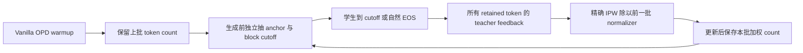
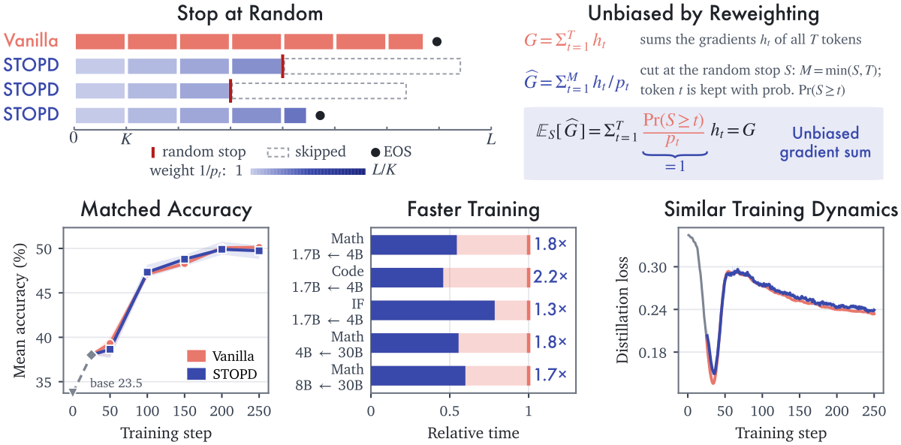

# STOPD：生成前随机截断与逐 token 逆概率校正

> **L1 cutoff / IPW / lagged normalizer 组件，真实短策略更新。** 完整长 rollout 训练成本过高，不复现（审查 DONE）；不是固定前缀截断的改名。

## 论文信息

| 字段 | 内容 |
|---|---|
| 论文链接 | [arXiv 2610.21337](https://arxiv.org/abs/2610.21337)；[固定 v1 全文](https://arxiv.org/html/2610.21337v1) |
| 公司 / 机构 | Cornell University 第一作者 Zhengxin Zhang；Georgia Tech、Alibaba Group 合作 |
| 首次公开日期 | 2026-10-15T06:22:08Z（UTC，arXiv v1） |
| 原作者代码 | 未找到 / 未确认原文方法代码仓库；从公开公式独立实现 |
| 本地 adapter / 方法键 | `stopd`；`adapter: null` |
| 本地复现代码 | [`stopd.py`](https://github.com/daiwk/auto-research/blob/main/src/auto_research/post_training/stopd.py) |
| 本地复现代码目录 | [`src/auto_research/post_training/`](https://github.com/daiwk/auto-research/tree/main/src/auto_research/post_training) |
| 运行入口 | [`run_oct16_post_components.py`](https://github.com/daiwk/auto-research/blob/main/scripts/run_oct16_post_components.py) |

## 原始论文总结

### 背景与主要改动

每条响应在生成**之前**独立采样 anchor，向上取整到 block 末尾，学生只生成到该 cutoff 或自然 EOS。保留的每个 token 都接收教师监督，并按其精确 inclusion probability 加权；自然 EOS 也是普通有效 token。若把截断结果直接除以本批随机 token 数，不能沿用无偏 gradient-sum 的论证，所以实现使用前一批加权 token count。



<!-- paper-figure:start -->
### 原论文关键图



> 原文 Figure 1，图片来自[原论文](https://arxiv.org/html/2610.21337v1)，版权归原作者所有。原 `fig_overview.svg` 栅格化；图中的准确率和耗时不是本地结果。
<!-- paper-figure:end -->

### 核心公式

最大长度 $L$、block 宽 $K$，$A\sim\operatorname{Uniform}\{0,\ldots,L-1\}$，

$$
S=\min\{K(\lfloor A/K\rfloor+1),L\},\quad
p_t=P(S\ge t)=\frac{L-K\lfloor(t-1)/K\rfloor}{L},\quad w_t=1/p_t.
$$

该公式适用于最后一个不足 $K$ 的 block。对完整自然终止长度 $T_i$，实际只观测 $\min(T_i,S_i)$。$\widehat G=\sum_{i,t} I_{it}h_{it}/p_t$ 满足条件期望 $E_S\widehat G=G$；**不是说每次归一化 SGD/Adam 更新都与 full rollout 相等**。

$$
\widehat L_k=\frac1{C_k}\sum_{i,t\le M_i}w_t\ell_{it},\quad
C_{W+1}=N_W,\quad C_k=\widehat N_{k-1}\ (k>W+1).
$$

权重与 normalizer 在微分中视为常量。`STOPDSchedule` 的 `begin_batch` / `loss` / `finish_batch` 两阶段合同防止晚采 cutoff、重复使用计划或误用当前随机分母。

### 论文离线与线上效果

原文跨数学、代码与 instruction following 报告 25–48% token 节省及 1.3–2.2 倍训练加速；不是本地小策略吞吐结论。线上 A/B：未报告。§4 主配置 1.7B student/4B teacher、batch256、250 steps×3 seeds、最长16K，每 run 2×H100；大规模使用 2×H200/GB200，完整成本超过本轮预算。

## 本地复现

### 数据协议与运行

固定公开 [Hamlet 1524](https://www.gutenberg.org/ebooks/1524)，revision `sha256:31584c19795779431b5933499a45b9cecb03e8c246b6ea7e245a2b6d65e8e784`；byte 范围 80%/10%/10% 隔离。微型教师 next-token 训练后冻结，学生真实在线生成；先作一次 Vanilla 更新，再实际随机截断，局部 loss 使用 full-vocabulary reverse-KL。EOS 来自策略采样，不为截断轨迹额外伪造 EOS。

```bash
PYTHONPATH=src python scripts/run_oct16_post_components.py \
  --methods stopd --corpus-path /path/to/hamlet.txt \
  --corpus-id gutenberg:1524 \
  --corpus-revision sha256:31584c19795779431b5933499a45b9cecb03e8c246b6ea7e245a2b6d65e8e784 \
  --corpus-sha256 31584c19795779431b5933499a45b9cecb03e8c246b6ea7e245a2b6d65e8e784 \
  --device cpu --seeds 42,43,44 --output runs/stopd-component.json
```

### 结果、代码映射与边界

[CPU 三 seed 证据](metrics/component-cpu-seeds42-44.json)记录 warmup exact count、下一步实际 cutoffs、使用的前批分母、本批仅供下步使用的 weighted count 和真实非零参数更新。`inclusion_probabilities` 与 `cutoffs_from_anchors` 是可独立调用的精确算子，`reverse_kl_token_losses` 不给教师回传梯度。

单测枚举所有 anchors，对非整除 block、含自然 EOS 的局部 loss 核对**期望 gradient sum**，同时检查 contiguous mask、cutoff 超限、warmup 与 lagged denominator。没有用 Monte Carlo 平均掩盖错误权重。未跑 16K、多优化器大模型误差/加速曲线；本地数据不能支持论文速度或能力结论。完整实验**成本过高，不复现（审查 DONE）**；`component_only`、`evolve_integrated: false`。
