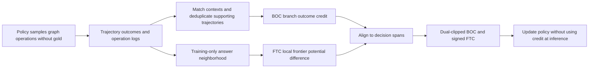
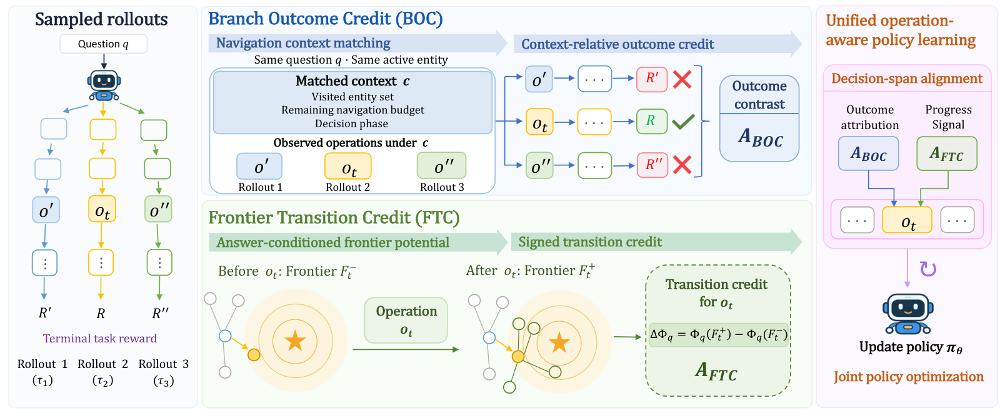

# OpCredit: Assign knowledge-graph Agent credit to specific operations

<!-- source-sha256: 68850a49841d1702552ad4020e63204a73b9860466f8f33e47c304390cc5f4f0 -->

[简体中文](README.md)

> L1 credit-assignment and gradient component, not a reproduction of CWQ, WebQSP, or GrailQA capability. Full experiments were not reproduced due to cost; review is complete. Gold labels are used only to compute training credit after rollout, never as Actor input or for Evolve promotion.

## Paper information

| Field | Details |
|---|---|
| Paper | [arXiv 2610.21345](https://arxiv.org/abs/2610.21345); [pinned v1 HTML](https://arxiv.org/html/2610.21345v1); [PDF](https://arxiv.org/pdf/2610.21345v1) |
| Institution | First author Yucheng Li, State Key Laboratory for Novel Software Technology, Nanjing University; collaborators include the University of Oxford. |
| First public release | 2026-10-15T06:29:17Z (arXiv v1, UTC) |
| Author code | [kaka1215/OpCredit](https://github.com/kaka1215/OpCredit), Apache-2.0; includes BOC/FTC and training adaptations, but configuration templates are unfilled and formal evaluation scripts are absent. See its `THIRD_PARTY_NOTICES.md` for third-party attribution. |
| Local adapter or method key | `opcredit`; `adapter: null`, standalone component. |
| Local reproduction code | [`operation_credit.py`](https://github.com/daiwk/auto-research/blob/main/src/auto_research/post_training/operation_credit.py) under [`src/auto_research/post_training/`](https://github.com/daiwk/auto-research/tree/main/src/auto_research/post_training). |
| Runner | [`scripts/run_oct17_supplement_post.py`](https://github.com/daiwk/auto-research/blob/main/scripts/run_oct17_supplement_post.py) |

## Paper method and evidence

An unsuccessful trajectory can contain useful operations, and a successful one can take detours. Branch Outcome Credit (BOC) reuses ordinary rollout outcomes by matching the question, active entity, visited set, remaining budget, and decision stage. Frontier Transition Credit (FTC) measures whether the operation's own local frontier moved toward the answer neighborhood. Both credits align to the same reasoning and executable-operation span; tool observations incur no policy loss. [Section 3 and Appendix D](https://arxiv.org/html/2610.21345v1#S3)



[](https://arxiv.org/html/2610.21345v1/method_overview_editable.png)

Original Figure 2 from the [paper](https://arxiv.org/abs/2610.21345); copyright remains with the authors.

### Core equations

Each trajectory counts once in $\Omega_q(c,o)$ and $\Omega_q(c)$. Let $\Delta=\widehat Q(c,o)-\widehat V(c)$:

$$
A_{BOC}=\begin{cases}\Delta/(\sigma_q+\epsilon),&\Delta\ne0,\\
(R_i-\mu_q)/(\sigma_q+\epsilon),&\Delta=0.\end{cases}
$$

Answer entities have $\delta=0$, their constructed one-hop neighbors have $\delta=1$, and all others have $\delta=2$. Use the best opportunity in the operation's local frontier, not average distance:

$$
\Phi_q(F)=\max_{e\in F}(2-\delta_q(e)),\qquad A_{FTC}=\Phi_q(F^+)-\Phi_q(F^-).
$$

Empty frontiers, unresolved entities, and questions without mapped gold have no FTC. BOC uses a clipped GRPO surrogate, taking the maximum with $c_{dc}A$ for negative advantages. FTC adds a signed likelihood term:

$$
L=L_{BOC}-\lambda_{aux}\mathbb E[B_{ij}\log\pi_\theta(y_{ij}\mid h_{ij})]+\beta KL-\lambda_H H.
$$

Reduce over generated tokens per trajectory, then average trajectories. The paper does not specify the numerical KL estimator; the local component uses full-categorical $KL(p_\theta\parallel p_{SFT})$. Standard deviation defaults to population with an explicit sample option. Credit, old policy, and SFT reference are detached.

### Reported results

In [Table 2](https://arxiv.org/html/2610.21345v1#S4), Qwen2.5-7B reported Hit@1 of 83.47/92.13/90.18 on CWQ/WebQSP/GrailQA, versus 72.15/86.28/83.73 for SFT. Table 3 includes BOC, FTC, and GRPO ablations with matched initialization and training. Some external baselines are cited, not retrained. No production A/B was reported.

## Local reproduction

A randomly initialized four-input, three-output policy genuinely samples six relation-choice and answer trajectories per question on two fixed tiny graphs. Gold is used only after rollout for terminal reward and neighborhood credit. Actor input is allowlisted to question, active entity, visited set, budget, stage, and visible entities. No Freebase, pretrained LLM, template SFT, or formal KGQA evaluation is used.

```bash
PYTHONPATH=src python scripts/run_oct17_supplement_post.py \
  --methods opcredit --device cpu --seeds 42,43,44 \
  --output runs/opcredit-component.json
```

Use `--device cuda` for CUDA; unavailable CUDA fails. The runner defaults to four real updates, capped at 12, and never overwrites output. Artifacts record source SHA-256, commit, seed, device, independent formula errors, and negative controls.

On 2026-10-17 an NVIDIA A100 completed four updates for each of seeds 42/43/44: [per-seed metrics](metrics/component-cuda-seeds42-44.json), [sanitized receipt](../../gpu-validations/opcredit-supplement-a100-20261017.json). Mean parameter $L_2$ change was 0.11930. Independent BOC/FTC reference error and frozen-reference movement were zero; duplicate trajectory records did not change credit. CPU runs were aggregated separately. None of these is a KGQA capability comparison.

- `branch_outcome_credit` deduplicates full-context support sets and falls back to the original trajectory advantage when the branch difference is zero. It never mixes question statistics.
- `frontier_transition_credit` checks eligibility, preserves negative potential changes, and does not substitute a cumulative history for the operation's local frontier.
- `align_decision_credits` requires exact coverage of generated tokens and rejects overlaps, observations, and padding.
- `operation_policy_loss` backpropagates dual-clipped BOC, signed FTC, and reference regularization without gradients to old policy, reference, or credit. Tests cover five kinds of context isolation, maximum potential, missing frontiers, gold allowlisting, zero masked gradients, and ratio overflow.

**Not reproduced:** Appendix A describes eight RTX 5880 48GB GPUs and about 2,500 GPU-hours for SFT, RL, ablations, and evaluation; 3B/7B/8B models, 1,600 RL steps, six rollouts per question, full Freebase RDF, and SPARQL. The single A100/A30 or Mac budget does not cover this, and no full trial was attempted. This is `diagnostic_only: true`, `promotion_eligible: false`, and `evolve_integrated: false`, not a usable KGQA Agent.
