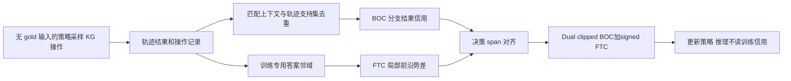
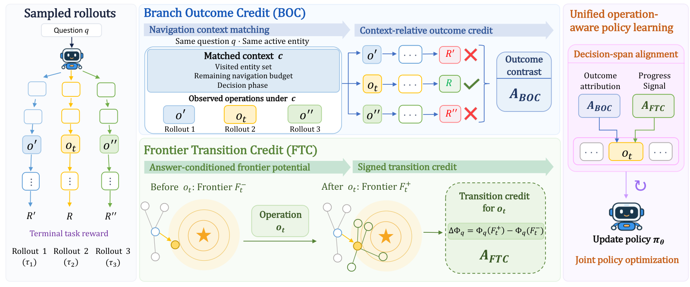

# OpCredit：把知识图谱 Agent 的奖励对齐到具体操作

> **L1 信用分配与梯度组件，不是 CWQ/WebQSP/GrailQA 能力复现。** 原文完整实验成本过高，不复现（审查 DONE）；本地 gold 只供训练后信用计算，不进入 Actor 输入或 evolve 晋级。

## 论文信息

| 字段 | 内容 |
|---|---|
| 论文链接 | [arXiv 2610.21345](https://arxiv.org/abs/2610.21345)；[固定 v1 HTML](https://arxiv.org/html/2610.21345v1)；[PDF](https://arxiv.org/pdf/2610.21345v1) |
| 公司 / 机构 | 第一作者 Yucheng Li，南京大学计算机软件新技术国家重点实验室；合作机构包括牛津大学 |
| 首次公开日期 | 2026-10-15T06:29:17Z（UTC，arXiv v1） |
| 原作者代码 | 已公开：[kaka1215/OpCredit](https://github.com/kaka1215/OpCredit)；含 BOC/FTC 和训练适配，配置模板未填、正式评测脚本未附 |
| 代码许可 | Apache-2.0；上游第三方归属另见其 THIRD_PARTY_NOTICES.md |
| 本地 adapter / 方法键 | `opcredit`；`adapter: null`，仅独立组件 |
| 本地复现代码 | [`operation_credit.py`](https://github.com/daiwk/auto-research/blob/main/src/auto_research/post_training/operation_credit.py) |
| 本地复现代码目录 | [`src/auto_research/post_training/`](https://github.com/daiwk/auto-research/tree/main/src/auto_research/post_training) |
| 运行入口 | [`run_oct17_supplement_post.py`](https://github.com/daiwk/auto-research/blob/main/scripts/run_oct17_supplement_post.py) |

## 原始论文总结

### 背景与主要改动

整条轨迹失败不代表每一步都无用，成功轨迹也可能绕路。OpCredit 的 BOC 从普通 rollout 中复用分支结果：同题、同活动实体，再匹配访问集合、剩余预算和决策阶段；FTC 则衡量**该操作局部前沿**相对答案邻域的进退。两种信用对齐同一段推理及可执行操作 token，不给工具观察记策略损失。[原文 §3、附录D](https://arxiv.org/html/2610.21345v1#S3)



<!-- paper-figure:start -->
### 原论文关键图

[](https://arxiv.org/html/2610.21345v1/method_overview_editable.png)

> **原论文 Figure 2（关键图）**：展示原论文的训练流程与关键优化环节。图片来自[原论文](https://arxiv.org/abs/2610.21345)，版权归原作者所有；点击图片可查看来源。
<!-- paper-figure:end -->

### 核心公式

支持集 $\Omega_q(c,o)$ 和 $\Omega_q(c)$ 内**每条轨迹只计一次**。令 $\Delta=\widehat Q(c,o)-\widehat V(c)$：

$$
A_{BOC}=\begin{cases}\Delta/(\sigma_q+\epsilon),&\Delta\ne0,\\
(R_i-\mu_q)/(\sigma_q+\epsilon),&\Delta=0.\end{cases}
$$

答案实体、其构造的一跳邻居和其余实体的 $\delta$ 分别为0、1、2。局部前沿取最佳机会而非平均距离：

$$
\Phi_q(F)=\max_{e\in F}(2-\delta_q(e)),\qquad A_{FTC}=\Phi_q(F^+)-\Phi_q(F^-).
$$

空前沿、未解析实体、没有映射 gold 的题目不产生 FTC。BOC 用 clipped GRPO surrogate；负优势再与 $c_{dc}A$ 取最大值。FTC 为带符号的辅助似然项：

$$
L=L_{BOC}-\lambda_{aux}\mathbb E[B_{ij}\log\pi_\theta(y_{ij}\mid h_{ij})]+\beta KL-\lambda_H H.
$$

各项均先对每条轨迹的生成 token 取均值，再跨轨迹取均值。原文未指定 KL 的数值估计器，本组件明确采用完整类别分布 $KL(p_\theta\parallel p_{SFT})$；标准差默认总体口径，可显式切为样本口径。信用、旧策略和 SFT 参考都 detach，不借信用计算链反传。

### 论文离线与线上效果

原文表2 Qwen2.5-7B 在 CWQ/WebQSP/GrailQA 的 Hit@1 为83.47/92.13/90.18，SFT 对照为72.15/86.28/83.73；表3有固定初始化及训练设置下的 BOC、FTC、GRPO 消融。主表部分外部基线是引用分数，不是全部重新训练。线上 A/B 未报告。[原文 §4、附录A](https://arxiv.org/html/2610.21345v1#S4)

## 本地复现

### 数据协议与运行

随机初始化4输入、3输出的小策略在两个固定微型图上，每题真实采样6条关系选择＋答案动作轨迹。gold 仅在 rollout 结束后计算终止奖励与邻域信用；公开状态白名单只有题目、活动实体、访问集合、预算、阶段和可见实体，不能传 gold 字段。没有 Freebase、预训练 LLM、模板 SFT 或正式 KGQA 评测。

```bash
PYTHONPATH=src python scripts/run_oct17_supplement_post.py \
  --methods opcredit --device cpu --seeds 42,43,44 \
  --output runs/opcredit-component.json
```

CUDA 改用 `--device cuda`；无 CUDA 不回退。默认4次真实 optimizer updates，最多12次，输出不覆盖。结果带源码 SHA256、commit、seed、设备、独立公式误差与负对照；三种子仍不能升级为能力比较。

### 结果、代码映射与边界

2026-10-17 已在真实 NVIDIA A100 上完成 seeds42/43/44，各4次更新：[逐 seed 指标](metrics/component-cuda-seeds42-44.json)、[净化 GPU 回执](../../gpu-validations/opcredit-supplement-a100-20261017.json)。参数变化 $L_2$ 均值0.11930，BOC/FTC 独立 reference 误差为0，冻结参考变化为0，重复轨迹记录不改变支持集信用。另有独立 CPU 三种子运行，不与 CUDA 混合聚合；这些是公式及梯度诊断，不是 KGQA 能力比较。

- `branch_outcome_credit` 使用完整上下文 key 和集合去重，零差回退原轨迹优势，跨题统计不混合。
- `frontier_transition_credit` 检查 eligibility 并保留负势差；不会以累计历史前沿代替操作局部前沿。
- `align_decision_credits` 要求 spans 恰好覆盖生成 token；重叠、观察 token 和 padding 均拒绝。
- `operation_policy_loss` 实际反传 dual-clipped BOC、signed FTC 和参考正则；旧策略、参考与信用无梯度。测试覆盖五类匹配隔离、最大势函数、missing frontier、gold 白名单、mask 零梯度及比率溢出。

**不复现的完整实验：** 原文附录A为8张 RTX5880 48GB，SFT/RL/消融/评测约2500 GPU小时；3B/7B/8B模型、1600步 RL、每题6rollout，还需完整 Freebase RDF 与 SPARQL 服务。对单张 A100/A30 或 Mac 成本过高，未探跑。组件固定 `diagnostic_only: true`、`promotion_eligible: false`、`evolve_integrated: false`；这里的程序性动作采样绝非“已实现可用的 KGQA Agent”。
