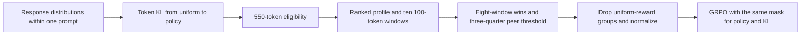
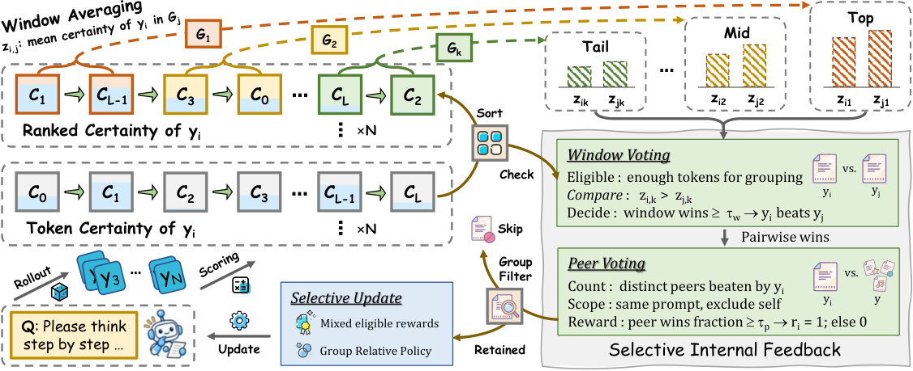

# SIF: Selective updates from ranked self-certainty windows and two-stage voting

<!-- source-sha256: 6887ec70436e2072c2647cfbd0ccc5966748d23ee5b2d45048cc81bccf5fb5b2 -->

[简体中文](README.md)

> L1 eligibility, voting, and dual-mask component. Default eligibility is still 550 tokens; short online updates are a separate short-window diagnostic, not default SIF training. Full experiments were not reproduced due to cost; review is complete.

## Paper information

| Field | Details |
|---|---|
| Paper | [arXiv 2610.21392](https://arxiv.org/abs/2610.21392); [pinned v1 full text](https://arxiv.org/html/2610.21392v1) |
| Institution | First author Xun Lu's primary affiliation is the Institute of Automation, Chinese Academy of Sciences (superscript 1); University of Chinese Academy of Sciences is also listed (superscript 2). Pengcheng Laboratory is a collaborator. |
| First public release | 2026-10-15T07:08:46Z (arXiv v1, UTC) |
| Author code | No released author method repository was found or confirmed. The component was independently implemented from the equations. |
| Local adapter or method key | `sif`; `adapter: null`. |
| Local reproduction code | [`sif.py`](https://github.com/daiwk/auto-research/blob/main/src/auto_research/post_training/sif.py) under [`src/auto_research/post_training/`](https://github.com/daiwk/auto-research/tree/main/src/auto_research/post_training). |
| Runner | [`scripts/run_oct16_post_components.py`](https://github.com/daiwk/auto-research/blob/main/scripts/run_oct16_post_components.py) |

## Paper method and evidence

Average self-certainty can rise even for confidently wrong responses. SIF compares ranked certainty profiles within the same prompt rather than treating confidence as a correctness label. It first votes over windows, then derives a binary reward from the fraction of eligible peers beaten. Ineligible responses and constant-reward groups are filtered; policy and KL terms both use the selection mask.





Original Figure 3 from the [paper](https://arxiv.org/html/2610.21392v1), retaining the original `SIF_main.png`. Not a local result; copyright remains with the authors.

### Core equations

Per-token certainty is $c_t=KL(U\Vert\pi(\cdot|s_t))=-\log|V|-|V|^{-1}\sum_v\log\pi(v|s_t)$, not entropy or sampled-token probability. Defaults $K=10,w=100,s=50$ give $L_{min}=w+(K-1)s=550$. Sort valid certainty values descending; zero-based starts are $a_k=\lfloor k(L-w)/(K-1)\rfloor$, and $z_k$ is the mean of the corresponding $w$ tokens.

$$
v_{ij}=\sum_{k=1}^{K}\mathbf1[z_{ik}>z_{jk}],\quad
b_{ij}=\mathbf1[v_{ij}\ge8],\quad
r_i=\mathbf1[\sum_{j\ne i}b_{ij}\ge0.75(|E|-1)].
$$

Compare eligible peers only, excluding self; ties do not vote. Groups with fewer than two eligible responses or identical eligible rewards do not update. Freeze advantages computed using eligible reward mean and sample standard deviation ($n-1$). Retained groups keep Equation 11's original $1/G$ factor and per-response length normalization; ineligible responses contribute zero rather than changing the factor to $1/G'$. Clipped policy and low-variance KL use the same token mask.

### Reported results

The paper compares three backbones on 12 mathematics and science benchmarks. For Qwen3-1.7B, SIF final averaged 45.29%, versus 39.18% for the original model and 43.46% for Intuitor best-validation. These are not local accuracy scores; no production A/B was reported. Appendix B uses eight A100-40GBs, full-parameter FSDP, 64 × 8 rollouts, 3,072 maximum tokens, and 80/115 steps. The paper used MATH test for online validation; the local diagnostic does not select checkpoints on test data.

## Local reproduction

The runner uses public [Hamlet 1524](https://www.gutenberg.org/ebooks/1524) at the SHA-256 revision below, with disjoint 80%/10%/10% byte ranges for training, validation, and test. It does not tune on held-out NLL.

Default 16-token online rollouts are all rejected by the 550-token eligibility check. An explicitly labeled short-window run uses $K=2,w=4,s=2$, minimum length six, to verify genuine gradients and updates through sorting, both votes, normalization, and both masks. This does not claim equivalence to default SIF; no 550-token generation is used to circumvent the cost gate.

```bash
PYTHONPATH=src python scripts/run_oct16_post_components.py \
  --methods sif --corpus-path /path/to/hamlet.txt \
  --corpus-id gutenberg:1524 \
  --corpus-revision sha256:31584c19795779431b5933499a45b9cecb03e8c246b6ea7e245a2b6d65e8e784 \
  --corpus-sha256 31584c19795779431b5933499a45b9cecb03e8c246b6ea7e245a2b6d65e8e784 \
  --device cpu --seeds 42,43,44 --output runs/sif-component.json
```

[Three-seed CPU metrics](metrics/component-cpu-seeds42-44.json) separately record zero default-eligible responses and actual short-window update gradients and parameter movement. Confidence is not correctness; NLL is not mathematical accuracy. `VotingConfig` retains original defaults; `token_self_certainty` accepts full-vocabulary logits; `prepare_credit` handles eligibility and votes; `sif_ppo_loss` updates under both masks.

Independent tests cover the true 550-token boundary, first and last of ten 100-token windows, the eight-window threshold, peer and self exclusion, sample standard deviation, constant rewards, and zero KL gradients for filtered responses. No random certainty generator substitutes for a capability model. Long-rollout multi-A100 training on 12 benchmarks was not reproduced due to cost. This is `component_only` and `evolve_integrated: false`; multiple short-window seeds do not establish capability.
