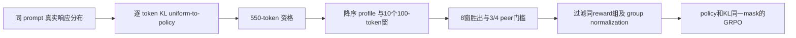
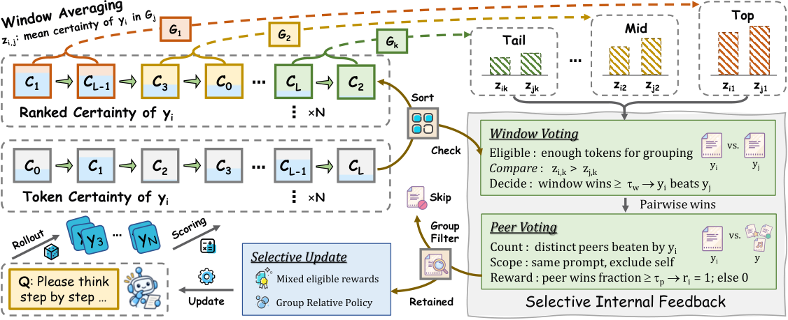

# SIF：排序自确定性窗口与两级投票的选择性更新

> **L1 完整资格 / 投票 / 双 mask 公式组件。** 默认资格仍为 550 tokens；短在线更新单独标为缩窗诊断，不能当原文默认 SIF 训练。完整实验成本过高，不复现（审查 DONE）。

## 论文信息

| 字段 | 内容 |
|---|---|
| 论文链接 | [arXiv 2610.21392](https://arxiv.org/abs/2610.21392)；[固定 v1 全文](https://arxiv.org/html/2610.21392v1) |
| 公司 / 机构 | 第一作者 Xun Lu 第一署名为 Institute of Automation, Chinese Academy of Sciences（PDF 首页上标1），另署 University of Chinese Academy of Sciences（上标2）；Pengcheng Laboratory 为合作单位 |
| 首次公开日期 | 2026-10-15T07:08:46Z（UTC，arXiv v1） |
| 原作者代码 | 未找到 / 未确认已发布的原作者方法代码仓库；独立按公式实现 |
| 本地 adapter / 方法键 | `sif`；`adapter: null` |
| 本地复现代码 | [`sif.py`](https://github.com/daiwk/auto-research/blob/main/src/auto_research/post_training/sif.py) |
| 本地复现代码目录 | [`src/auto_research/post_training/`](https://github.com/daiwk/auto-research/tree/main/src/auto_research/post_training) |
| 运行入口 | [`run_oct16_post_components.py`](https://github.com/daiwk/auto-research/blob/main/scripts/run_oct16_post_components.py) |

## 原始论文总结

### 背景与主要改动

平均 self-certainty 可以随错误置信一起增长。SIF 不把它当正确性标签，而是比较同一 prompt 内响应的排序 certainty profile：先按窗口比较投票，再按击败 peer 的比例给二元 reward，过滤不具资格的响应和同 reward 组。policy 与 KL 必须同时施加选择 mask。



<!-- paper-figure:start -->
### 原论文关键图



> 原文 Figure 3，图片来自[原论文](https://arxiv.org/html/2610.21392v1)，版权归原作者所有。保留原 `SIF_main.png`，不是本地结果。
<!-- paper-figure:end -->

### 核心公式

每 token certainty 是 $c_t=KL(U\Vert\pi(\cdot|s_t))=-\log|V|-|V|^{-1}\sum_v\log\pi(v|s_t)$，**不是 entropy 或 sampled-token probability**。默认 $K=10,w=100,s=50$，因此 $L_{min}=w+(K-1)s=550$。有效 token 的 $c$ 降序排序，零基 window start 为 $a_k=\lfloor k(L-w)/(K-1)\rfloor$，$z_k$ 为对应 $w$ 个 token 的均值。

$$
v_{ij}=\sum_{k=1}^{K}\mathbf1[z_{ik}>z_{jk}],\quad
b_{ij}=\mathbf1[v_{ij}\ge8],\quad
r_i=\mathbf1[\sum_{j\ne i}b_{ij}\ge0.75(|E|-1)].
$$

只比较 eligible peers、排除自身、tie 不投票；少于两个 eligible 或 eligible rewards 全相同的组不更新。优势采用 eligible reward 的均值与**sample std（n−1）**，并冻结。在 retained group 内保留 Eq.11 的原 $1/G$ 响应因子和逐响应长度归一；不具资格响应贡献零，而不是重新改为 $1/G'$。GRPO clipped policy 与 low-variance KL 共用相同 token mask。

### 论文离线与线上效果

原文三 backbone、12 数学/科学 benchmark；Qwen3-1.7B 的 SIF final 平均 45.29%，原模型 39.18%，Intuitor best-validation 43.46%。这是原文、不是本地正确率。线上 A/B：未报告。附录 B 使用 8×A100-40GB、FSDP 全参、64×8 rollouts、最长3072、80/115 steps。原文以 MATH test 做 online validation，本地不照搬 test 选 checkpoint。

## 本地复现

### 数据协议与运行

固定公开 [Hamlet 1524](https://www.gutenberg.org/ebooks/1524)，revision `sha256:31584c19795779431b5933499a45b9cecb03e8c246b6ea7e245a2b6d65e8e784`；train/validation/test byte 区间 80%/10%/10% 不相交，不按 heldout NLL 选超参。

默认 16-token 真实在线 rollout **全部不满足 550 资格**，runner 如实记录默认拒绝结果。为验算短策略 gradient 和参数更新，另显式使用 $K=2,w=4,s=2$、最小长度6的缩窗配置，仍走排序、双投票、group normalization、policy/KL 双 mask；这只是**short-window mechanism diagnostic**，不是默认参数或论文训练缩小后仍等价的声明。不生成 550-token 长链来绕过成本门槛。

```bash
PYTHONPATH=src python scripts/run_oct16_post_components.py \
  --methods sif --corpus-path /path/to/hamlet.txt \
  --corpus-id gutenberg:1524 \
  --corpus-revision sha256:31584c19795779431b5933499a45b9cecb03e8c246b6ea7e245a2b6d65e8e784 \
  --corpus-sha256 31584c19795779431b5933499a45b9cecb03e8c246b6ea7e245a2b6d65e8e784 \
  --device cpu --seeds 42,43,44 --output runs/sif-component.json
```

### 结果、代码映射与边界

[CPU 三 seed 指标](metrics/component-cpu-seeds42-44.json)分别记录默认 eligible 数0与缩窗真实 update 的 gradient/参数变化；confidence 不是 correctness，NLL 也不是数学准确率。`VotingConfig` 的默认值不变；`token_self_certainty` 提供真实 full-vocabulary logits 接口；`prepare_credit` 执行资格、窗口和双投票；`sif_ppo_loss` 执行双 mask 更新。

数值测试独立覆盖真实默认550资格边界、10×100首尾窗口、8窗投票、peer/self 排除、sample std、同 reward group 丢弃及**被过滤响应的 KL 梯度也为零**。没有随机 confidence 生成器充当能力模型。完整多 A100 长生成与12基准训练**成本过高，不复现（审查 DONE）**；`component_only`、`evolve_integrated: false`，缩窗多 seed 不升级为正式能力比较。
