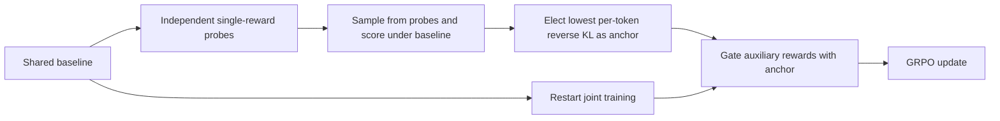
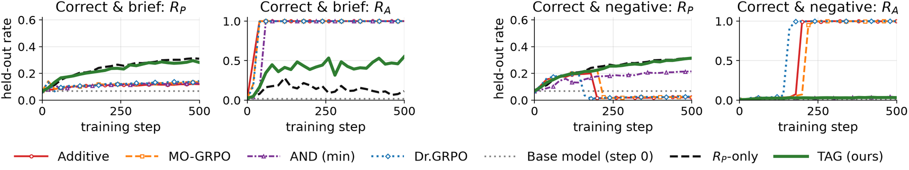

# TAG: Use a trusted anchor to gate multi-reward optimization

<!-- source-sha256: 80ae87925ddaed87f00e62a49e40d87dda1e0d9fe9b35484f0e54b281712298b -->

[简体中文](README.md)

> L1 algorithm and gradient diagnostic, not a reproduction of mathematical or coding capability. Full experiments were not reproduced due to cost; review is complete and the component cannot be promoted by Evolve.

## Paper information

| Field | Details |
|---|---|
| Paper | [arXiv 2610.21404](https://arxiv.org/abs/2610.21404); [pinned v1 full text](https://arxiv.org/html/2610.21404v1) |
| Institution | First author Yushu Li, University of British Columbia; work done during an Amazon Annapurna Labs internship, with authors from both institutions. |
| First public release | 2026-10-15T07:21:58Z (arXiv v1, UTC) |
| Author code | No official TAG repository was found in the paper or author search; release status and license are unconfirmed. |
| Local adapter or method key | `tag-reward-gating`; `adapter: null`, standalone component. |
| Local reproduction code | [`src/auto_research/post_training/reviewed_oct18.py`](https://github.com/daiwk/auto-research/blob/main/src/auto_research/post_training/reviewed_oct18.py), `elect_anchor` and `tag_reward`. |
| Runner | [`scripts/run_oct18_post_components.py`](https://github.com/daiwk/auto-research/blob/main/scripts/run_oct18_post_components.py) |

## Paper method and evidence

When correctness is added to brevity or latency rewards, an easier auxiliary reward can dominate GRPO: total reward rises while the main task deteriorates. TAG trains a separate probe for each reward from the same baseline, elects the least distribution-shifting reward as the anchor, discards the probes, and restarts joint training from the original baseline. Auxiliary credit requires anchor success. [Section 5](https://arxiv.org/html/2610.21404v1#S5)



[](https://arxiv.org/html/2610.21404v1/figures/exp_main_ruh_1p7b.png)

Original Figure 5 from the [paper](https://arxiv.org/abs/2610.21404), not a local result. [Figure 1](https://arxiv.org/html/2610.21404v1#S1) illustrates reward hacking with short, incorrect answers; Figure 4 shows why reverse KL is sensitive to newly introduced modes. Rights remain with the authors.

### Core equations

Probe trajectories must be sampled by $\pi_{T,k}$ itself, not by the baseline:

$$
\widehat d_k=\frac{\sum_{x,y\sim\pi_{T,k}}\sum_t[\log\pi_{T,k}(y_t\mid h_t)-\log\pi_0(y_t\mid h_t)]}{\sum_{x,y\sim\pi_{T,k}}|y|},\qquad k^*=\arg\min_k\widehat d_k.
$$

This pools all generated tokens rather than weighting responses equally. Finite-sample estimates can be negative and must not be clamped before election. Equation 6 defines:

$$
R_{TAG}=R_{k^*}\frac{1+\sum_{k\ne k^*}\lambda_k R_k}{1+\sum_{k\ne k^*}\lambda_k},\qquad\lambda_k\ge0.
$$

If $R_{k^*}=0$, auxiliaries receive no credit. Anchor-only and joint success still differ.

### Reported results

For Qwen3-4B under correctness and concision rewards, TAG reached pass@4 of 0.581 versus 0.220 for simple addition. Responses were 44% shorter than correctness-only optimization, but pass@4 remained about five percentage points lower than that baseline. See [Table 1 and Section 6.2](https://arxiv.org/html/2610.21404v1#S6.SS2); no production A/B was reported.

## Local reproduction

The runner uses a randomly initialized, 8-dimensional causal cumulative-embedding policy with a 32-token vocabulary. Its two artificial rewards check token parity, not mathematical correctness. Each probe updates three times from the same baseline, genuinely samples held-out prompts for election, then joint training restarts from the unchanged baseline for three gated updates.

```bash
PYTHONPATH=src python scripts/run_oct18_post_components.py \
  --methods tag-reward-gating --device cpu --seeds 42,43,44 \
  --output runs/tag-component.json
```

Use `--device cuda` for CUDA; unavailable CUDA fails rather than silently falling back. Outputs cannot overwrite previous results and record seed, device, commit, and source SHA-256. Default three updates, maximum eight; budget does not expand automatically.

On 2026-10-18 a real NVIDIA A100 completed three joint and six probe updates per seed (42/43/44): [receipt](../../gpu-validations/tag-reward-gating-a100-20261018.json), [per-seed metrics](metrics/component-cuda-seeds42-44.json). Mean student parameter $L_2$ change was 0.039629; all gradients and updates were nonzero. Maximum independent scalar-reference error was about $3.70\times10^{-17}$. Baseline reset, anchor/gate formula, and auxiliary-only zero-credit checks had zero error. The elected anchors were 0, 0, and 1; no runs were discarded. `elect_anchor` implements the sampling estimator; `tag_reward` preserves the normalization denominator; `group_advantages` and `policy_surrogate` drive actual updates. These are artificial-verifier diagnostics, not task accuracy.

**Not reproduced:** The original 1.7B–30B model matrix, 500 steps per arm, 300 extra probe steps per reward, and reward aggregation comparisons are too costly for one A100/A30 or Mac. No full run or runtime estimate was attempted. This remains `diagnostic_only: true`, `promotion_eligible: false`, and `evolve_integrated: false`.
