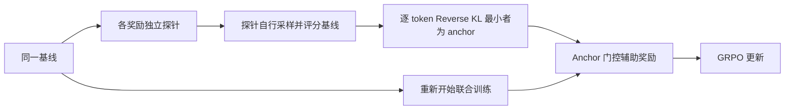
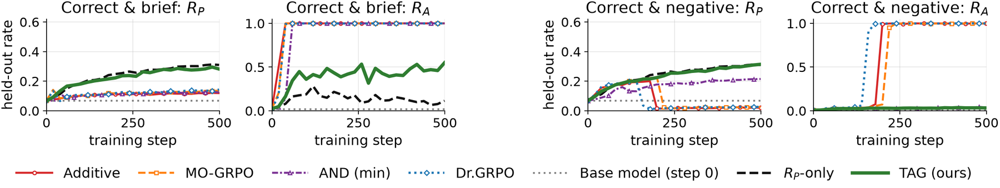

# TAG：用可信锚点约束多奖励优化

> **L1 算法组件／梯度诊断，不是数学或代码能力复现。** 完整实验成本过高，不复现（审查 DONE）；不参与 evolve 晋级。

## 论文信息

| 字段 | 内容 |
|---|---|
| 论文链接 | [arXiv 2610.21404](https://arxiv.org/abs/2610.21404)；[固定 v1 全文](https://arxiv.org/html/2610.21404v1) |
| 公司 / 机构 | 一作 Yushu Li 属 University of British Columbia；工作在 Amazon Annapurna Labs 实习期间完成，合作作者来自两机构 |
| 首次公开日期 | 2026-10-15T07:21:58Z（UTC，arXiv v1） |
| 原作者代码 | 未在论文及作者检索结果中找到 TAG 方法官方仓库；不是“确认未开源” |
| 代码许可 | 未找到方法代码，许可未确认 |
| 本地 adapter / 方法键 | `tag-reward-gating`；`adapter: null`，独立组件，不是能力 adapter |
| 本地代码位置 | [`src/auto_research/post_training/reviewed_oct18.py`](https://github.com/daiwk/auto-research/blob/main/src/auto_research/post_training/reviewed_oct18.py)：`elect_anchor`、`tag_reward` |
| 运行入口 | [`scripts/run_oct18_post_components.py`](https://github.com/daiwk/auto-research/blob/main/scripts/run_oct18_post_components.py) |

## 原始论文总结

### 背景与主要改动

正确性和简短、低时延等奖励相加时，容易获取的辅助奖励可能主导 GRPO：总奖励上涨，主要任务却变差。TAG 不是简单降低辅助权重，而是先从同一基线分别优化每个奖励，观察哪个探针对基线的分布漂移最小，再将该奖励选为 anchor。随后丢弃探针、从原基线重新联合训练，辅助信用只有在 anchor 满足时才生效。[原文 §5](https://arxiv.org/html/2610.21404v1#S5)



原文关键图：[Figure 1：短而错误的奖励投机](https://arxiv.org/html/2610.21404v1#S1)；Figure 4 展示 reverse KL 对新造模式的敏感性。它们不是本地训练结果。

<!-- paper-figure:start -->
### 原论文关键图

[](https://arxiv.org/html/2610.21404v1/figures/exp_main_ruh_1p7b.png)

> **原论文 Figure 5（关键图）**：展示原论文的训练流程与关键优化环节。图片来自[原论文](https://arxiv.org/abs/2610.21404)，版权归原作者所有；点击图片可查看来源。
<!-- paper-figure:end -->

### 核心公式

探针 $\pi_{T,k}$ 的轨迹必须由**探针本身**采样，不能用基线采样后改算 forward KL。逐生成 token 的 Monte Carlo 估计为

$$
\widehat d_k=\frac{\sum_{x,y\sim\pi_{T,k}}\sum_t[\log\pi_{T,k}(y_t\mid h_t)-\log\pi_0(y_t\mid h_t)]}{\sum_{x,y\sim\pi_{T,k}}|y|},\qquad k^*=\arg\min_k\widehat d_k.
$$

这是所有生成 token 的池化均值，不是逐响应 KL 再等权平均。有限样本估计允许为负，不应人为截断改变选举。原文式6为

$$
R_{TAG}=R_{k^*}\frac{1+\sum_{k\ne k^*}\lambda_k R_k}{1+\sum_{k\ne k^*}\lambda_k},\qquad\lambda_k\ge0.
$$

因此 $R_{k^*}=0$ 时辅助奖励无法单独获得信用；anchor 单独成功和联合成功仍被区分。

### 论文离线与线上效果

在 Qwen3-4B 的正确且简短设置中，原文 TAG 的 pass@4 为0.581，简单相加为0.220；相对只优化正确性，响应缩短44%，但 pass@4 仍比正确性单奖励低约5个百分点。不能据此宣传“所有质量指标都提升”。原文未报告线上 A/B。[原文表1及§6.2](https://arxiv.org/html/2610.21404v1#S6.SS2)

## 本地复现

### 数据协议与运行

使用随机初始化的32词表、8维 causal cumulative-embedding 策略，不下载任何 checkpoint。两个奖励是人工 token 奇偶条件，不表示数学正确性。每个奖励从同一基线独立做3次更新，在另一组提示上由该探针真实采样并计算选举统计，然后从未变化的基线做3次门控更新。

```bash
PYTHONPATH=src python scripts/run_oct18_post_components.py \
  --methods tag-reward-gating --device cpu --seeds 42,43,44 \
  --output runs/tag-component.json
```

CUDA 使用 `--device cuda`；不可用时失败，不静默回退。输出拒绝覆盖，保存逐 seed、设备、完整 commit 和执行源 SHA256。默认3次更新，最多8次，不自动扩展预算。

### 结果、代码映射与边界

2026-10-18 已在真实 NVIDIA A100 上完成 seeds 42/43/44，各3次联合更新和6次探针更新，三种子组件验收通过：[验收回执](../../gpu-validations/tag-reward-gating-a100-20261018.json)、[逐 seed 指标](metrics/component-cuda-seeds42-44.json)。学生参数变化 $L_2$ 均值0.039629，三个 seed 的梯度及参数更新均非零；独立标量参考最大误差约 $3.70\times10^{-17}$。探针到联合训练的重置误差、anchor/门控公式误差及“辅助单独成功得0分”负对照均为0。三个 seed 选出的 anchor 分别为0、0、1，未据此挑选或删除运行。这些是人工 verifier 的机制诊断，不是任务 accuracy 或数学能力提升。

`elect_anchor` 实现原文式5的采样估计；`tag_reward` 保留原文式6的归一化分母；`group_advantages` 与 `policy_surrogate` 执行真实梯度更新。人工 verifier 和未预训练模型决定本地仅为机制诊断。

**完整实验不复现：** 原文多模型1.7B–30B、每臂500步、每个奖励额外300步探针和多种奖励聚合对照，对单卡 A100/A30 或 Mac 成本过高；未启动完整实验，不估报耗时。固定 `diagnostic_only: true`、`promotion_eligible: false`、`evolve_integrated: false`。
