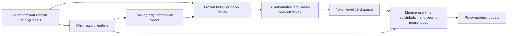
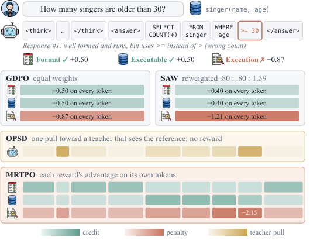

# MRTPO: Assign each reward to the tokens it actually concerns

<!-- source-sha256: 41945cae3036896a20b0dd0db3832718fd1df1f9cca29fb557fd726ae72c88f6 -->

[简体中文](README.md)

> L1 algorithm and gradient diagnostic, not a reproduction of SQL, instruction-following, or tool capabilities. Full experiments were not reproduced due to cost; review is complete, and the component is not eligible for Evolve promotion.

## Paper information

| Field | Details |
|---|---|
| Paper | [arXiv 2610.21439](https://arxiv.org/abs/2610.21439); [pinned v1 full text](https://arxiv.org/html/2610.21439v1) |
| Institution | First author Skylar Zhai, University of Minnesota; collaborators from NUS, UIUC, USC, UPenn, and MBZUAI. |
| First public release | 2026-10-15T07:47:04Z (arXiv v1, UTC) |
| Author code | [Official MRTPO](https://github.com/zhaihaotian/MRTPO), with training for three tasks, verifier replay, and visualization (Apache-2.0). |
| Local adapter or method key | `mrtpo`; `adapter: null`, standalone component. |
| Local reproduction code | [`src/auto_research/post_training/reviewed_oct18.py`](https://github.com/daiwk/auto-research/blob/main/src/auto_research/post_training/reviewed_oct18.py), `mrtpo_advantages`; independently implemented from the formulas. |
| Runner | [`scripts/run_oct18_post_components.py`](https://github.com/daiwk/auto-research/blob/main/scripts/run_oct18_post_components.py) |

## Paper method and evidence

GDPO normalizes rewards separately but still broadcasts each one across the whole response. SQL format, executability, and execution results may depend on different tokens. MRTPO replays the sampled response using the frozen behavior policy, first with all verifier information and then leaving out one reward's information block at a time. The more that removal changes a token's distribution, the more of the reward's credit it receives, whether the advantage is positive or negative. [Section 4](https://arxiv.org/html/2610.21439v1#S4)



[](https://arxiv.org/html/2610.21439v1/fig1.png)

Original Figure 1, with rights retained by the authors. Figures 1 and 3 illustrate the tokens affected by format, executability, and execution errors; see the [method and captions](https://arxiv.org/html/2610.21439v1#S4).

### Core equations

For distributions from the same frozen policy under complete and leave-one-out contexts:

$$
q_{k,t}=\sqrt{JS(p^{all}_t\parallel p^{\setminus k}_t)/\ln2},\quad
w_{k,t}=(1-\beta_n)+\beta_n\frac{q_{k,t}}{\bar q_k},\quad
S_t=\sum_k A_k w_{k,t}.
$$

$\beta_n$ warms up with smoothstep. An empty block or identical distributions gives uniform weight 1 for that reward. Weight averages stay at 1 within each response. Appendix D defines $U=\sum_k A_k$ and $D_t=S_t-U$ and then caps the redistribution:

$$
s=\min\left(1,\sqrt{\frac{\sum_j T_j U_j^2}{\sum_{j,t}D_{j,t}^2}}\right),\quad
\widetilde S_t=U+sD_t,\quad A_t=\widetilde S_t/(std_{batch}(\widetilde S)+\epsilon).
$$

JS compares full vocabulary distributions, not just the sampled token probability. Normalize by batch standard deviation over valid tokens after capping.

### Reported results

Across six SQL tests with Qwen2.5-Coder-3B, average execution accuracy was 67.32 for GDPO and 68.60 for MRTPO. Average instruction-following scores with Qwen3-4B were 61.37 and 62.54. These are author-reported results from [Tables 1–3](https://arxiv.org/html/2610.21439v1#S5), not local scores; no production A/B was reported.

## Local reproduction

A randomly initialized 32-token policy samples genuine responses; two artificial verifiers produce token-conditional rewards. The frozen snapshot rescores the same prefixes with all information and under each omission. Neither student sampling nor student update scoring receives verifier blocks. Default: three genuine optimizer updates per seed. No SQL, BFCL, or pretrained LLM is used.

```bash
PYTHONPATH=src python scripts/run_oct18_post_components.py \
  --methods mrtpo --device cpu --seeds 42,43,44 \
  --output runs/mrtpo-component.json
```

Use `--device cuda` for CUDA. Output cannot overwrite a previous artifact and records seeds, source SHA-256, commit, and device. The runner is capped at eight updates and does not download resources.

On 2026-10-18 an NVIDIA A100 ran three updates for each of seeds 42/43/44: [receipt](../../gpu-validations/mrtpo-a100-20261018.json), [per-seed metrics](metrics/component-cuda-seeds42-44.json). Mean student parameter $L_2$ change was 0.034557, with nonzero gradients and updates in every seed. Maximum errors were about $3.84\times10^{-14}$ against an independent scalar JS/weight reference and $4.44\times10^{-16}$ for mean-credit conservation. Empty-block uniform fallback error and frozen behavior-policy drift were both zero. These measurements verify replay credit assignment, not task accuracy.

**Not reproduced:** The paper used 8 H20s, 8 H200s, and 4 A100s for different tasks, with 3–5 seeds, 100–300 training steps, multiple 1.5B–7B models, and SQL, instruction, and tool benchmarks. The full stack exceeds the single-GPU budget; there is no production verifier, capability adapter, or Evolve integration.
