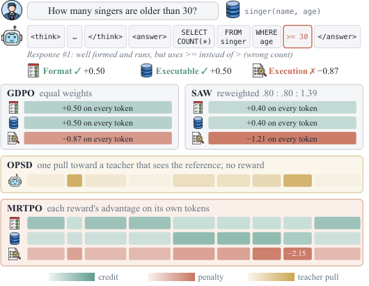

# MRTPO：把每种奖励分配给真正相关的 token

> **L1 算法组件／梯度诊断，不是 SQL、指令遵循或工具能力复现。** 完整实验成本过高，不复现（审查 DONE）；不进入 evolve 晋级。

## 论文信息

| 字段 | 内容 |
|---|---|
| 论文链接 | [arXiv 2610.21439](https://arxiv.org/abs/2610.21439)；[固定 v1 全文](https://arxiv.org/html/2610.21439v1) |
| 公司 / 机构 | 一作 Skylar Zhai 属 University of Minnesota；合作机构包括 NUS、UIUC、USC、UPenn、MBZUAI |
| 首次公开日期 | 2026-10-15T07:47:04Z（UTC，arXiv v1） |
| 原作者代码 | [官方 MRTPO](https://github.com/zhaihaotian/MRTPO)，已核对包含三任务训练、verifier 重放与可视化 |
| 代码许可 | 上游代码 Apache-2.0；本地按公式独立实现，没有复制上游训练栈 |
| 本地 adapter / 方法键 | `mrtpo`；`adapter: null`，独立组件 |
| 本地代码位置 | [`src/auto_research/post_training/reviewed_oct18.py`](https://github.com/daiwk/auto-research/blob/main/src/auto_research/post_training/reviewed_oct18.py)：`mrtpo_advantages` |
| 运行入口 | [`scripts/run_oct18_post_components.py`](https://github.com/daiwk/auto-research/blob/main/scripts/run_oct18_post_components.py) |

## 原始论文总结

### 背景与主要改动

GDPO 虽然分别归一化多种奖励，但仍把每种奖励均摊到整条响应。SQL 可执行性、格式、执行结果可能只分别依赖少数 token。MRTPO 用采样时的冻结策略重放响应：先提供所有 verifier 信息，再逐个删除奖励信息块。某个块被移除后，哪些位置的预测变化更大，就把该奖励更多地分配给哪些位置；正负 advantage 都使用相同的相关性权重。[原文 §4](https://arxiv.org/html/2610.21439v1#S4)


原文关键图：Figure 1/3 展示格式、可执行性和执行错误分别影响的 SQL token；见[方法与图注](https://arxiv.org/html/2610.21439v1#S4)。

<!-- paper-figure:start -->
### 原论文关键图

[](https://arxiv.org/html/2610.21439v1/fig1.png)

> **原论文 Figure 1（关键图）**：展示原论文方法的总体设计和关键组成。图片来自[原论文](https://arxiv.org/abs/2610.21439)，版权归原作者所有；点击图片可查看来源。
<!-- paper-figure:end -->

### 核心公式

令 $p^{all}_t$ 与 $p^{\setminus k}_t$ 是同一冻结策略在完整和留一上下文下的分布，则

$$
q_{k,t}=\sqrt{JS(p^{all}_t\parallel p^{\setminus k}_t)/\ln2},\quad
w_{k,t}=(1-\beta_n)+\beta_n\frac{q_{k,t}}{\bar q_k},\quad
S_t=\sum_k A_k w_{k,t}.
$$

$\beta_n$ 使用 smoothstep 预热；信息块为空或两分布完全相同，回退到该奖励的均匀权重1。每条响应的权重均值为1，保留原奖励总信用。按附录D，以 $U=\sum_kA_k$ 和 $D_t=S_t-U$ 计算

$$
s=\min\left(1,\sqrt{\frac{\sum_j T_j U_j^2}{\sum_{j,t}D_{j,t}^2}}\right),\quad
\widetilde S_t=U+sD_t,\quad A_t=\widetilde S_t/(std_{batch}(\widetilde S)+\epsilon).
$$

JS 是全词表分布差异，不是只比较被采样 token 的概率。先限制重分配量，再按有效 token 做 batch 标准差归一化。

### 论文离线与线上效果

原文 Qwen2.5-Coder-3B 的六个 SQL 测试平均执行准确率：GDPO 为67.32，MRTPO 为68.60；Qwen3-4B 指令遵循平均从61.37到62.54。上述均为论文结果，不是本地成绩；未报告线上 A/B。[原文表1–3](https://arxiv.org/html/2610.21439v1#S5)

## 本地复现

### 数据协议与运行

随机初始化32词表策略真实生成响应，两种人工 verifier 只产生 token 条件奖励。冻结快照在完整信息和两个留一上下文下重新评分**相同响应前缀**；学生原始采样、更新评分均不接收 verifier 块。每个 seed 默认3次真实梯度更新，不使用 SQL、BFCL 或预训练 LLM。

```bash
PYTHONPATH=src python scripts/run_oct18_post_components.py \
  --methods mrtpo --device cpu --seeds 42,43,44 \
  --output runs/mrtpo-component.json
```

CUDA 改为 `--device cuda`；输出不可覆盖，包含 seed、源代码 SHA256、commit 和设备。每项最多8次更新，无资源下载或隐式大实验。

### 结果、代码映射与边界

2026-10-18 已在真实 NVIDIA A100 上完成 seeds 42/43/44，各3次更新，三种子组件验收通过：[回执](../../gpu-validations/mrtpo-a100-20261018.json)、[逐 seed 指标](metrics/component-cuda-seeds42-44.json)。学生参数变化 $L_2$ 均值0.034557，各 seed 均有非零梯度及参数更新。独立逐标量 JS/权重参考最大误差约 $3.84\times10^{-14}$，响应平均信用守恒最大误差约 $4.44\times10^{-16}$；空块均匀回退负对照与冻结行为策略参数变化均为0。学生未接收 verifier 信息块。上述数值只验证重放信用算法，不是 SQL、指令遵循或工具 benchmark 分数。

**完整实验不复现：** 论文分别用8 H20、8 H200和4 A100，包含3–5种子、100–300训练步、多个1.5B–7B模型及 SQL/指令/工具任务。对现有单卡预算成本过高；未运行原训练栈。只实现冻结重放信用组件，未提供生产 verifier 或完整任务 adapter，不接入 evolve。
