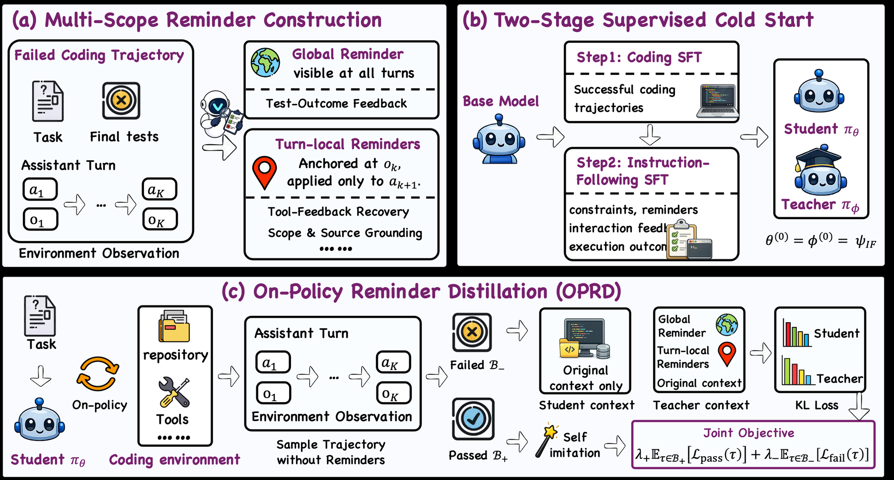

# OPRD: distilling multi-scope reminders into a reminder-free coding policy

<!-- source-sha256: 888d376982c7c945f064dc6fcae8a14f1eaecbb18b80b2dc2fc63208d9444140 -->

[简体中文](README.md)

> **L1 algorithm component, not a reproduction of SWE-bench coding capability.** It implements reminder scope, same-prefix scoring, and the training objective. Full experiments were not reproduced due to cost (review complete). This is not eligible for evolve promotion.

## Paper information

| Field | Details |
|---|---|
| Paper | [arXiv 2610.21496](https://arxiv.org/abs/2610.21496); [pinned v1 HTML](https://arxiv.org/html/2610.21496v1); [PDF](https://arxiv.org/pdf/2610.21496v1) |
| Organization | First author Yuechen Luo, Tsinghua University; collaborating institutions include Shanghai AI Laboratory and NUS |
| First public release | 2026-10-15T08:32:30Z (UTC, arXiv v1) |
| Authors' code | No official OPRD method code was found. VeOmni is the training framework, not a release of this method. |
| Code license | No method code was found, so its license is unconfirmed. The paper is CC BY 4.0. |
| Local adapter / method key | `oprd-reminder`; `adapter: null`, standalone component only. The runner's `--methods oprd` refers to this reminder distillation, not the older reverse-distillation adapter invoked by `auto-research reproduce --paper oprd`. |
| Local reproduction code | [`reminder_distillation.py`](https://github.com/daiwk/auto-research/blob/main/src/auto_research/post_training/reminder_distillation.py) |
| Local reproduction directory | [`src/auto_research/post_training/`](https://github.com/daiwk/auto-research/tree/main/src/auto_research/post_training) |
| Runner | [`run_oct17_supplement_post.py`](https://github.com/daiwk/auto-research/blob/main/scripts/run_oct17_supplement_post.py) |

## Original paper

### Motivation and method

A coding agent's final pass/fail outcome cannot identify which turn ignored an existing constraint. OPRD trains on the student's own reminder-free trajectories. It uses self-imitation on successful trajectories. For failures, the teacher reads training-only reminders and scores **the same student prefix**, rather than generating a different answer. Global reminders persist, but the local reminder associated with observation $o_k$ applies only to the next action $a_{k+1}$ and must then be removed. Inference uses neither the teacher nor any reminders. See [Section 3](https://arxiv.org/html/2610.21496v1#S3).

~~~mermaid
flowchart LR
  A[Student samples without reminders] --> B[Execution outcome]
  B -->|Pass| C[Self-imitation NLL over assistant tokens]
  B -->|Fail| D[Global and next-turn local reminders]
  D --> E[Frozen teacher scores the same student prefix]
  E --> F[Renormalize on the shared top-100 support]
  F --> G[Reverse-KL student update]
  C --> H[Reminder-free student]
  G --> H
~~~

<!-- paper-figure:start -->
### Key figure from the paper

> **Figure 2:** The training pipeline and key optimization steps. From the [original paper](https://arxiv.org/abs/2610.21496); copyright remains with the authors. Click the figure to see the source.
<!-- paper-figure:end -->

### Core equations

Over valid assistant tokens $\Omega(\tau)$, the success branch is:

$$
L_+(\tau)=-\frac{1}{|\Omega(\tau)|}\sum_{t\in\Omega(\tau)}\log p_\theta(y_t\mid h_t).
$$

The failure branch ranks by $\max(\log p_\theta(v),\log p_\phi(v))$ to choose **one shared top-100 support**. Both distributions are renormalized on that support to obtain $\bar p_\theta,\bar p_\phi$. The losses are:

$$
L_-(\tau)=\frac{T^2}{|\Omega(\tau)|}\sum_{t\in\Omega(\tau)}D_{KL}\!\left(\bar p_\theta\parallel\operatorname{sg}[\bar p_\phi]\right),\qquad
L=\lambda_+\mathbb E_{\tau\in B_+}L_++\lambda_-\mathbb E_{\tau\in B_-}L_-.
$$

Average tokens per trajectory first, then average each of the success and failure branches separately. An absent branch contributes zero. The teacher is refreshed from the current student at 20/40/60/80% of training and stays frozen otherwise. See Equations 6, 9, and 10 and Appendix B.

### Paper results

In Table 2, the paper's Qwen3.5-4B scores 61.2/30.5/52.0 on SWE-bench Verified/Pro/Multilingual, averaging 47.9. The original model averages 36.6; the Coding SFT + IF SFT control averages 41.6. None are local results. No online A/B test is reported. See [Section 4 and Appendix B](https://arxiv.org/html/2610.21496v1#S4).

## Local reproduction

### Data protocol and run instructions

The local runner uses a randomly initialized causal cumulative-embedding policy with a vocabulary of 128 and embedding width of 12. Each step samples eight real three-turn trajectories with two tokens per turn. A parity check supplies the diagnostic outcome; it is **not coding correctness**. The teacher rereads the same response prefix, while the student's context contains no reminders. The runner downloads no weights, uses no repository tasks, executes no reference patch, and implements neither the paper's Coding SFT/IF SFT nor its reminder generator.

~~~bash
PYTHONPATH=src python scripts/run_oct17_supplement_post.py \
  --methods oprd --device cpu --seeds 42,43,44 \
  --output runs/oprd-component.json
~~~

For CUDA, replace `--device cpu` with `--device cuda`. Unavailable CUDA fails explicitly rather than falling back. The default is four updates, capped at 12; existing output is not overwritten. The output records the full source SHA256, commit, seeds, device, and all negative controls.

### Results, code mapping, and limits

On October 17, 2026, all three seeds (42, 43, and 44) ran four updates each on a real NVIDIA A100. See the [per-seed metrics](metrics/component-cuda-seeds42-44.json) and [sanitized GPU receipt](../../gpu-validations/oprd-reminder-supplement-a100-20261017.json). The mean student parameter change in $L_2$ was 0.06964; the maximum error against an independent scalar reference was $8.89\times10^{-16}$. Teacher parameter change between refreshes and the number of teacher gradients were both zero. Separate three-seed CPU runs are not pooled with CUDA. These metrics verify the mechanism, not coding capability.

- `contexts_for_turn` reconstructs two contexts from reminder-free history. A local reminder is not written to persistent history.
- `score_trajectory` actually calls both policies, disallows shared parameter storage, keeps the assistant prefix identical, and stops teacher gradients.
- `shared_support_reverse_kl` implements shared-support selection, renormalization, and $T^2$. Invalid padding is sanitized before softmax.
- `outcome_routed_loss` and `RefreshingTeacher` implement branch weights and frozen refreshes. Unit tests cover zero KL for identical distributions, no teacher reads on the success branch, zero gradient at masked positions, and no reminder leakage.

**Full experiments not reproduced:** Appendix B uses 16 H20s, sequence length 131072, batch size 32, and three epochs, plus 4,000 online tasks, 8,000 coding SFT examples, 2,000 IF SFT examples, 4B/9B models, and long-horizon repository evaluation. That exceeds the single-A100/A30 or Mac budget. Large resources were not downloaded and the full experiment was not attempted. The component remains `diagnostic_only: true`, `promotion_eligible: false`, and `evolve_integrated: false`. No coding capability gain is claimed.
