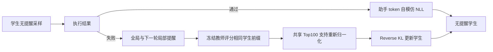
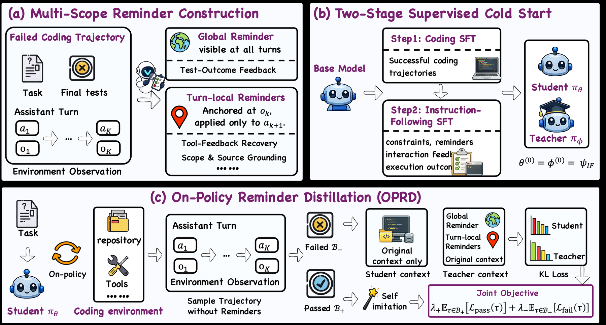

# OPRD：把多作用域提醒蒸馏到无提醒编码策略

> **L1 算法组件，不是 SWE-bench 编码能力复现。** 已实现作用域、同前缀评分和训练目标；完整实验成本过高，不复现（审查 DONE）。不进入 evolve 晋级。

## 论文信息

| 字段 | 内容 |
|---|---|
| 论文链接 | [arXiv 2610.21496](https://arxiv.org/abs/2610.21496)；[固定 v1 HTML](https://arxiv.org/html/2610.21496v1)；[PDF](https://arxiv.org/pdf/2610.21496v1) |
| 公司 / 机构 | 第一作者 Yuechen Luo，Tsinghua University；合作机构包括上海人工智能实验室和 NUS |
| 首次公开日期 | 2026-10-15T08:32:30Z（UTC，arXiv v1） |
| 原作者代码 | 未找到 OPRD 方法的官方代码；VeOmni 为训练框架，不应记作本方法已开源 |
| 代码许可 | 未找到方法代码，代码许可未确认；论文采用 CC BY 4.0 |
| 本地 adapter / 方法键 | `oprd-reminder`；`adapter: null`，仅独立组件；runner 的 `--methods oprd` 指本篇提醒蒸馏，不是旧的 `auto-research reproduce --paper oprd` 反向蒸馏 adapter |
| 本地复现代码 | [`reminder_distillation.py`](https://github.com/daiwk/auto-research/blob/main/src/auto_research/post_training/reminder_distillation.py) |
| 本地复现代码目录 | [`src/auto_research/post_training/`](https://github.com/daiwk/auto-research/tree/main/src/auto_research/post_training) |
| 运行入口 | [`run_oct17_supplement_post.py`](https://github.com/daiwk/auto-research/blob/main/scripts/run_oct17_supplement_post.py) |

## 原始论文总结

### 背景与主要改动

编码 Agent 的最终通过/失败不能指出哪一轮忽略了已有约束。OPRD 在学生自己生成的无提醒轨迹上训练：成功轨迹自模仿；失败轨迹由教师读取训练专用提醒，重新评分**同一学生前缀**，不是教师另生成一条答案。全局提醒持续有效，观测 $o_k$ 对应的局部提醒只在下一轮 $a_{k+1}$ 有效，之后必须移除。正式推理去掉教师和全部提醒。[原文 §3](https://arxiv.org/html/2610.21496v1#S3)



<!-- paper-figure:start -->
### 原论文关键图

[](https://arxiv.org/html/2610.21496v1/Figures/main_v2.png)

> **原论文 Figure 2（关键图）**：展示原论文的训练流程与关键优化环节。图片来自[原论文](https://arxiv.org/abs/2610.21496)，版权归原作者所有；点击图片可查看来源。
<!-- paper-figure:end -->

### 核心公式

在有效助手 token 集合 $\Omega(\tau)$ 上，成功分支为

$$
L_+(\tau)=-\frac{1}{|\Omega(\tau)|}\sum_{t\in\Omega(\tau)}\log p_\theta(y_t\mid h_t).
$$

失败分支先按 $\max(\log p_\theta(v),\log p_\phi(v))$ 选**同一个** Top-100 支持集，双方在其上重新归一化成 $\bar p_\theta,\bar p_\phi$，再计算

$$
L_-(\tau)=\frac{T^2}{|\Omega(\tau)|}\sum_{t\in\Omega(\tau)}D_{KL}\!\left(\bar p_\theta\parallel\operatorname{sg}[\bar p_\phi]\right),\qquad
L=\lambda_+\mathbb E_{\tau\in B_+}L_++\lambda_-\mathbb E_{\tau\in B_-}L_-.
$$

每条轨迹先取 token 均值，再分别取成功/失败分支均值；不存在的分支贡献0。教师在训练进度20/40/60/80%从当前学生刷新，其余时间冻结。来源为原文式6、9、10和附录B。

### 论文离线与线上效果

原文表2中 Qwen3.5-4B 的 SWE-bench Verified/Pro/Multilingual 分别为61.2/30.5/52.0，平均47.9；原始模型平均36.6，经过 Coding SFT＋IF SFT 的对照平均41.6。三者不是本地结果；线上 A/B 未报告。[原文 §4、附录B](https://arxiv.org/html/2610.21496v1#S4)

## 本地复现

### 数据协议与运行

本地使用随机初始化的128词表、12维 causal cumulative-embedding 策略。每步真实采样8条三轮轨迹、每轮2个 token；奇偶校验只用于构造诊断 outcome，**不是编码正确性**。教师重新读取相同 response 前缀；学生上下文不含提醒。没有下载权重、使用仓库任务、执行参考 patch，亦未实现原文 Coding SFT/IF SFT 或提醒生成模型。

```bash
PYTHONPATH=src python scripts/run_oct17_supplement_post.py \
  --methods oprd --device cpu --seeds 42,43,44 \
  --output runs/oprd-component.json
```

CUDA 将 `--device cpu` 改为 `--device cuda`；无 CUDA 时明确失败，不回退。默认4次更新，最多12次，已存在的输出拒绝覆盖。完整来源 SHA256、commit、种子、设备和所有负对照保存在结果中。

### 结果、代码映射与边界

2026-10-17 已在真实 NVIDIA A100 上完成 seeds42/43/44，各4次更新：[逐 seed 指标](metrics/component-cuda-seeds42-44.json)、[净化 GPU 回执](../../gpu-validations/oprd-reminder-supplement-a100-20261017.json)。学生参数变化 $L_2$ 均值0.06964，独立标量 reference 最大误差 $8.89\times10^{-16}$；教师在两次刷新之间变化和教师梯度数均为0。另有独立 CPU 三种子运行，不与 CUDA 混合聚合；这些指标仅验证机制，不证明编码能力。

- `contexts_for_turn` 从无提醒历史重建两个上下文；局部提醒不写回持久历史。
- `score_trajectory` 真正调用两个策略，禁止共享参数存储，助手前缀完全相同，教师 stop-gradient。
- `shared_support_reverse_kl` 执行共享支持选择、重新归一化和 $T^2$；无效 padding 在 softmax 前清理。
- `outcome_routed_loss` 与 `RefreshingTeacher` 实现分支权重和冻结刷新。单测覆盖同教师零 KL、成功分支不读取教师值、mask 零梯度及提醒不泄漏。

**不复现的完整实验：** 原文附录B为16张 H20、131072长度、batch32、3epochs；还包括4000个在线任务、8千条编码 SFT 和2千条 IF SFT、4B/9B模型及长程仓库评测。对单张 A100/A30 或 Mac 成本过高，未下载大资源或启动完整试跑。组件固定 `diagnostic_only: true`、`promotion_eligible: false`、`evolve_integrated: false`，不支持编码能力提升声明。
