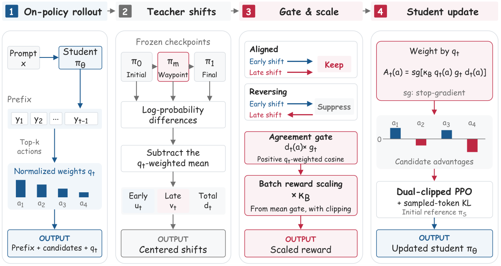

# Waypoint-OPD: temporal-consistency gating within one teacher RL run

<!-- source-sha256: ec931b44ac0a51b55885beaf13462bc727e5c42359ee24235b2adefbbc16debb -->

[简体中文](README.md)

> **L1 gate and dense-PPO component with real tiny-policy updates.** Full experiments were not reproduced due to cost (review complete). This is not a rerun of large teacher training and is not integrated into evolve.

## Paper information

| Field | Details |
|---|---|
| Paper | [arXiv 2610.21601](https://arxiv.org/abs/2610.21601); [pinned v1 full text](https://arxiv.org/html/2610.21601v1) |
| Organization | Alibaba Cloud Computing; first author Bingxi Hou |
| First public release | 2026-10-15T09:47:19Z (UTC, arXiv v1) |
| Authors' code | [WaypointOPD](https://github.com/hhhbxloveai/WaypointOPD) is public. An explicit license was not confirmed, so no source was vendored; the component independently implements the equations. |
| Local adapter / method key | `waypoint-opd`; `adapter: null` |
| Local reproduction code | [`waypoint_opd.py`](https://github.com/daiwk/auto-research/blob/main/src/auto_research/post_training/waypoint_opd.py) |
| Local reproduction directory | [`src/auto_research/post_training/`](https://github.com/daiwk/auto-research/tree/main/src/auto_research/post_training) |
| Runner | [`run_oct16_post_components.py`](https://github.com/daiwk/auto-research/blob/main/scripts/run_oct16_post_components.py) |

## Original paper

### Motivation and method

Initial-to-final log-probability shifts alone cannot distinguish two changes in the same direction from a reversal midway through training. A waypoint from the same RL run serves as consistency evidence, not a new imitation target. Student top-k chooses the candidates. Early and late shifts are centered by the student weights on those candidates; the positive cosine then scales the endpoint credit.

~~~mermaid
flowchart LR
  A[Student generation and top-k] --> B[Initial, waypoint, and final score the same prefix]
  B --> C[Center early and late shifts with q weights]
  C --> D[Positive cosine gate with small-norm fallback]
  D --> E[Batch scaling over valid prefixes]
  E --> F[Detached dense credit and dual-clipped PPO]
  F --> G[Sampled KL anchor at student initialization]
~~~

<!-- paper-figure:start -->
### Key figure from the paper

> Figure 2 from the [original paper](https://arxiv.org/html/2610.21601v1); copyright remains with the authors. The original `waypoint_overview.svg` was rasterized without redrawing. This is not a local result.
<!-- paper-figure:end -->

### Core equations

Over the student's top-k set $K$, let $q=\operatorname{softmax}(\log\pi_{old}|_K)$ and $C_q[z]=z-\sum_a q(a)z(a)$. Then:

$$
u=C_q[\log\pi_m-\log\pi_0],\quad v=C_q[\log\pi_1-\log\pi_m],\quad
g=\max(0,\langle u,v\rangle_q/(\|u\|_q\|v\|_q)).
$$

If either norm is at most $10^{-8}$, use $g=1$. Over valid response prefixes, set $\kappa_B=\operatorname{clip}(0.8/\max(\operatorname{mean}_B g,\epsilon_{num}),0.75,1.5)$ and candidate advantages $A(a)=\operatorname{sg}[\kappa_Bq(a)g(u(a)+v(a))]$. Appendix B's candidate-wise dual clipping bounds the negative-advantage term below by $cA$ and adds sampled-token KL against the initial student. The gate, support, teachers, reference, and $A$ are frozen; unsampled candidates still receive gradients.

### Paper results

Relative to Direct-OPD, the paper reports math mean@32 improvements of 2.18, 1.59, and 1.89 percentage points for 8B, 14B, and 30B-A3B students, respectively. These are original multi-benchmark results, not local byte NLL. No online A/B test is reported. Table 9's 8B math run took 64.31 GPU hours on 8×H20 for 100 steps, excluding evaluation and teacher RL.

## Local reproduction

### Data protocol and run instructions

Uses the pinned [Hamlet 1524](https://www.gutenberg.org/ebooks/1524) revision `sha256:31584c19795779431b5933499a45b9cecb03e8c246b6ea7e245a2b6d65e8e784`, with byte ranges split 80%/10%/10% for train/validation/test. The tiny teacher first warms up on next-token prediction on the public text, then performs **exactly eight RL updates, each with 64 single-action rollouts**. The reward tests whether the first generated byte ID is even. Because the reward depends only on the first action, REINFORCE differentiates that causal action's log probability rather than the average log probability of unrelated continuation tokens. The total budget is 512 actions, without retries or outcome selection; frozen snapshots are always at steps **0/4/8**. This is a **real RL trajectory, but the reward is not text quality or reasoning correctness**.

~~~bash
PYTHONPATH=src python scripts/run_oct16_post_components.py \
  --methods waypoint-opd --corpus-path /path/to/hamlet.txt \
  --corpus-id gutenberg:1524 \
  --corpus-revision sha256:31584c19795779431b5933499a45b9cecb03e8c246b6ea7e245a2b6d65e8e784 \
  --corpus-sha256 31584c19795779431b5933499a45b9cecb03e8c246b6ea7e245a2b6d65e8e784 \
  --device cpu --seeds 42,43,44 --output runs/waypoint-component.json
~~~

### Results, code mapping, and limits

The [three-seed CPU metrics](metrics/component-cpu-seeds42-44.json) record actual online generation, nonzero gradient and parameter changes, and no changes to the three snapshots. The changes are tiny and do not establish a capability gain. `validate_snapshot_lineage` checks run identity and step order. `prepare_credit` implements gating, centering, and batch calibration. `waypoint_ppo_loss` implements dense dual-clipped PPO and sampled KL.

Tests cover opposing shifts with the same endpoint, the small-norm fallback, invariance to constant shifts, zero-sum candidate advantages, exact local logit gradients, masking invalid tokens out of both policy and KL loss, and updates to unsampled candidates. Regression tests also enforce the fixed 8×64 budget and 0/4/8 lineage and reject an all-zero gate with no KL gradient. Three arbitrary models are not treated as a checkpoint trajectory. This does not include a large-model scorer, 57K-example teacher RL, math/code benchmarks, or AIME24 checkpoint selection. The paper uses AIME24 for both selection and reporting; the local diagnostic does not adopt that protocol. **Full experiments were not reproduced due to cost (review complete).** `component_only` does not imply `evolve_integrated`.

### First real CUDA failure and diagnostic correction

The first A100 attempt, at source checkpoint `a6ac6598`, failed on `waypoint-opd has no actual policy gradient`. It is not counted as a pass, and the original record remains intact. The old setup used just four samples per segment and two independent updates, multiplying the first-action reward by the average log probability of the entire rollout of up to 12 tokens. Unrelated continuation introduced variance and diluted the useful signal. Across the old three CPU seeds, parameter changes were only about $10^{-7}$–$10^{-6}$, and the mean positive gate was as low as approximately 0.005. CUDA draws from a different actual sample stream, so nonzero CPU changes do not imply a CUDA pass.

The correction changes only the fixed tiny-teacher budget and aligns the gradient with the causal action. It **does not change the paper's gate, thresholds, batch scaling, PPO, KL, or nonzero-gradient assertion**. If all gates are zero and KL has no gradient, the runner still explicitly fails with the seed, step, and diagnostics; regression coverage preserves that behavior. The revised CPU result and any later A100 rerun must have independent evidence. A more measurable rule reward or teacher shift is not a language capability gain. See the [initial failure record](validation/a100-initial-failure.md).
