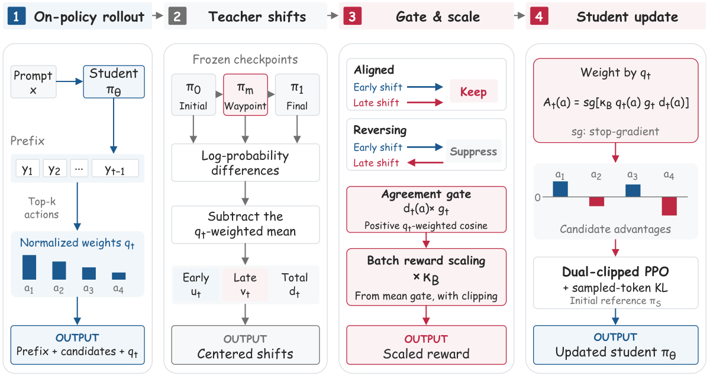

# Waypoint-OPD：同一次教师 RL 中的时序一致性门控

> **L1 gate / dense PPO 组件与真实微型策略更新。** 完整实验成本过高，不复现（审查 DONE）；不是教师大模型训练重跑，也未集成 evolve。

## 论文信息

| 字段 | 内容 |
|---|---|
| 论文链接 | [arXiv 2610.21601](https://arxiv.org/abs/2610.21601)；[固定 v1 全文](https://arxiv.org/html/2610.21601v1) |
| 公司 / 机构 | Alibaba Cloud Computing；第一作者 Bingxi Hou |
| 首次公开日期 | 2026-10-15T09:47:19Z（UTC，arXiv v1） |
| 原作者代码 | [WaypointOPD](https://github.com/hhhbxloveai/WaypointOPD) 已公开；未确认明确许可证，不直接 vendor；本组件从公式独立实现 |
| 本地 adapter / 方法键 | `waypoint-opd`；`adapter: null` |
| 本地复现代码 | [`waypoint_opd.py`](https://github.com/daiwk/auto-research/blob/main/src/auto_research/post_training/waypoint_opd.py) |
| 本地复现代码目录 | [`src/auto_research/post_training/`](https://github.com/daiwk/auto-research/tree/main/src/auto_research/post_training) |
| 运行入口 | [`run_oct16_post_components.py`](https://github.com/daiwk/auto-research/blob/main/scripts/run_oct16_post_components.py) |

## 原始论文总结

### 背景与主要改动

仅 initial/final 的 log-probability 位移不能区分“前后两段同向”与“中途反转”。同一 RL run 的 waypoint 只提供一致性证据，不是新的模仿目标。候选由学生 top-k 选择，early/late 位移先按候选学生权重中心化，再以正 cosine 缩放 endpoint credit。


<!-- paper-figure:start -->
### 原论文关键图



> 原文 Figure 2，图片来自[原论文](https://arxiv.org/html/2610.21601v1)，版权归原作者所有。原 `waypoint_overview.svg` 栅格化，无内容重绘；不是本地结果。
<!-- paper-figure:end -->

### 核心公式

在学生 top-k 上令 $q=\operatorname{softmax}(\log\pi_{old}|_K)$，$C_q[z]=z-\sum_a q(a)z(a)$，然后

$$
u=C_q[\log\pi_m-\log\pi_0],\quad v=C_q[\log\pi_1-\log\pi_m],\quad
g=\max(0,\langle u,v\rangle_q/(\|u\|_q\|v\|_q)).
$$

任一范数不超过 $10^{-8}$ 时 $g=1$。有效 response prefix 上取 $\kappa_B=\operatorname{clip}(0.8/\max(\operatorname{mean}_B g,\epsilon_{num}),0.75,1.5)$，候选优势 $A(a)=\operatorname{sg}[\kappa_Bq(a)g(u(a)+v(a))]$。使用附录 B 的 candidate-wise dual clip：负优势另以 $cA$ 为下界，再加入学生初始化参考的 sampled-token KL。门、support、teacher/reference 和 $A$ 全冻结；未采样候选也收到梯度。

### 论文离线与线上效果

原文数学 domain mean@32 在 8B/14B/30B-A3B 学生上，相对 Direct-OPD 增加 2.18/1.59/1.89 个百分点；这是原文多基准结果，不是本地 byte NLL。线上 A/B：未报告。Table 9 的 8B 数学 100 步用 8×H20、64.31 GPUh，且不含评测及教师 RL 训练。

## 本地复现

### 数据协议与运行

使用固定 [Hamlet 1524](https://www.gutenberg.org/ebooks/1524) 内容 revision `sha256:31584c19795779431b5933499a45b9cecb03e8c246b6ea7e245a2b6d65e8e784`；byte 范围 80%/10%/10% 分为 train/validation/test。真实微型教师先做公开文本 next-token 预热，再以“首个生成 byte ID 为偶数”的规则 reward 执行**固定8次、每次64个单 action rollout** 的 RL。reward 只依赖首 action，故 REINFORCE 只对该因果 action 的 log-probability 求梯度；不是把 reward 乘无关后续 token 的平均 logp。总预算固定512个动作，无 retry、无结果挑选，三快照恒为 step **0/4/8** 并冻结。这是**实际 RL 轨迹，但 reward 不是文本质量/推理正确性**。

```bash
PYTHONPATH=src python scripts/run_oct16_post_components.py \
  --methods waypoint-opd --corpus-path /path/to/hamlet.txt \
  --corpus-id gutenberg:1524 \
  --corpus-revision sha256:31584c19795779431b5933499a45b9cecb03e8c246b6ea7e245a2b6d65e8e784 \
  --corpus-sha256 31584c19795779431b5933499a45b9cecb03e8c246b6ea7e245a2b6d65e8e784 \
  --device cpu --seeds 42,43,44 --output runs/waypoint-component.json
```

### 结果、代码映射与边界

[CPU 三 seed 指标](metrics/component-cpu-seeds42-44.json)记录真实在线生成、非零 gradient/参数变化和三快照零变化；幅度很小，不解释成能力改善。`validate_snapshot_lineage` 检查同 run 与有序 step；`prepare_credit` 实现 gate、中心化和 batch 校准；`waypoint_ppo_loss` 实现 dense dual-clipped PPO 与 sampled KL。

测试覆盖同 endpoint 的反向位移、低范数回退、常量平移不变性、候选优势零和、局部精确 logit gradient、无效 token 的 policy/KL 双隔离及未采样候选更新；固定8×64预算、0/4/8 lineage 与全零gate仍拒绝也有回归。不把三个随机模型冒充 checkpoint 轨迹。没有大模型 scorer、57K 教师 RL、数学/代码 benchmark 或 AIME24 checkpoint selection；原文将 AIME24 同时用作选择与报告，本地没有沿用这种选择口径。完整实验**成本过高，不复现（审查 DONE）**；`component_only` 不代表 `evolve_integrated`。

### 首次真实 CUDA 失败与诊断修正

首次 A100 执行源码 checkpoint `a6ac6598` 在 `waypoint-opd has no actual policy gradient` 断言处失败，未被当成通过，也不覆盖其原始失败记录。旧配置每段仅4样本、两次独立更新，且首 action reward 乘整条最长12-token的平均 logp：无关 continuation 引入方差并稀释有效信号。旧 CPU 三 seed 的参数变化仅约 $10^{-7}$–$10^{-6}$，正 gate 均值最低约0.005。CUDA 使用不同实际采样流，不能由 CPU 非零变化推定通过。

修正只改变上述固定 tiny-teacher 训练预算和 reward-因果 action 梯度匹配，**不改论文 gate、阈值、batch scaling、PPO、KL 或非零梯度断言**。当 gates 全零且 KL 也无梯度时，runner 仍明确失败，并附 seed/step/诊断；回归测试保留该边界。新的 CPU 结果与后续 A100 重跑必须独立留证，不能把规则 reward 或 teacher 位移更可测称为语言能力提升。详见[首次失败记录](validation/a100-initial-failure.md)。
