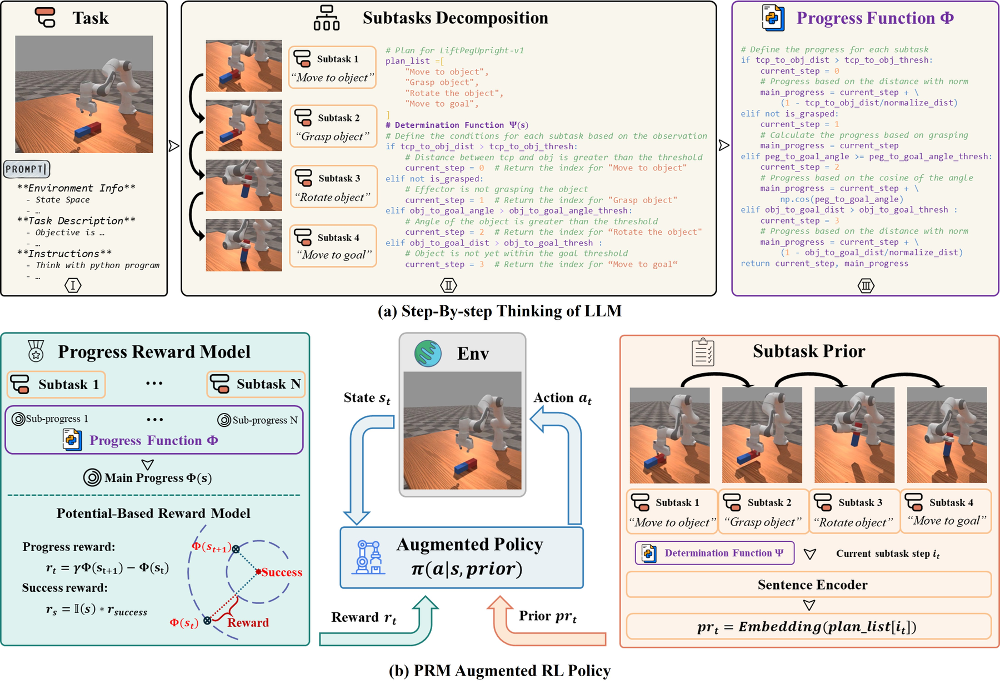

# PRM4RL: subtask progress, potential-based reward, and state augmentation

<!-- source-sha256: 404e1041009164a357a0d8c4288fe414f8e029ca323d293f07ad3dd14492cfd8 -->

[简体中文](README.md)

> **L1 diagnostic for the state machine, embedding interface, and reward mechanism.** This work was published at NeurIPS 2025 and uploaded to arXiv on October 15, 2026. It is not a newly proposed 2026 algorithm. The full robotics experiments were not reproduced because of cost (review complete).

## Paper information

| Field | Details |
|---|---|
| Paper | [arXiv 2610.22056](https://arxiv.org/abs/2610.22056); [pinned v1 full text](https://arxiv.org/html/2610.22056v1) |
| Organization | First author Xiuhui Zhang, Beihang University |
| First public release | arXiv v1: 2026-10-15T15:21:25Z (UTC). The paper was published at NeurIPS 2025; the exact date of the earlier public release has not been verified. The arXiv date is not the method's debut. |
| Authors' code | [deng-ai-lab/PRM4RL](https://github.com/deng-ai-lab/PRM4RL), the authors' public implementation |
| Local adapter / method key | `progress-reward`; `adapter: null` |
| Local reproduction code | [`progress_reward.py`](https://github.com/daiwk/auto-research/blob/main/src/auto_research/post_training/progress_reward.py) |
| Local reproduction directory | [`src/auto_research/post_training/`](https://github.com/daiwk/auto-research/tree/main/src/auto_research/post_training) |
| Runner | [`run_oct17_post_components.py`](https://github.com/daiwk/auto-research/blob/main/scripts/run_oct17_post_components.py) |

## Original paper

### Motivation and method

Sparse success signals provide little guidance for long-horizon robot control. PRM4RL asks an LLM to generate a list of subtasks, a function $\Psi$ that identifies the current subtask, and a progress potential $\Phi$. It uses the subtask's semantics as a state prior and the difference in progress between successive states as dense reward for low-level RL. The plan is generated in advance; the LLM does not run at every environment step.

~~~mermaid
flowchart LR
  A[Environment description and task] --> B[LLM generates plan, Psi and Phi]
  B --> C[Review functions and subtask list]
  C --> D[Map current state to subtask]
  D --> E[Append subtask embedding to state]
  C --> F[Potential difference plus success bonus]
  E --> G[SAC or PPO control policy]
  F --> G
~~~

<!-- paper-figure:start -->
### Key figure from the paper

> **Figure 2:** The architecture, its main modules, and their connections. From the [original paper](https://arxiv.org/abs/2610.22056); copyright remains with the authors. Click the figure to see the source.
<!-- paper-figure:end -->

### Core equations

$$
s'_t=[s_t,\mathbf E(plan\_list[\Psi(s_t)])],\qquad
R_t^{PRM}=\gamma\Phi(s_{t+1})-\Phi(s_t)+\mathbb I(success_{t+1})r_{bonus}.
$$

The discounted potential term telescopes: $\sum_{t=0}^{T-1}\gamma^tF_t=-\Phi(s_0)+\gamma^T\Phi(s_T)$. At a finite episode's true termination, an absorbing boundary with zero potential eliminates the extra term that depends on the final state. **A time-limit truncation is not a true termination.** The local interface accepts an explicit `terminated` flag; if omitted, it evaluates the formula as written rather than silently zeroing all episode endings.

### Paper results

The authors compare against ELLM, Text2Reward, and expert-designed dense rewards on MetaWorld and ManiSkill. On some difficult tasks they report nearly 100% success, against less than 15% for the controls. These are simulated robot-control experiments, not language-model mathematics benchmarks. No online A/B test is reported.

## Local reproduction

### Data protocol and run instructions

`ProgressPlan` accepts only caller-reviewed completion predicates, potentials, and subtask names. It does not execute arbitrary Python returned by upstream systems or LLMs. `stage` recomputes the stage from the current state, so it can move backward when, for example, the robot loses its grasp. It does not use a counter that only advances. `augment_state` selects the current subtask representation from a supplied embedding table.

The runner uses a one-dimensional position, three explicit thresholds, and fixed one-hot subtask embeddings. It samples left/right actions, computes progress rewards, and updates a small linear policy with REINFORCE. It does not run a semantic sentence encoder, an LLM planner, SAC/PPO, or a robotics simulator. No model or physics-engine download is required.

~~~bash
PYTHONPATH=src python scripts/run_oct17_post_components.py \
  --methods progress-reward --device cpu --seeds 42,43,44 \
  --output runs/progress-reward-component.json
~~~

Use `--device cuda` for CUDA; the runner raises an explicit error if CUDA is unavailable. The default is four real optimizer updates, capped at 12. Seeds are fixed and configurations are not selected by reward.

### Results, code mapping, and limits

On October 17, 2026, the diagnostic ran on a real NVIDIA A100 with seeds 42, 43, and 44: [per-seed metrics](metrics/component-cuda-seeds42-44.json) and [sanitized GPU receipt](../../gpu-validations/progress-reward-a100-20261017.json). Formula and embedding-selection errors were both zero, and the terminal telescoping error was $5.55\times10^{-17}$. The mean $L_2$ parameter change after four steps was 0.08669. A negative control omitting the true-terminal boundary retained a terminal term of 0.729. These are neither robot success rates nor policy capability results.

- `ProgressPlan.stage/progress` expose the reviewed functions. `augment_state` retains the original state and appends the correct subtask embedding.
- `progress_reward` implements the original formula and the explicit absorbing-terminal rule. It adds no undocumented bonus for entering a subtask.
- The runner checks the equation term by term with an independent calculation, discounted telescoping, terminal/truncation negative controls, and nonzero policy updates. Unit tests cover state regression and rejection of invalid embeddings.

**Full experiments not reproduced:** The authors use GPT-4o to construct plans and functions, with 4×RTX3090 GPUs, 128 CPU cores, and 256 GiB RAM. With five seeds run in parallel, each MetaWorld task takes approximately one hour and ManiSkill approximately 1–10 hours per task. The complete multi-task, multi-arm evaluation exceeds the single-A100/A30 budget and was not attempted. The reusable pieces are the reviewed interface and potential-based reward. Status: `component_only`, `diagnostic_only: true`, and `promotion_eligible: false`. No claim is made about the paper's success rates.
