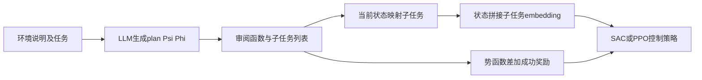
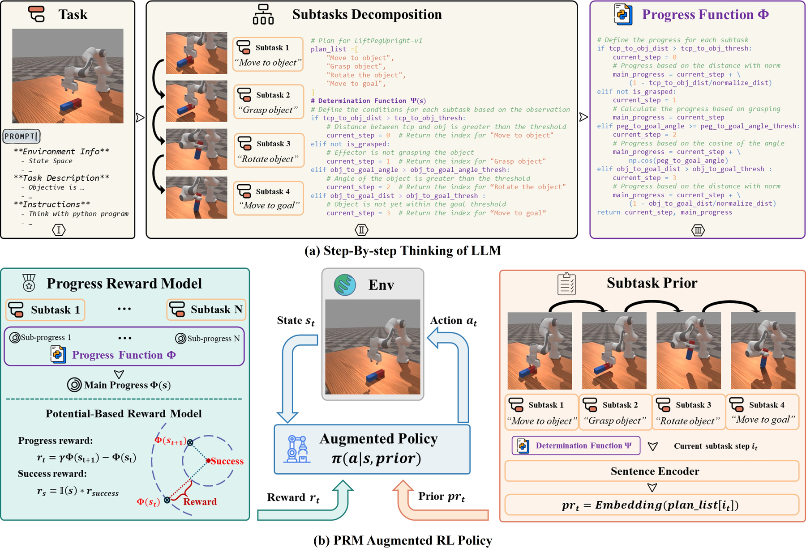

# PRM4RL：子任务进度、势函数奖励与状态增强接口

> **L1 状态机、embedding 接口及 reward 机制诊断。** 这是 NeurIPS 2025 已发表成果于 2026-10-15 上传 arXiv，不能称为新提出的 2026 算法。完整机器人实验成本过高，不复现（审查 DONE）。

## 论文信息

| 字段 | 内容 |
|---|---|
| 论文链接 | [arXiv 2610.22056](https://arxiv.org/abs/2610.22056)；[固定 v1 全文](https://arxiv.org/html/2610.22056v1) |
| 公司 / 机构 | 第一作者 Xiuhui Zhang，Beihang University |
| 首次公开日期 | arXiv v1：2026-10-15T15:21:25Z（UTC）；论文已发表于 NeurIPS 2025，早期会议公开的具体日未核，不把 arXiv 日期冒充方法首发日 |
| 原作者代码 | [deng-ai-lab/PRM4RL](https://github.com/deng-ai-lab/PRM4RL)，原作者公开实现 |
| 本地 adapter / 方法键 | `progress-reward`；`adapter: null` |
| 本地复现代码 | [`progress_reward.py`](https://github.com/daiwk/auto-research/blob/main/src/auto_research/post_training/progress_reward.py) |
| 本地复现代码目录 | [`src/auto_research/post_training/`](https://github.com/daiwk/auto-research/tree/main/src/auto_research/post_training) |
| 运行入口 | [`run_oct17_post_components.py`](https://github.com/daiwk/auto-research/blob/main/scripts/run_oct17_post_components.py) |

## 原始论文总结

### 背景与主要改动

稀疏成功信号难以指导长程机器人控制。PRM4RL 让 LLM 给出子任务、当前子任务判定函数 $\Psi$ 与进度势函数 $\Phi$；将子任务语义作为状态先验，将相邻状态进度差作为低层 RL 的密集 reward。规划只需预先生成，而不是每个环境步重新调用 LLM。



<!-- paper-figure:start -->
### 原论文关键图

[](https://arxiv.org/html/2610.22056v1/figures/framework.jpg)

> **原论文 Figure 2（关键图）**：展示原论文提出的核心架构、主要模块及其连接关系。图片来自[原论文](https://arxiv.org/abs/2610.22056)，版权归原作者所有；点击图片可查看来源。
<!-- paper-figure:end -->

### 核心公式

$$
s'_t=[s_t,\mathbf E(plan\_list[\Psi(s_t)])],\qquad
R_t^{PRM}=\gamma\Phi(s_{t+1})-\Phi(s_t)+\mathbb I(success_{t+1})r_{bonus}.
$$

势函数项的折扣和满足 $\sum_{t=0}^{T-1}\gamma^tF_t=-\Phi(s_0)+\gamma^T\Phi(s_T)$。有限 episode 真终止需要零势函数的吸收边界，才能消除依赖终点的额外项；**时间截断不等于真实终止**。本地提供显式 `terminated`，未传时逐字计算论文公式，不偷偷将所有结束都归零。

### 论文离线与线上效果

原文在 MetaWorld 和 ManiSkill 比较 ELLM、Text2Reward 与专家 dense reward；报告若干困难任务接近100%成功，而对照低于15%。这些是机器人模拟控制实验，不是语言模型数学 benchmark。线上 A/B：未报告。

## 本地复现

### 数据协议与运行

本地 `ProgressPlan` 只接收调用者审阅过的 completion predicates、potential 与子任务名称，不执行上游或 LLM 返回的任意 Python。`stage` 从当前状态重新计算，可因抓取丢失等情况回退，不使用仅随时间递增的计数器。`augment_state` 从外部提供的 embedding 表取出当前子任务表示。

runner 使用一维位置、三个明确阈值和固定 one-hot 子任务表征，实际采样左右动作、计算进度 reward，并用 REINFORCE 更新小线性策略。这不是语义 sentence encoder、LLM planner、SAC/PPO 或机器人模拟环境；无需下载模型和物理引擎。

```bash
PYTHONPATH=src python scripts/run_oct17_post_components.py \
  --methods progress-reward --device cpu --seeds 42,43,44 \
  --output runs/progress-reward-component.json
```

CUDA 使用 `--device cuda`，没有 CUDA 明确报错；默认四次真实 optimizer updates、上限12。种子固定，不以 reward 选择配置。

### 结果、代码映射与边界

2026-10-17 已在真实 NVIDIA A100 上完成 seeds 42/43/44：[逐 seed 指标](metrics/component-cuda-seeds42-44.json)、[净化 GPU 收据](../../gpu-validations/progress-reward-a100-20261017.json)。原公式与 embedding 选择误差均为0，终止 telescoping 误差 $5.55\times10^{-17}$；四步参数变化 $L_2$ 均值 .08669。省略真终止边界的负对照保留 .729 的末端项。它们不是机器人成功率或策略能力评测。

- `ProgressPlan.stage/progress` 是审阅函数接口，`augment_state` 保留原始状态并拼接正确子任务 embedding。
- `progress_reward` 实现原式与显式吸收终态规则，不引入“每进入一个子任务自动加分”等未定义 bonus。
- runner 检查逐项独立公式、折扣 telescoping、终止/截断负对照及非零策略更新；单测包含状态回退与非法 embedding 拒绝。

**不复现的完整实验：** 原文以 GPT-4o 构造计划与函数，4×RTX3090、128核CPU、256GiB内存，五种子并行时 MetaWorld 每任务约1小时、ManiSkill约1–10小时。单张 A100/A30 的完整多任务多臂评测不合成本预算，未探跑。可复用的是审阅后接口与势函数组件；`component_only`、`diagnostic_only: true`、`promotion_eligible: false`，不宣称原文成功率。
