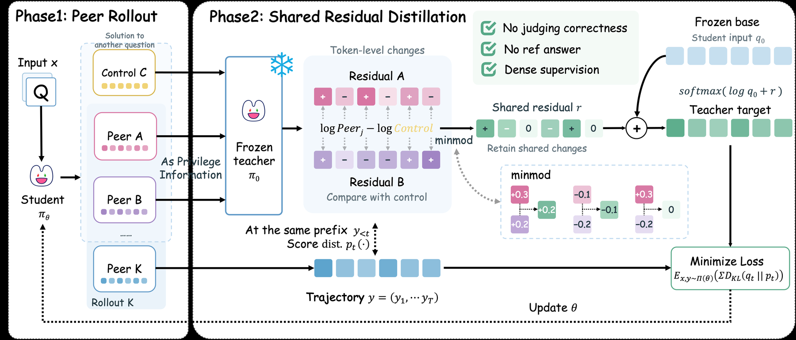

# SRD: Building self-distillation targets from residuals shared by unverified peers

<!-- source-sha256: 948969eabaae00068aec0e0a7d6efb0fbc3ec1288b77e48adea1b4ed7910fb02 -->

[简体中文](README.md)

> **L1 formula, sampling-isolation, and gradient component, not a math-capability reproduction.** The full multi-model experiment was reviewed and not reproduced because of cost. No Qwen downloads, external teacher calls, or Evolve promotion.

## Paper information

| Field | Details |
| --- | --- |
| Paper links | [arXiv 2610.22080](https://arxiv.org/abs/2610.22080); [pinned v1 full text](https://arxiv.org/html/2610.22080v1) |
| Company / institution | First author Feiyang Chen, Shanghai Jiao Tong University; Runze Ma is co-first author |
| First public release | 2026-10-15T15:36:40Z (UTC, arXiv v1) |
| Author code | No SRD method source found. The linked OPSD repository is a baseline, not SRD code. |
| Local adapter / method key | `shared-residual-distillation`; `adapter: null` |
| Local implementation | [`shared_residual_distillation.py`](https://github.com/daiwk/auto-research/blob/main/src/auto_research/post_training/shared_residual_distillation.py) |
| Local directory | [`src/auto_research/post_training/`](https://github.com/daiwk/auto-research/tree/main/src/auto_research/post_training) |
| Runner | [`run_oct17_post_components.py`](https://github.com/daiwk/auto-research/blob/main/scripts/run_oct17_post_components.py) |

## Paper summary

### Background and main changes

Without gold or verifiable rewards, an incorrect solution can still contain useful steps. SRD does not vote for a correct answer. It compares same-question peers' changes to token distributions against a cross-question control, accepting only conservative residuals supported by multiple peers. The student still reads only the question and its own prefix, and inference does not need peers.

~~~mermaid
flowchart LR
  A[Current student generates K trajectories per question] --> B[Uniform split into M peers and remaining targets]
  B --> C[Fix the same target prefix]
  C --> D[Frozen initial model provides q0, qc, and qj]
  D --> E[Center log qj minus log qc under q0]
  E --> F[Same-sign minimum-magnitude minmod]
  F --> G[Detached qcap]
  G --> H[Coordinate-capped KL updates student]
~~~

<!-- paper-figure:start -->
### Original paper figure

> **Paper Figure 2:** Overall method and components. From the [original paper](https://arxiv.org/abs/2610.22080); copyright remains with the authors. Click the image to open its source.
<!-- paper-figure:end -->

### Core equations

At the same target prefix, $q_0$ is the frozen initial model with question-only context, $q_c$ the cross-question control view, and $q_j$ the same-question peer view:

$$
d_j(v)=\log q_j(v)-\log q_c(v),\qquad
\delta_j(v)=d_j(v)-\sum_u q_0(u)d_j(u).
$$

Take the minimum if all $\delta_j(v)>0$, maximum if all are negative, otherwise $r(v)=0$. Then

$$
q_\cap=\operatorname{sg}[\operatorname{softmax}(\log q_0+r)],\qquad
L=\frac1N\sum_t\sum_v\min\{q_\cap(v)\log[q_\cap(v)/p_\theta(v)],\tau\}.
$$

The cap limits each **signed vocabulary coordinate**, not total KL, so the surrogate can be negative. $N$ counts valid target tokens. Do not use $q_c$ as the centering weights or put a target in its own peer context.

### Offline and online results reported in the paper

On AIME24–26, mean avg@12 rises from 11.02/19.07/21.39 to 16.20/45.46/54.44 for Qwen3 1.7B/4B/8B. The paper also reports HMMT, MATH-500, IFEval, and MMLU-Pro, with GRPO, TTRL, and OPSD comparisons. Avg@12 is sample accuracy, **not pass@12**. No online A/B is reported.

## Local reproduction

### Data protocol and execution

Use two fixed integer prompts and a randomly initialized causal cumulative-embedding policy with eight vocabulary tokens. At every update actually sample four length-four trajectories per question, uniformly select two peers, and use the rest as targets. Controls come from the other question. A frozen initial policy reads each context per prefix; the student sees no peer, control, or gold. No math benchmark, checkpoint, or real semantic reasoning task.

~~~bash
PYTHONPATH=src python scripts/run_oct17_post_components.py \
  --methods shared-residual-distillation --device cpu --seeds 42,43,44 \
  --output runs/srd-component.json
~~~

Change only `--device cpu` to `--device cuda` for CUDA; no fallback. Four actual optimizer updates by default, with one to 12 allowed and no retry for seed selection.

### Results, code mapping, and limits

Real A100 execution on 2026-10-17 used seeds 42/43/44; see [per-seed metrics](metrics/component-cuda-seeds42-44.json) and [sanitized GPU receipt](../../gpu-validations/shared-residual-distillation-a100-20261017.json). Mean student change $L_2$ is .05511, teacher change zero, and mean independent target error $1.16\times10^{-16}$. These establish mechanism and gradients, not math accuracy. Random samples need not match across devices; CPU and CUDA evidence is not mixed.

- `split_peers` checks at least two questions, $K>M\ge2$ per question, disjoint target/peer sets, and cross-question controls.
- `shared_residual_target` implements full-vocabulary centering, minmod, and detached target.
- `clipped_distillation_loss` retains signed coordinates, clears padding before softmax, and gives invalid positions exactly zero gradient.
- The runner uses an independent scalar-loop target reference and a zero-residual control with equal peer/control views. It records nonzero student updates and no frozen-teacher change. Failures and negative losses are retained, not improvements.

**Full experiment not reproduced:** Three Qwen3 models, 29.4K math problems, 100 steps with 32 questions × four rollouts, four teacher distributions per target prefix, 20K training context, and 32K×12 math evaluation. The multi-arm, multi-model pipeline is expected to take hours on one A100/A30; no probe was started. `diagnostic_only: true`, `promotion_eligible: false`, `evolve_integrated: false`.
