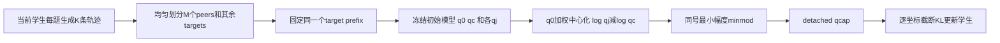
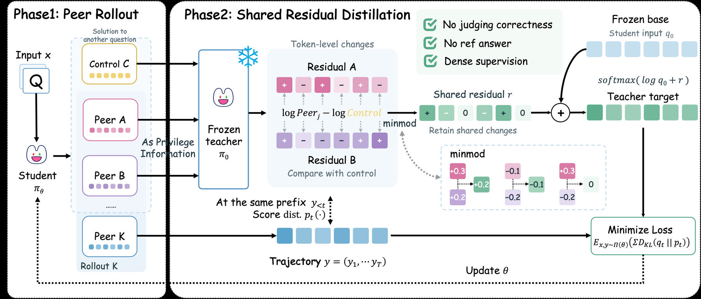

# SRD：从未验证 peers 的共同残差构造自蒸馏目标

> **L1 公式、采样隔离与梯度组件，不是数学能力复现。** 完整多模型实验成本过高，不复现（审查 DONE）；本地不下载 Qwen、不调用外部教师，不进入 evolve 晋级。

## 论文信息

| 字段 | 内容 |
|---|---|
| 论文链接 | [arXiv 2610.22080](https://arxiv.org/abs/2610.22080)；[固定 v1 全文](https://arxiv.org/html/2610.22080v1) |
| 公司 / 机构 | 第一作者 Feiyang Chen，Shanghai Jiao Tong University；Runze Ma 共同一作 |
| 首次公开日期 | 2026-10-15T15:36:40Z（UTC，arXiv v1） |
| 原作者代码 | 未找到 SRD 方法代码；原文的 OPSD 仓库是基线，不应误记为 SRD 开源 |
| 本地 adapter / 方法键 | `shared-residual-distillation`；`adapter: null` |
| 本地复现代码 | [`shared_residual_distillation.py`](https://github.com/daiwk/auto-research/blob/main/src/auto_research/post_training/shared_residual_distillation.py) |
| 本地复现代码目录 | [`src/auto_research/post_training/`](https://github.com/daiwk/auto-research/tree/main/src/auto_research/post_training) |
| 运行入口 | [`run_oct17_post_components.py`](https://github.com/daiwk/auto-research/blob/main/scripts/run_oct17_post_components.py) |

## 原始论文总结

### 背景与主要改动

没有标准答案或可验证 reward 时，整段错误解答也可能包含有用步骤。SRD 不投票选“正确答案”，而比较同题 peers 相对跨题 control 对 token 分布的改变，只接收多位 peer 共同支持的保守残差。学生仍只读取题目与自己的前缀，训练后的推理不需要 peers。



<!-- paper-figure:start -->
### 原论文关键图

[](https://arxiv.org/html/2610.22080v1/figures/2.png)

> **原论文 Figure 2（关键图）**：展示原论文方法的总体设计和关键组成。图片来自[原论文](https://arxiv.org/abs/2610.22080)，版权归原作者所有；点击图片可查看来源。
<!-- paper-figure:end -->

### 核心公式

对相同的目标前缀，$q_0$ 为 question-only 冻结初始模型，$q_c$ 为跨题 control view，$q_j$ 为同题 peer view：

$$
d_j(v)=\log q_j(v)-\log q_c(v),\qquad
\delta_j(v)=d_j(v)-\sum_u q_0(u)d_j(u).
$$

若所有 $\delta_j(v)>0$，取它们的最小值；若全小于零，取最大值；否则令 $r(v)=0$。随后

$$
q_\cap=\operatorname{sg}[\operatorname{softmax}(\log q_0+r)],\qquad
L=\frac1N\sum_t\sum_v\min\{q_\cap(v)\log[q_\cap(v)/p_\theta(v)],\tau\}.
$$

cap 是对**带符号的单个词表坐标**施加的上界，不是对总 KL 截断；因此 surrogate 可以为负。$N$ 为有效 target token 数。不得把 $q_c$ 当成中心化权重，也不得把 target 自己放入 peer context。

### 论文离线与线上效果

原文 Qwen3 1.7B/4B/8B 的 AIME24–26 mean avg@12 分别由 11.02/19.07/21.39 升至 16.20/45.46/54.44；还报告 HMMT、MATH-500、IFEval、MMLU-Pro。avg@12 是采样正确率，**不是 pass@12**。对照包括 GRPO、TTRL、OPSD。线上 A/B：未报告。

## 本地复现

### 数据协议与运行

使用固定两个整数 prompt、8-token vocabulary、随机初始化的 causal cumulative-embedding 小策略。每个更新重新实际采样每题四条长度四的轨迹；均匀保留两个 peers，余下作为 targets；control 来自另一题。冻结初始策略逐前缀读取各上下文，学生不读 peer/control 或标准答案。没有数学 benchmark、checkpoint 或真实语义推理任务。

```bash
PYTHONPATH=src python scripts/run_oct17_post_components.py \
  --methods shared-residual-distillation --device cpu --seeds 42,43,44 \
  --output runs/srd-component.json
```

CUDA 仅将 `--device cpu` 改为 `--device cuda`；没有 CUDA 时明确失败，不回退 CPU。默认四次真实 optimizer updates，允许 1–12 步，不重试挑选种子。

### 结果、代码映射与边界

2026-10-17 已在真实 NVIDIA A100 上完成 seeds 42/43/44：[逐 seed 指标](metrics/component-cuda-seeds42-44.json)、[净化 GPU 收据](../../gpu-validations/shared-residual-distillation-a100-20261017.json)。学生参数变化 $L_2$ 均值为 .05511，冻结教师变化为0；独立目标 reference 误差均值 $1.16\times10^{-16}$。这些数值只验证机制与梯度，不证明数学正确率。不同设备的随机采样不要求逐条相同，CPU 与 CUDA 运行证据不混合聚合。

- `split_peers` 检查至少两个问题、每题 $K>M\ge2$、target/peer 互斥与跨题 control。
- `shared_residual_target` 实现 full-vocabulary center/minmod/target，教师全部 detach。
- `clipped_distillation_loss` 保留带符号坐标，padding 在 softmax 前清理，invalid gradient 严格为零。
- runner 用独立 scalar-loop reference 检查目标，用相同 peer/control 的零残差作负对照，记录非零学生更新与冻结教师零变化。原始失败或负 loss 保留，不作为“效果提升”。

**不复现的完整实验：** 原文三种 Qwen3 模型、29.4k数学训练题、100步，每步32题×4 rollouts，每个目标前缀四份教师分布；20k训练上下文与32k×12数学评测。相对于单张 A100/A30，这一完整多臂、多模型链路预计耗时数小时，未启动试跑。组件仅 `diagnostic_only: true`、`promotion_eligible: false`、`evolve_integrated: false`。
