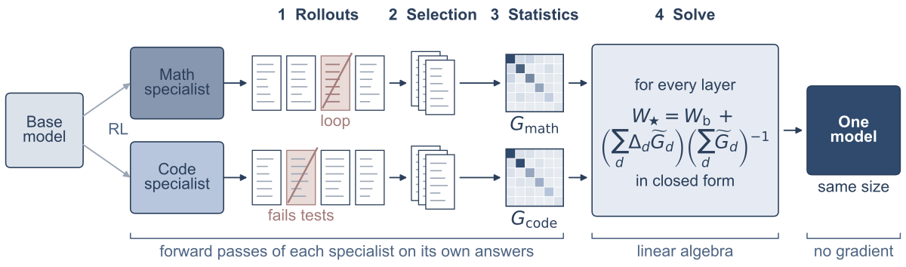

# TF-OPD: Training-free closed-form fusion from teacher-generated statistics

<!-- source-sha256: a33b06adde0711a438f35bfc920bd89b491a16ce920421f33444547d24ef5f6c -->

[简体中文](README.md)

> **L1 formula component and tiny autoregressive diagnostic, not full reproduction.** The full experiment was reviewed and not reproduced because of cost; `adapter: null`, `evolve_integrated: false`.

## Paper information

| Field | Details |
| --- | --- |
| Paper links | [arXiv 2610.22236](https://arxiv.org/abs/2610.22236); [pinned v1 full text](https://arxiv.org/html/2610.22236v1) |
| Company / institution | First author Bangji Yang lists University of Illinois Urbana-Champaign first (PDF superscript 1); Tsinghua University collaborates. |
| First public release | 2026-10-15T17:15:01Z (UTC, arXiv v1), not the October 16 announcement |
| Author code | No verified public method repository found. Dependencies and third-party implementations are not author code. |
| Local adapter / method key | `tf-opd`; standalone formula component, no reproduction adapter |
| Local implementation | [`tf_opd.py`](https://github.com/daiwk/auto-research/blob/main/src/auto_research/post_training/tf_opd.py) |
| Local implementation directory | [`src/auto_research/post_training/`](https://github.com/daiwk/auto-research/tree/main/src/auto_research/post_training) |
| Runner | [`run_oct16_post_components.py`](https://github.com/daiwk/auto-research/blob/main/scripts/run_oct16_post_components.py) |

## Paper summary

### Background and main changes

Merging linear layers of experts with a common initialization can be written as least squares matching teacher outputs. The key is not arbitrary covariance: use second moments of the inputs each teacher actually sees on **its own generated responses after termination and loop filtering**. Normalize by token count so longer answers do not dominate other domains.

~~~mermaid
flowchart LR
  A[Experts from the same base generate independently] --> B[Filter for natural termination and loops]
  B --> C[Each teacher replays its own trajectories]
  C --> D[Token-normalized Gram for each linear layer]
  D --> E[Off-diagonal shrinkage and FP64 solve]
  E --> F[FP32 merged weights and unreproduced update fraction]
~~~

<!-- paper-figure:start -->
### Original paper figure

> **Paper Figure 2**, from the [original paper](https://arxiv.org/html/2610.22236v1). Copyright remains with the authors. The original `overview.svg` was converted to PNG without changing content. Not a local result.
<!-- paper-figure:end -->

### Core equations

Let $W_d=W_b+\Delta_d$ and $G_d=X_d^\top X_d/n_d$ for a linear layer. Eqs. 1–4 give

$$
\widetilde G_d=w_d[\alpha G_d+(1-\alpha)\operatorname{diag}(G_d)],\quad
\Delta_\star\sum_d\widetilde G_d=\sum_d\Delta_d\widetilde G_d,\quad W_\star=W_b+\Delta_\star.
$$

Default $\alpha=0.9$. Solve the transposed system without explicit inverse, using float64 for the solve and float32 for storage. Nonlinear weights use task arithmetic. The unreproduced fraction for each teacher update is

$$
\epsilon_d=\frac{\operatorname{tr}[(\Delta_\star-\Delta_d)\widetilde G_d(\Delta_\star-\Delta_d)^\top]}{\operatorname{tr}[\Delta_d\widetilde G_d\Delta_d^\top]}.
$$

Identical Grams give a weighted mean rather than a sum of updates. Orthogonal input supports recover each teacher exactly. Tests cover both, normal-equation residuals, actual replay Grams after filtering, and hook cleanup.

### Offline and online results reported in the paper

Merged OLMo 3 7B averages 61.1% on seven math/coding benchmarks versus 59.8% for the math expert and 53.6% for the coding expert. Evaluation precision formats differ across models. No online A/B is reported. Appendix B Table 4 reports about ten GPU-hours for two-expert fusion and 2.5–3 GPU-hours per model for AIME25, not local measurements.

## Local reproduction

### Data protocol and execution

Public [Hamlet (Gutenberg 1524)](https://www.gutenberg.org/ebooks/1524), pinned revision `sha256:31584c19795779431b5933499a45b9cecb03e8c246b6ea7e245a2b6d65e8e784`. No checkpoint downloads. A tiny 257-token byte policy takes eight next-token warm-up updates. From the shared base, two disjoint training segments give four SFT updates each. They are **real small teachers, not the paper's RL experts**.

Teachers autoregressively sample with natural EOS. Replay only terminated, non-DEFLATE-loop trajectories; no random matrix stands in for teacher statistics. Unlabeled public text has no correctness verdict, so math/code correctness filtering is disabled and this remains a component diagnostic. A real network executes input layer and head, not full-layer production Transformer fusion.

~~~bash
PYTHONPATH=src python scripts/run_oct16_post_components.py \
  --methods tf-opd --corpus-path /path/to/hamlet.txt \
  --corpus-id gutenberg:1524 \
  --corpus-revision sha256:31584c19795779431b5933499a45b9cecb03e8c246b6ea7e245a2b6d65e8e784 \
  --corpus-sha256 31584c19795779431b5933499a45b9cecb03e8c246b6ea7e245a2b6d65e8e784 \
  --device cpu --seeds 42,43,44 --output runs/tf-opd-component.json
~~~

### Results and limits

See the [actual three-seed CPU metrics](metrics/component-cpu-seeds42-44.json). Merged parameters change, teacher parameters do not, and closed-form fusion has no optimizer step. NLL checks forward execution only, not cross-domain transfer. Raw byte ranges isolate train/validation/test at 80%/10%/10%, without tuning or checkpoint selection.

`sample_teacher_rollout` → `retain_rollout` → `collect_teacher_grams` → `fuse_models/solve_layer` is the callable pipeline. Hand-set Grams in low-level `solve_layer` tests are L0 numerical checks only. The general fusion entry rejects tied embedding/head or other shared storage to avoid silent overwrites between embedding arithmetic and head solve. BytePolicy uses untied weights. CUDA evidence is tracked separately by batch receipt; CPU is not GPU proof. Full 7B experts, real math/code graders, and the benchmark suite were **reviewed and not reproduced because of cost**, with no Evolve retry or ranking.
