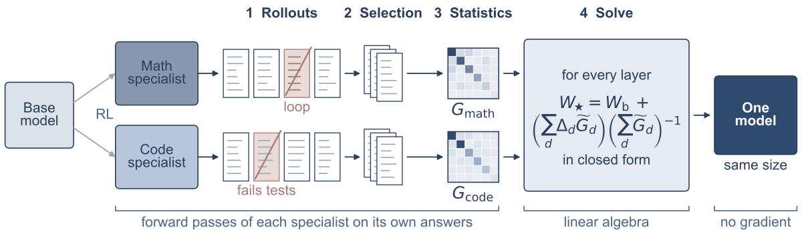

# TF-OPD：教师自生成统计上的无训练闭式融合

> **L1 公式组件与微型自回归诊断，不是完整论文复现。** 完整实验成本过高，不复现（审查 DONE）；`adapter: null`、`evolve_integrated: false`。

## 论文信息

| 字段 | 内容 |
|---|---|
| 论文链接 | [arXiv 2610.22236](https://arxiv.org/abs/2610.22236)；[固定 v1 全文](https://arxiv.org/html/2610.22236v1) |
| 公司 / 机构 | 第一作者 Bangji Yang 的第一署名机构为 University of Illinois Urbana-Champaign（PDF 首页上标1）；Tsinghua University 是合作单位 |
| 首次公开日期 | 2026-10-15T17:15:01Z（UTC，arXiv v1；不是 10 月 16 日公告日期） |
| 原作者代码 | 未找到 / 未确认已发布的方法代码仓库；不把依赖或第三方实现当原作者代码 |
| 本地 adapter / 方法键 | `tf-opd`；独立公式组件，未注册 reproduction adapter |
| 本地复现代码 | [`tf_opd.py`](https://github.com/daiwk/auto-research/blob/main/src/auto_research/post_training/tf_opd.py) |
| 本地复现代码目录 | [`src/auto_research/post_training/`](https://github.com/daiwk/auto-research/tree/main/src/auto_research/post_training) |
| 运行入口 | [`run_oct16_post_components.py`](https://github.com/daiwk/auto-research/blob/main/scripts/run_oct16_post_components.py) |

## 原始论文总结

### 背景与主要改动

共同初始化的专家模型，其线性层融合可以写成匹配各教师输出的最小二乘。关键不是任意协方差，而是每个教师在**自己生成的、经过终止和循环筛选的答案**上实际遇到的输入二阶矩；统计按 token 数归一，不能让长答案自然压倒其他领域。


<!-- paper-figure:start -->
### 原论文关键图



> 原文 Figure 2，图片来自[原论文](https://arxiv.org/html/2610.22236v1)，版权归原作者所有。由原文 `overview.svg` 无内容修改转为 PNG；不是本地实验结果。
<!-- paper-figure:end -->

### 核心公式

对层权重 $W_d=W_b+\Delta_d$，令 $G_d=X_d^\top X_d/n_d$，保留原文式 1–4：

$$
\widetilde G_d=w_d[\alpha G_d+(1-\alpha)\operatorname{diag}(G_d)],\quad
\Delta_\star\sum_d\widetilde G_d=\sum_d\Delta_d\widetilde G_d,\quad W_\star=W_b+\Delta_\star.
$$

默认 $\alpha=0.9$，解转置线性方程而不显式求逆，求解使用 float64、存储 float32。非线性权重采用 task arithmetic。每个教师的 update 未复现份额为

$$
\epsilon_d=\frac{\operatorname{tr}[(\Delta_\star-\Delta_d)\widetilde G_d(\Delta_\star-\Delta_d)^\top]}{\operatorname{tr}[\Delta_d\widetilde G_d\Delta_d^\top]}.
$$

相同 Gram 应得到加权平均，不是 updates 求和；正交输入支持可精确恢复各教师。单测同时检查这两点、正规方程残差、过滤后真实回读的 Gram 和 hook 清理。

### 论文离线与线上效果

原文 OLMo 3 7B 在七个数学/代码基准的平均准确率为 61.1%，数学/代码专家分别为 59.8%/53.6%；不同模型的评测精度格式不同，不能忽略该差别。线上 A/B：未报告。附录 B Table 4 的双专家融合约 10 GPUh，另有每模型 AIME25 2.5–3 GPUh，均不是本地测量。

## 本地复现

### 数据协议与运行

公开 [Hamlet（Gutenberg 1524）](https://www.gutenberg.org/ebooks/1524)，固定内容 revision 为 `sha256:31584c19795779431b5933499a45b9cecb03e8c246b6ea7e245a2b6d65e8e784`。不下载 checkpoint，微型 257-token byte policy 先作 8 次 next-token 预热，再从共同 base 分别在两个不相交训练片段作 4 次 SFT。它们是**真实小教师，但不是原文 RL 专家**。

教师真实自回归采样，包含自然 EOS；只保留终止且非 DEFLATE 循环的轨迹再回读，未用随机矩阵代替 teacher statistics。公开无标签文本没有正确性判定，故不启用原文数学/代码正确性过滤，明确停留在组件诊断。输入层和 head 由真网络执行，不宣传为生产 Transformer 全层融合。

```bash
PYTHONPATH=src python scripts/run_oct16_post_components.py \
  --methods tf-opd --corpus-path /path/to/hamlet.txt \
  --corpus-id gutenberg:1524 \
  --corpus-revision sha256:31584c19795779431b5933499a45b9cecb03e8c246b6ea7e245a2b6d65e8e784 \
  --corpus-sha256 31584c19795779431b5933499a45b9cecb03e8c246b6ea7e245a2b6d65e8e784 \
  --device cpu --seeds 42,43,44 --output runs/tf-opd-component.json
```

### 结果与边界

实际 CPU 三 seed 证据见 [组件指标](metrics/component-cpu-seeds42-44.json)。融合参数确实改变、教师参数不变，闭式融合阶段没有 optimizer step。NLL 只用于检验完整 forward 可执行，不证明跨领域能力迁移。训练/validation/test 按原始 byte 范围 80%/10%/10% 隔离，无调参或选 checkpoint。

`sample_teacher_rollout` → `retain_rollout` → `collect_teacher_grams` → `fuse_models/solve_layer` 是可调用链路；低层 `solve_layer` 的手填 Gram 测试仅为 L0 数值证明。通用融合入口会明确拒绝 tied embedding/head 或其他共享参数 storage，避免 embedding arithmetic 与 head solve 相互静默覆盖；本轮 BytePolicy 不绑权重。CUDA 路径由批次统一验证回执另行记录，CPU 结果不能充当 GPU 证明。完整 7B 专家、真实数学/code grader、全部 benchmark 均**成本过高，不复现（审查 DONE）**，不进入 evolve 自动重试或能力排名。
